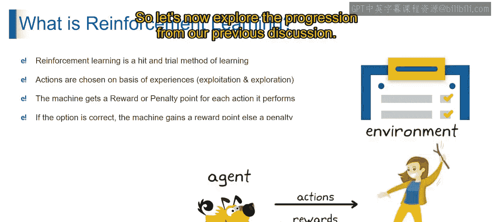
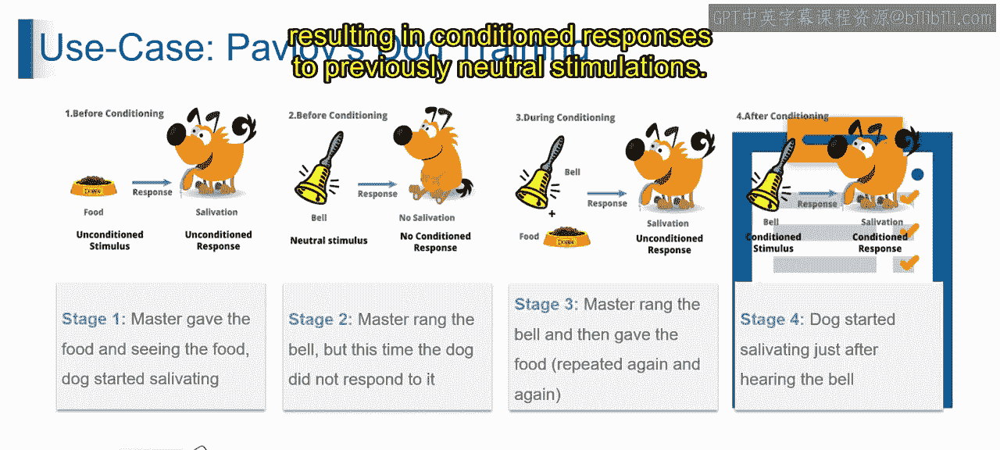
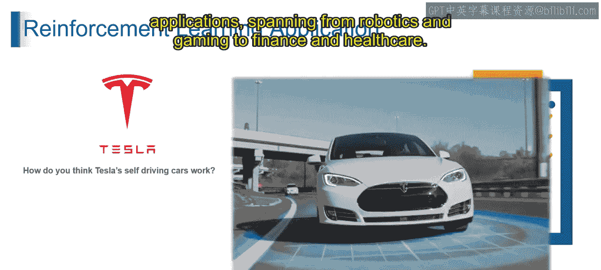
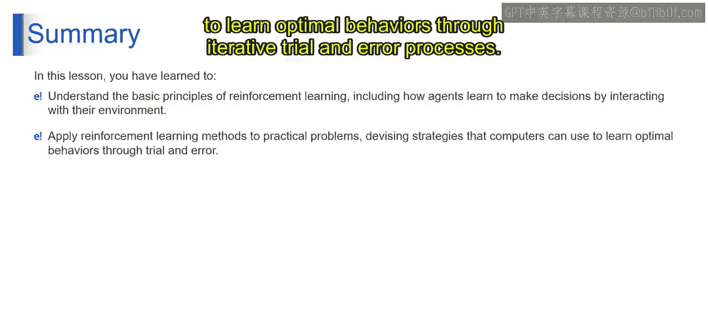

# Edureka《通过LLMs学习生成式人工智能（机器学习和NLP基础，第1课／共4课）｜Learn Generative AI with LLMs》中英字幕 - P20：19_强化学习的用例.zh_en - GPT中英字幕课程资源 - BV1q4421Q7qh

So let's now explore the progression from our previous discussion so now let's understand a use case of Pavlov's dog training the stage one here is that here the foot and salivation initially the dog naturally salivated when presented with the foot this is an innate response generally okay in the stage2 bell and no response means the pavlov rang the bell but the dog did not respond with salivation because the bell had no inherent meaning or the association for this that is in the step2 coming to the step3 pavlov rang the bell before giving the foot to the dog repeatedly after several pairings of the bell with the food the dog began to associate the bell with the food that。

😊，Happened in the stage 3。 So based on this all the actions in the stage4。

 it is going to be the conditioned response mean eventually the dog started sal at the sound of the bell alone even without the presence of the food。

 This learned response demonstrates the power of association between the bell and the food means in terms of reinforcement learning。

 the food acts as a reward positive reinforcement for the dog's behavior。

 the bell initially has no significance。 but through the repeated pairings with the food。

 it becomes a single or the conditioned stimulus that predicts the arrival of the food means the dog learns through a process of trial and error with the association between the be and the food is strengthened over the time through repeated reinforcement bell。

😊，by a food means the Pavlos dog training exemplifies reinforcement learning principles where the animals。

 nothing but in our case， the machines learn to associate with the rewards through repeated pairings resulting in conditioned responses to previously neutral stimulations。

😊。

Now， coming to the applications of reinforcement learning， it can be used in robotics， gameplay。

 recommendation systems， finance， healthcare， resource management and even autonomous vehicles when we say autonomous vehicles the example is Tesla cars So reinforcement learning is used to train the autonomous vehicles to navigate safely and efficiently in complex environment such as city streetss and highways by learning from interactions with the environment and receiving the feedback on driving actions。

 Overall， reinforcement learning offers a powerful framework for autonomous decision making and adaptive behavior in various real world applications span from robotics and gaming to finance and healthcare Now the summary throughout this lesson。

 you have grasp the fundamental principles of reinforcement learning comprehending。😊。

How agents learn from environment interactions to make the decisions， Moreover。

 you have gained proficiency in applying reinforcement learning techniques to the real world challenges。

 providing strategies for computers to learn optimal behaviors through iterative trial and error processes。

😊。

Thank you。