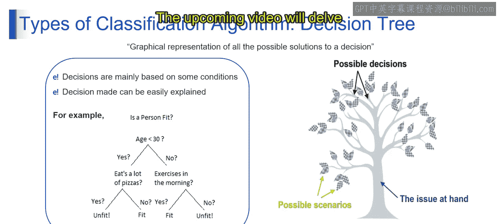

# Edureka《通过LLMs学习生成式人工智能（机器学习和NLP基础，第1课／共4课）｜Learn Generative AI with LLMs》中英字幕 - P21：20_分类.zh_en - GPT中英字幕课程资源 - BV1q4421Q7qh

Hello， everyone， let's dive into the captivating world of machine learning and the foundational concepts of NLP together。

 So now let's understand the classification In this。

 we are going to understand the introduction to classification。😊。

And what are the different classification algorithms by the end of the session you will be able to understand and learn the core concept and the purpose of classification in machine learning and you are able to explore common classification algorithms so let's get started introduction to classification。

Imagine you are organizing waste into different vents labeled plastic paper。

 glass and metal each type of waste shares similar features。

 plastic items are typically flexible paper items are flat and lightweight and glass items are transparent and breakable and metal items are rigid and durable so by grouping the waste items into these categories based on their shared features you are essentially performing a classification problem statement here means in technical terms classification is a machine learning task where the goal is to categorize data points into predefined classes or categories based on their features just like sorting waste into the vents classification algorithms analyze the features of the data points and assign them to the appropriate class labels。

This allows machines to learn patterns and relationships in the data。

 enabling them to classify new unseen instances accurately so now let's understand the different classification algorithms the first one is of neural network it is a deep learning model composed of layers of interconnected neurons we can see on the screen which are capable of learning complex patterns in the data then the next one is of decision trace it is a treelike model where each internal node represents a feature which each branch represents a decision rule and each leaf node represents a class label then the name by classifier so it is a probabilistic model that uses base theorem to predict the probability of a class given the input features assuming independence between the feature。

😊，Then KN it is a nonparmetric lazy learning algorithm that classifies data points based on the majority class of their and nearest neighbors in the feature space here we have the representation over there the circle considers which one is the nearest point to this whether the left side one or the right side one that's about the KNN then the logistic regression it is the linear classification model that estimates the probability of an instance belonging to a particular class based on its features using a logistic function to map predictions to probabilities that's understand all this brief understanding the logistic regression festival of all Lo regression is like drawing a line to classify data points into two categories based on their features it is used when the outcome we want to。

is categorical such as yes or no， spam or not spam or pass or fail。

 The logistic regression equation calculates the probability of the event that is whether the provided email being a spam or not it looks like P is equal to one divided by one plus exponential to the power of minus B0 plus b of x where B0 and B are coefficients in this case suppose we want to predict whether an email is spam based on the features like the presence of certain words or the phrases we collect the data on the past emails where each email is labeled as spam as spam and not spam as0 using logistic regression we can build a model that predicts the probability of an email being spam based on its features for instance。

😊，If the predicted probability is greater than 0。5。

 we classify the email as a spam otherwise we classify it as node spam now the next one is of decision trees decisions trees are like slow chats that help make decisions based on the conditions that represent all possible solutions to a decision in a graphical format making it easy to follow and understand so here the key points are decisions and explanations so decision nodes in the tree represent conditions or questions based on which decisions are made coming to the explanation the decisions made at each node can be easily explained as they are based on the simple conditions。

😊，For example， consider determining whether a person is fit based on the age diet and exercise habits。

 the decision tree would branch out based on the condition like if the age is less than 30 and coming to the diet plan。

 whether he eats a lot of pieces and exs in the morning。

 if his age is less than 30 and if he eats a lot of pieces and he should be unfit or else he should be fit and based on the condition of exercises in the morning and if his age is not less than 30 based on the given condition of exercising in the morning。

 he should be fit and if he is not exercising in the morning。

 then he is going to be the unfit means it is classifying based on the particular condition means it is checking the combination of the conditions's month。

😊，Here the possible decisions are nothing but each node in the tree represents a decision point where choices are made based on the conditions or the features then coming to the possible scenarios the branches of three represents the different scenarios or path that can occur based on the decisions made at each node then coming to the issue at hand the decision tree addresses the main issue or the problem by systematically exploring and categorizing possible outcomes leading to clear resolution or the decision so that's about decision tree so the upcoming video will delve further into the ongoing discussion。

