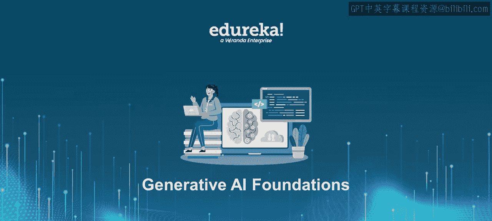
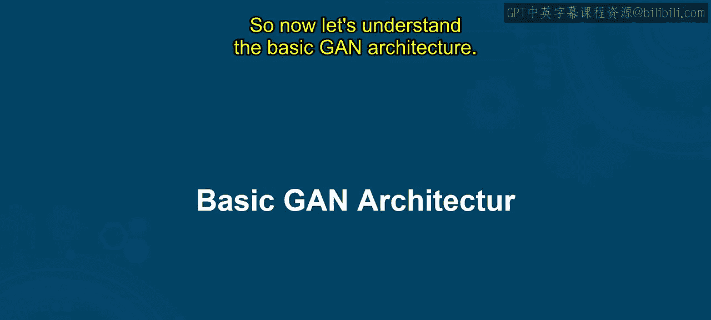
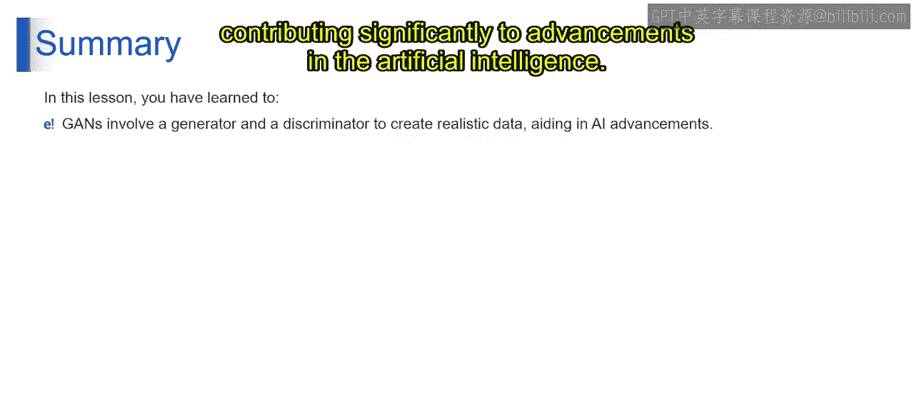

# Edureka《通过LLMs学习生成式AI（基础、应用开发、流行工具，第2、3、4课／共4课）｜Learn Generative AI with LLMs》中英 - P21：20_基本GAN架构.zh_en - GPT中英字幕课程资源 - BV1ym421V7gx

Hello everyone welcome to Generative AI foundations so now let's understand the basic G architecture in this we are going to cover the G architecture by the end of the session you are able to understand what are the different components and what is the structure of G architecture so let's get started architecture of GN。

😊。

So G A Ns， the generative adversarial networks have a simple。

 yet powerful architecture consists of two main components。 Those are generator and discriminator。

 So first of all， here we can see。😊，Real samples。 So what exactly it is。

 So real samples represent the actual data you want the generator to learn from。

 So then the latent space， the latent space often filled with random noise that is called as that is like a playground for creative exploration means it's akin to providing the artist that is nothing but a generator with some real paintings to study and a palette of random colors to experiment with。

 So that's about the real space and also the latent space then the next one is of the generator。

 So the generator takes the real samples and the noise attempting to create something new that resembles the real data It's like the artist trying to generate art inspired by the examples and the random elements means imagine the artist which is nothing but a generator here using。

😊，Provided paintings as inspiration and the random palette to craft unique artwork。

 So that's about the generator。 then the next one is a false sample。

 So the output of the generator is a false sample here a creation that ideally looks like it came from the same source as the real samples means the artist masterpiece。

 a painting that mirrors the style of the provided artwork。

 but it entirely new and created from the imagination So that's about false sample Then the next one is of the discriminator the discriminator receives both the real samples and the false samples playing the role of the detective to distinguish between the authentic and the generator data So that's about the discriminator means the vigilant teacher here you can consider a vigilant teacher is nothing but a discriminator evaluates both the original paintings and the artist creation。

😊，Refining its ability to tell which is the genuine one So that's about the discriminator then the false discriminator outputs a decision whether the given sample is real or the false one this feedback loops back to the generator for the improvements so means the teacher who is a discriminator here declares if the artwork is authentic or not providing constructive feedback to the art test that is nothing but a generator here means this is iterative process and this iterative process continues with the generator aiming to create more convincing data and the discriminator getting better at distinguishing but when the real and the generated data it's like a creative completion that leads to continuous improvement in data generation within the GN this is a highleve architecture of the GN so now let's focus on。

😊，Individuals。So for the generator， the generator is， as I mentioned。

 it's an artistic matro in the G view It thrives on random noise transforming it into a data like creating images that should ideally look just like the real deal It hones its craft through layers of learning using techniques like convolutional or transposed convolutional convolution bring its creation to the life the ultimate aim is then to produce data so convincing that it becomes indistinguishable from the real thing So in the essence the generator is the creative force turning randomness into the authentic masterpiece so that's about the generator then the discriminator So the discriminator plays the role of the sharp eye detective in the G narrative as a binary classifier It's not a mission to spot the difference between the authentic data。

😊，And the creations of the generator through the training。

 the discriminator becomes adept at classifying input samples as either genuine or the generator means armed with real data from the data set and crafted samples from the generator its mission is clear correctly identify what's the real and what is not means the discriminator's objective is precision in distinguishing between the real and fake images making it the vigilant gatekeeper of data authenticity in the gene dynamic So that's about the discriminator。

 So now the summary So means in the lesson you have discovered the generative adversarial networks enlist a generator and the discriminator to collaboratively produce authentic data contributing significantly to advancements in the artificial intelligence。

 Thank you。😊。

