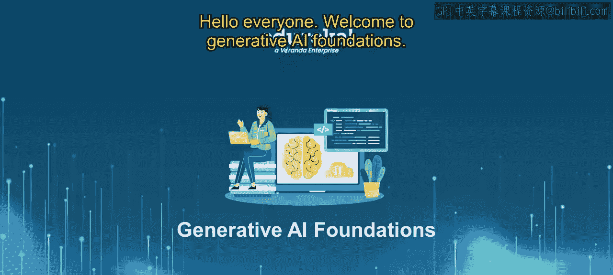
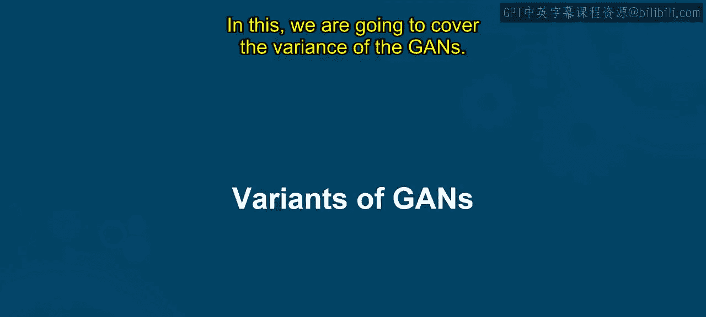
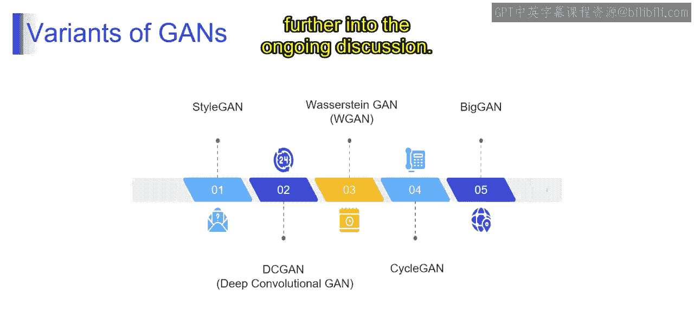

# Edureka《通过LLMs学习生成式AI（基础、应用开发、流行工具，第2、3、4课／共4课）｜Learn Generative AI with LLMs》中英 - P22：21_GAN的变体.zh_en - GPT中英字幕课程资源 - BV1ym421V7gx

Hello everyone， welcome to generative AI foundations。

 So now let's understand the different variants of Gs in this we are going to cover the variances of the Gs by the end of the session you are able to identify what kind of different variants available for Gs so let's get started the variants of Gs So imaginegans as a diverse family of artist each with its unique style So variants ofgans are like different genres of art they share the same core but with distinct approaches So these variants tweak the standardgan recipe to achieve specific goals or handle particular challenges So in this as you mentioned we are having the different variants So those are stylegan D G and Wgan and cyclegan and biggan so let's understand all this the first one is of stylegan so imagine。

😊。

Versatile artist who can not only paint realistic portraits。

 but also adapt their style to suit different objects。 The stylegan is like that。

 the same like this artist in the G family mastering the art of diverse and personalized creations means when we say adaptable style。

 the stylegan introduces the concept of style ingans。

 allowing further generation of diverseers and customizable visual styles in the output。

 Then I sit it will adjustable detailing。 Then I say adjustable detailing means the stylegan incorporates adaptive detailing。

 enabling the generation of high quality Real images with varying levels of intricacy。

 then the unique characteristics。 This stylegan excels in capturing the unique features and characteristics making it suitable for wide range of applications with styling visual requirements。

 So that's about。😊，GsSo then what are the applications of this。 So by using the stylegans。

 we can use it for artistic image synthesis， visual fashion design and deep fake generation and face aging and dging and image to image translation and many more。

 So that's about stylegan。 So now let's understand deep convolutional G。

 Just imagine a G artist equipped with a powerful set brushes specially designed for capturing intricate details and thes within。

 So this deep convolutionalgan is like that artist in the G family utilizing deep convolutional layers to create visually rich and finely detailed images means this D G incorporates deep convolutional layer enhancing the network' ability to capture intricate features and patterns in the generated data。

 Then it will utilize the convolutional network。 D G creates。😊，Each visual palette。

 allowing for the generation of high quality images with realistic texture and details。

 this D G focuses on improving the realism of generated images by leveraging deep convolutional architectures making it well suited for applications requiring detailed and authentic data。

 that is about D G。 So coming to the applications of the Dgan it is used in the image generation super resolution imaging and style transfer anomaly detection and domain to domain translation。

 semantic segmentation， data augmentation and many more。 So that's about Dgan。

 Then the next one is of W G which is also known as ver G imagine agan architecture who is not just concerned with creating beautiful paintings。

 but also ensuring a stable and smooth artistic process。 So this W G is that architect in the G。😊。

Focusing on maintaining a balanced and reliable training dynamic。😊。

Means this Wgan employs the distance to achieve a more stable training process addressing issues like mode collab nonconvergence that can disrupt the smooth flow of G training this Wgan introduces a more balanced training landscape mitigating the challenges faced by traditionalganNs and providing a stable foundation for the adversarial training of the generator and discriminator with this Wgan distance metric it prioritizes continuity in the generated data distribution contributing to a more reliable and consistent GN training process So coming to the applications of this Wgan it is used for image synthesis improved training stability data augmentation medical image synthesis child transfer and many mode then the next one is of cyclegan so imagine a G。

😊，That not only generates impressive paintings， but also has the unique ability to transform artwork seamlessly between the different styles。

 The cyclegan is that transformative artist in the G family。

 specializing in style transform and ensuring a smooth cycle of artistic evaluation that's about cyclegan So in case if you understand the technical understanding cyclegan excels in the style transform。

 allowing for the conversion of images from one style to the other while maintaining the content contributing to a seamless artistic transition in cyclegan。

 the content of the image is preserved during the style transform。

 ensuring that the essential elements and structures are maintained in the transformed output and also it is a bidirectional transformation the cyclegan operates bidirectally。

 enabling the transformation from style a2。😊，B and back to a creating a cycle of transformations while maintaining visual coherent。

 that's about the cycle again。 So the upcoming video will delve further into the ongoing discussion。

😊。

