# Edureka《通过LLMs学习生成式人工智能（机器学习和NLP基础，第1课／共4课）｜Learn Generative AI with LLMs》中英字幕 - P22：21_分类算法的类型.zh_en - GPT中英字幕课程资源 - BV1q4421Q7qh

So let's now explore the progression from our previous discussion Now the random forest random forest is like a diverse group of decision making experts each specializing in different aspects the collaborate to make a collective decision resulting in a more accurate and reliable prediction based on the majority voting and final class classification so how exactly it works so as mentioned it will consider multiple decision trees here so imagine you are solving a problem by seeking the advice from various experts similarly random forest builds multiple decision trees each trained on a random subset of the data and features and then collective decision each decision tree is independently makes a prediction based on its subset of the data and the features then it will merge the。

😊。

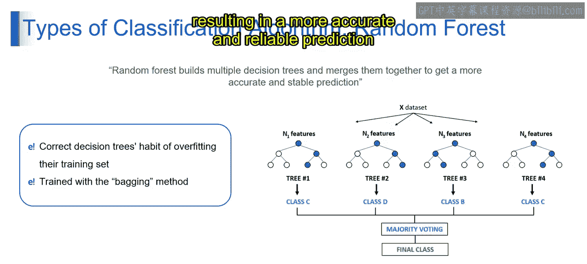

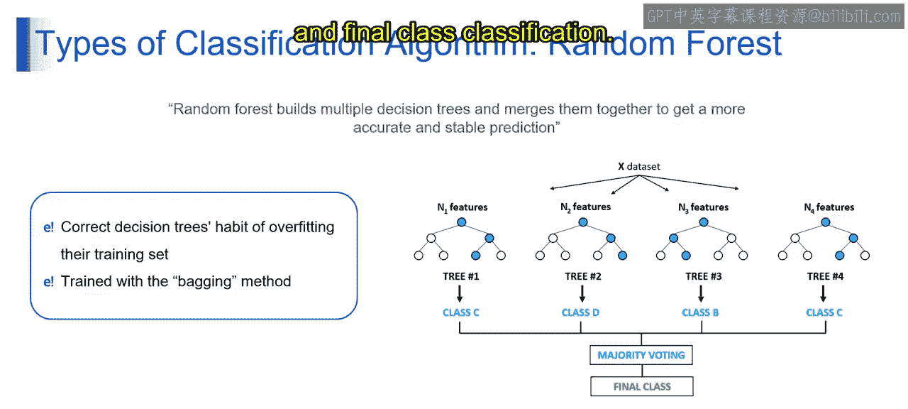

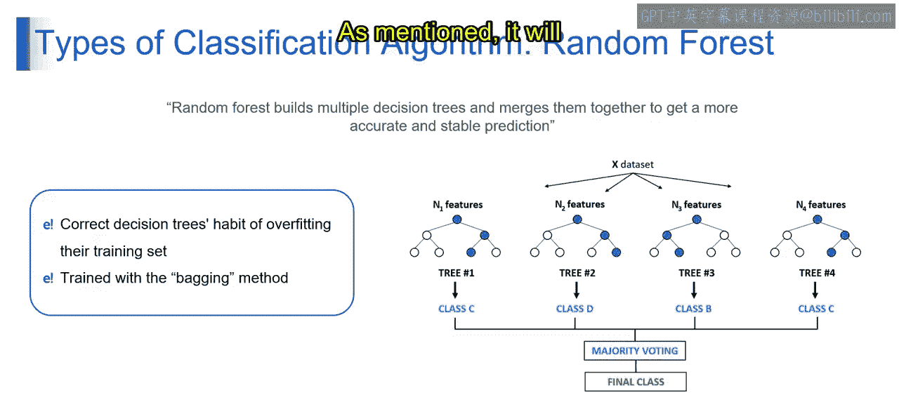

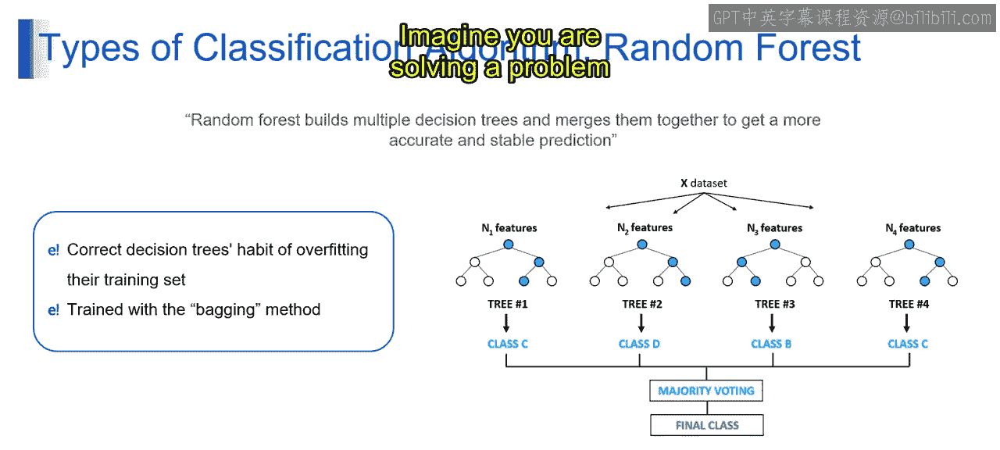

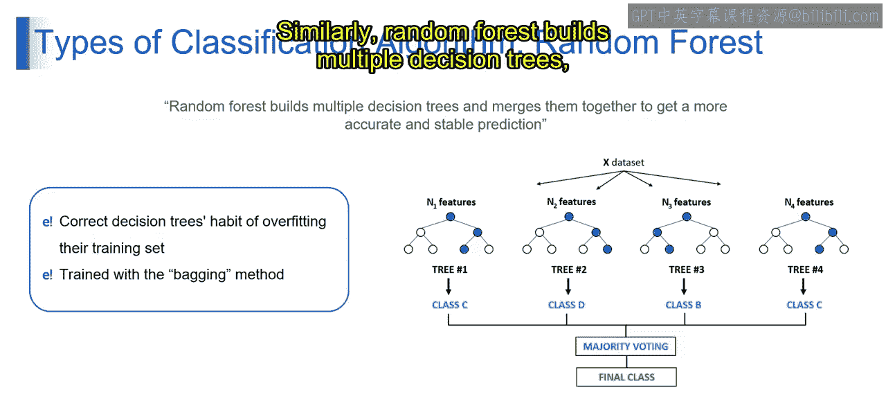

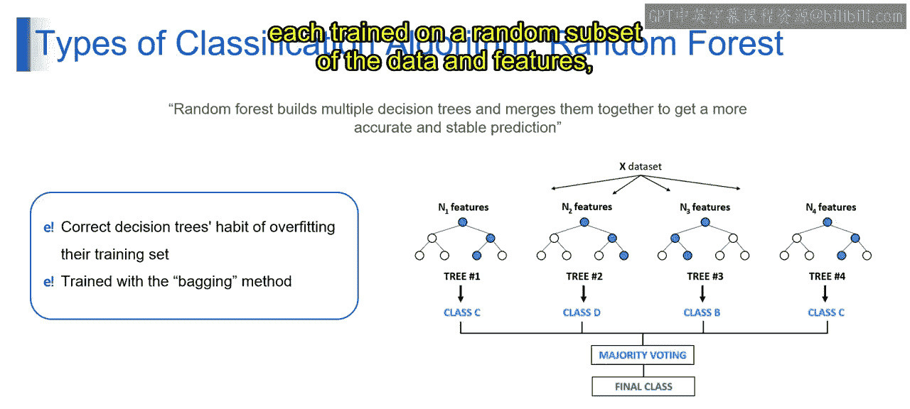

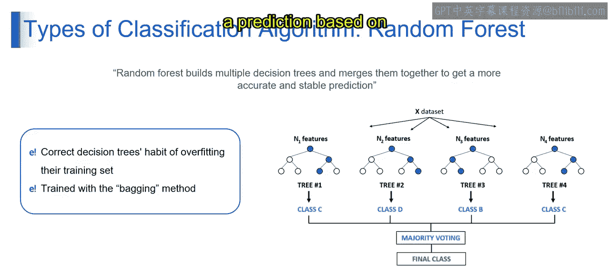

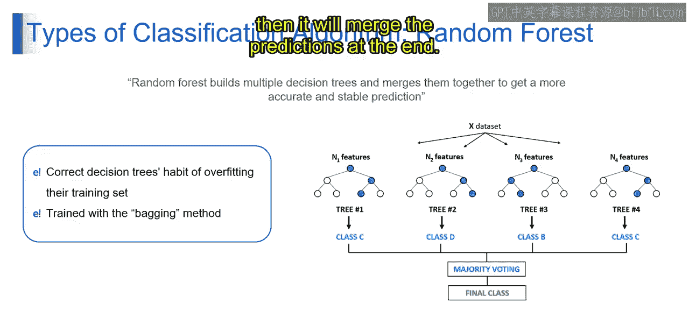

Predictions at the end means the predictions from all the decision trees are combined through voting for classification or averaging for regression means if it is of the classification problem statement the majority the predictions from all the decisions are combined through the voting process and if it is of the regression process it can be combined through averaging the os to arrive at final prediction。

😊。

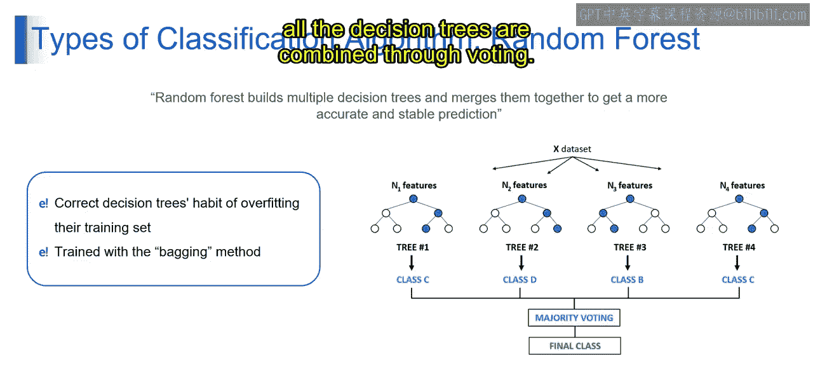

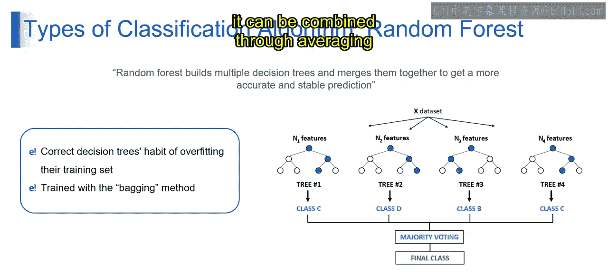

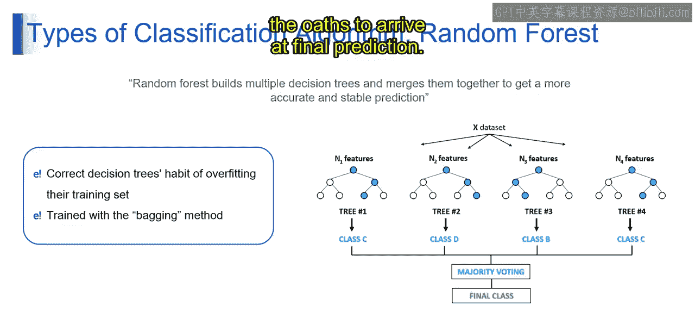

And here in this case， the bagging is nothing but in random forest it involves training multiple decision trees on different subsets of the training data and aggregating their predictions to improve the accuracy and reducing the overfitting that reason we will be using the bagging here in simple terms random forest is an ensemble learning technique that constructs a multiple decision trees during the training process and outputs the class that is the mode of the classes that is nothing but the classification or the main of predictions that is in the regressionreation problem statement of the individual trees so that is about the random forest so the upcoming video will delve further into the ongoing discussion。

😊。

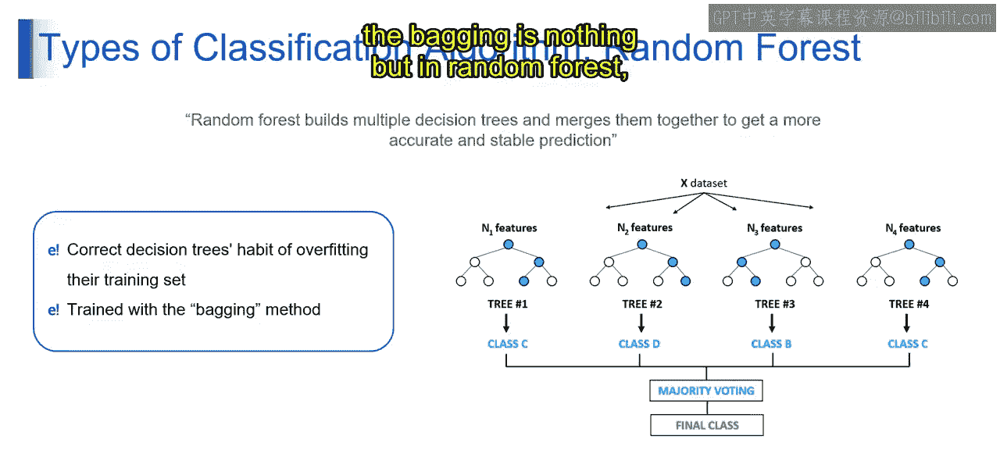

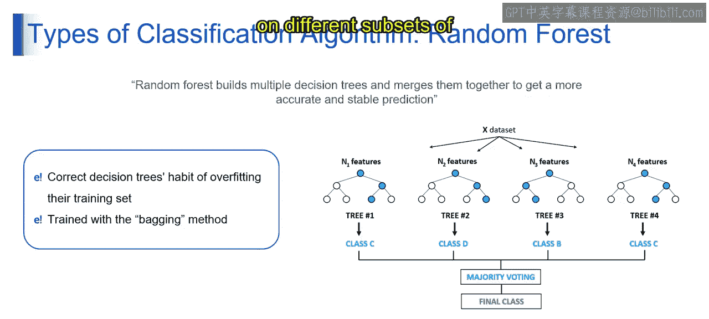

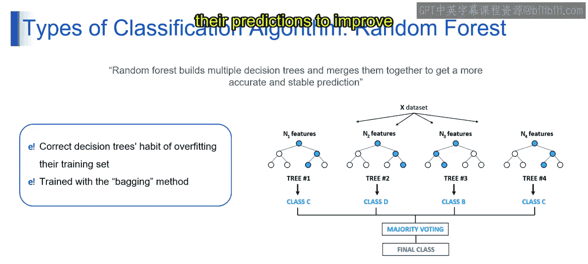

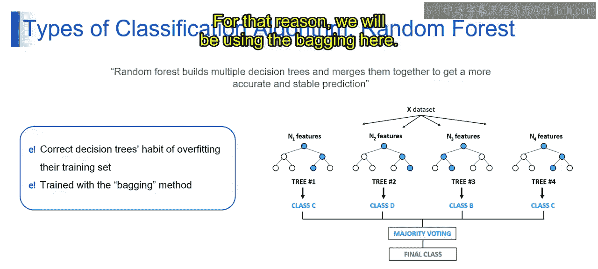

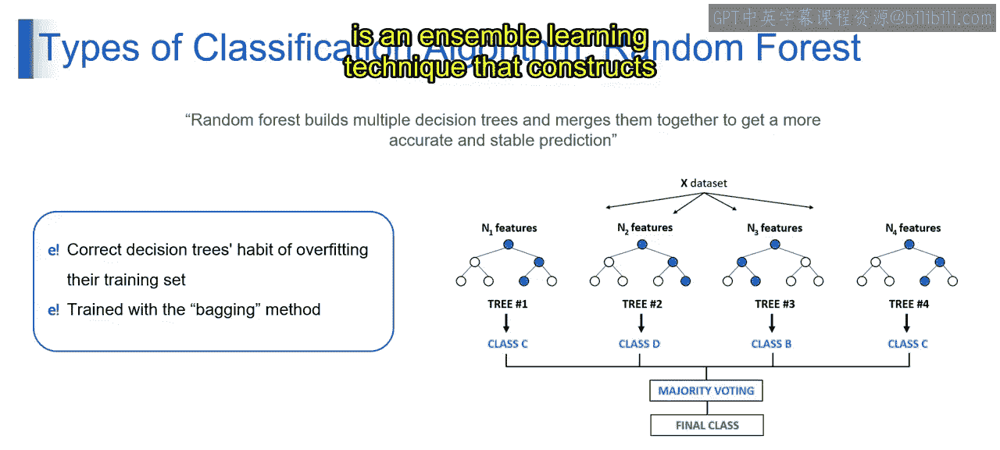

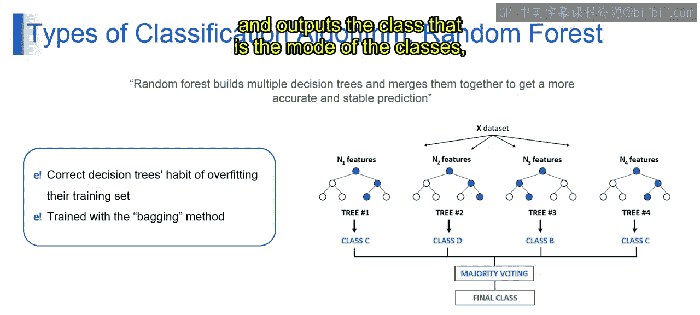

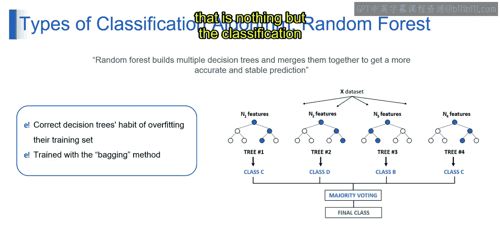

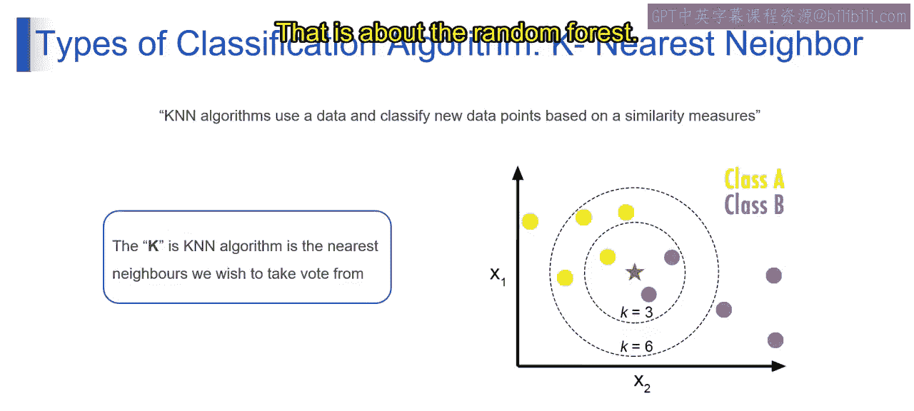

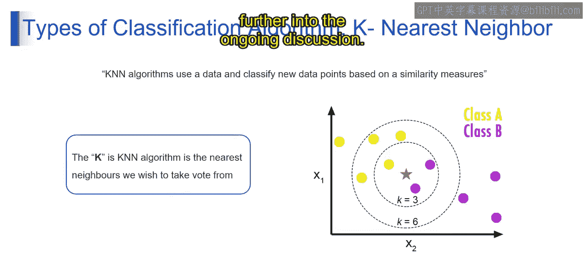