# Edureka《通过LLMs学习生成式AI（基础、应用开发、流行工具，第2、3、4课／共4课）｜Learn Generative AI with LLMs》中英 - P23：22_BigGAN.zh_en - GPT中英字幕课程资源 - BV1ym421V7gx

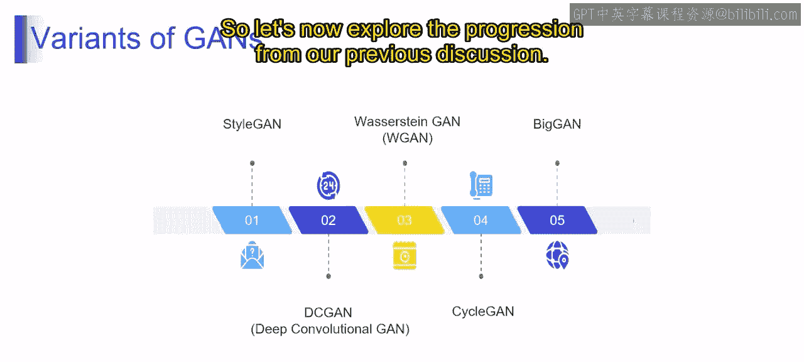

So let's now explore the progression from our previous discussion coming to the applications of it it can be used in image to image translation style transfer domain adaptation realistic image synthesis artistic content preservation and many more then the last one is of big G Imagine a G that's not just an artist but a grand master capable of creating immense highly detailed masterpiece so big G is that commanding presence in the G family so designed to generate a cosal and inly detailed images with an unprecedented level of sophistication。

😊。

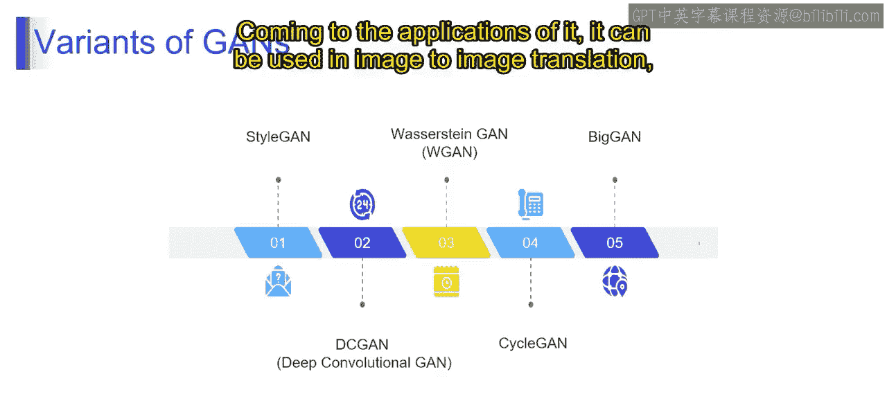

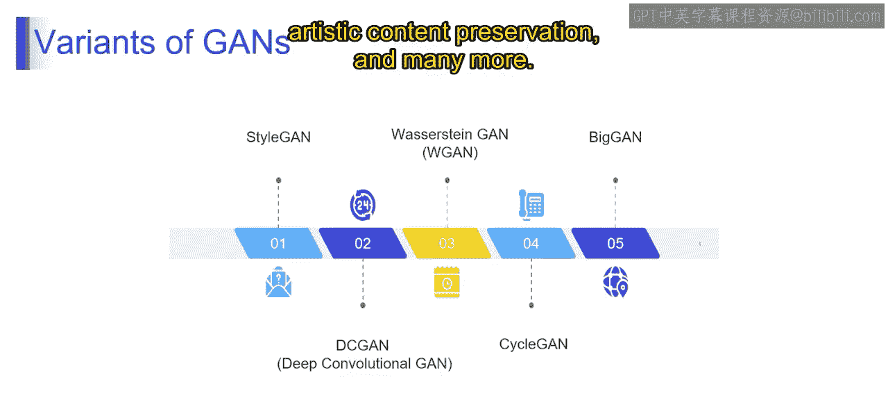

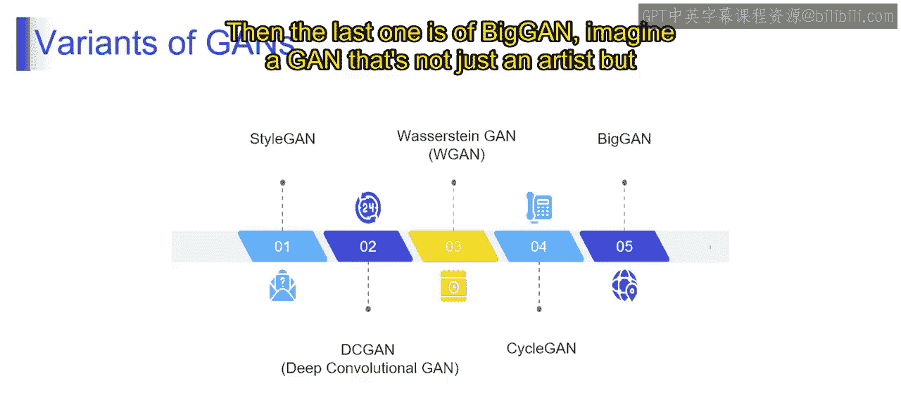

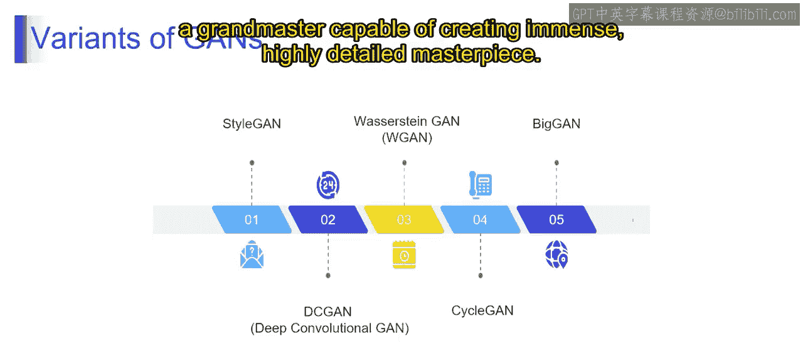

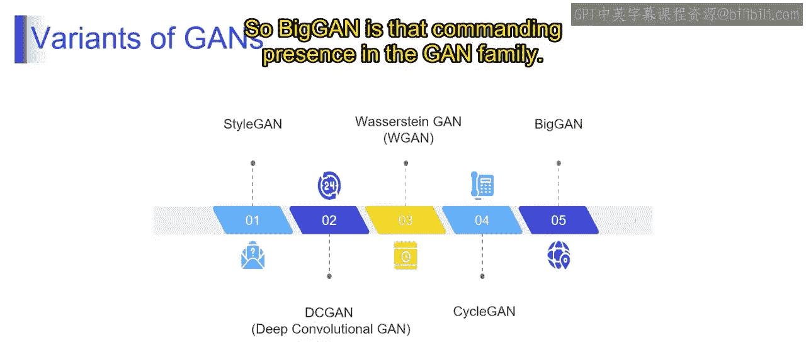

Means the big G is designed for generating a large scale high resolution images。

 allowing for the creation of colossal artworks with unpaleled detail。

 This big G excels in intricate detailing， capturing fine features and patterns within the coossal images it generates with its extensive architecture。

 biggan achieves an unprecedented level of sophistication in GNs pushing the boundaries of image generation capabilities。

 That's about the biggan coming to the application it is used in high resolution image synthesis。

 fine grainined image control， conditional image generation data augmentation for classification artistic content creation。

 semantic image editing and many more。 So these all are the different variants of the GNs。😊。

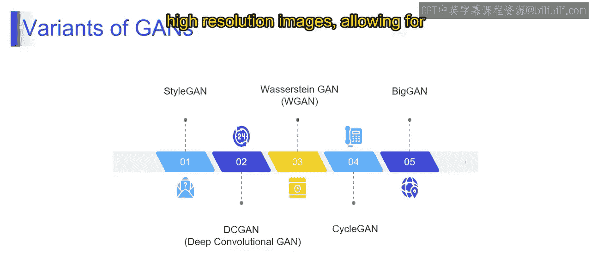

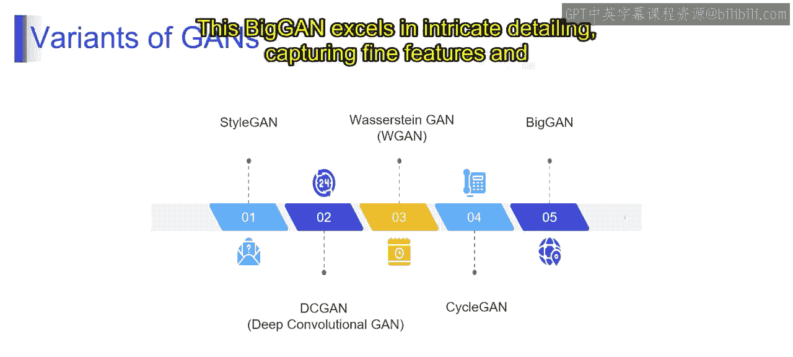

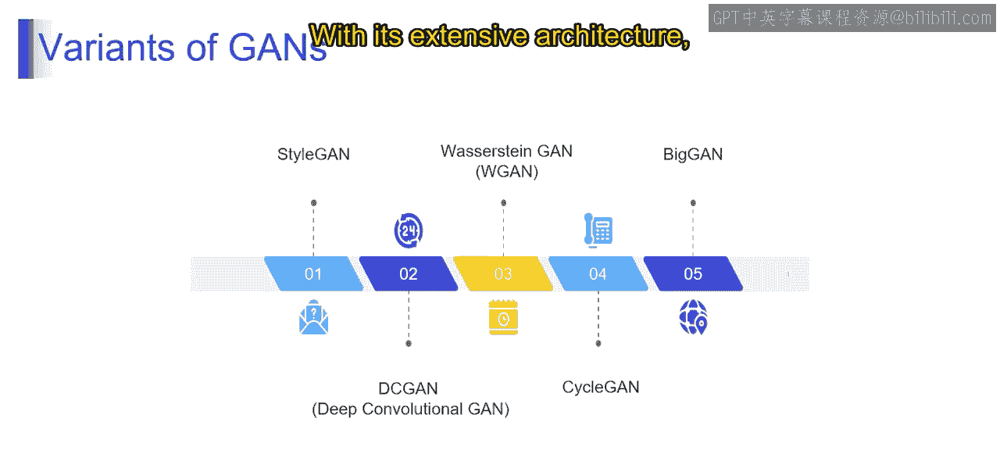

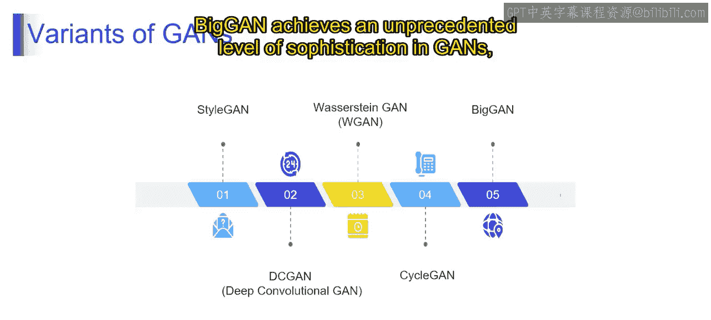

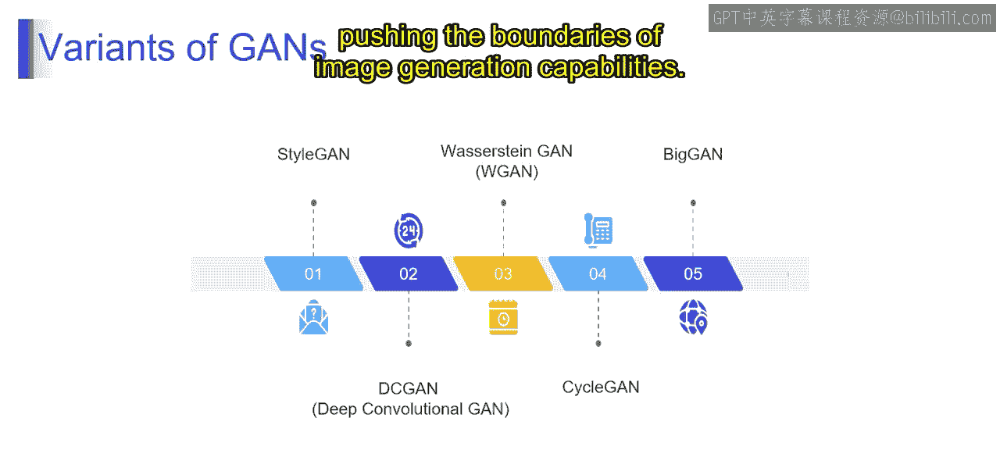

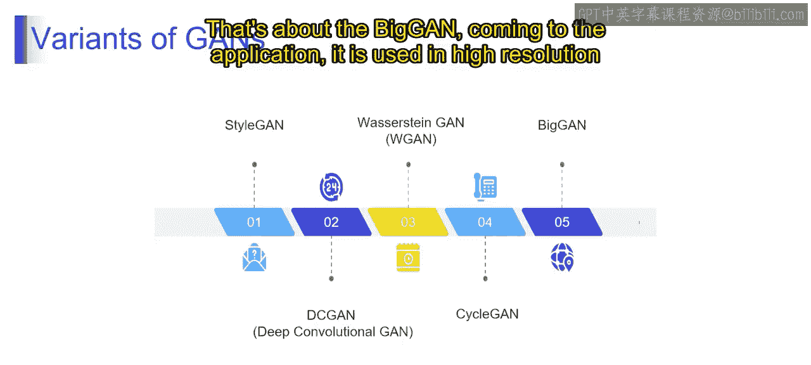

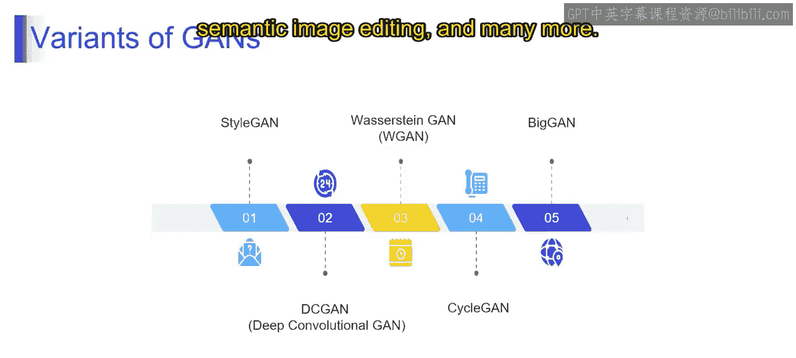

So in summary， throughout this lesson you have gained insights into different types of the GAN variants each with its unique trends and enhancements from the style GNs adaptability to artistic style to W GANs focus on stable training cycle GANs transformative abilities and big GANs grand scale you have explored a diverse palette of GAN variants。

 so recognizing these enhancements equips you with the deeper understanding of artistic and technical understanding within the fascinating real of generative adversarial networks thank you。

😊。

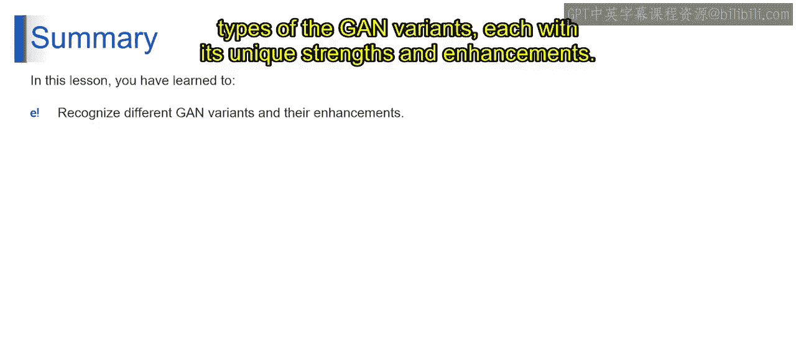

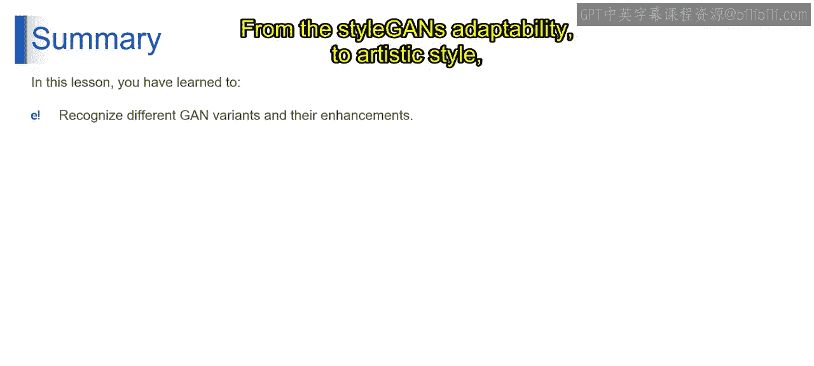

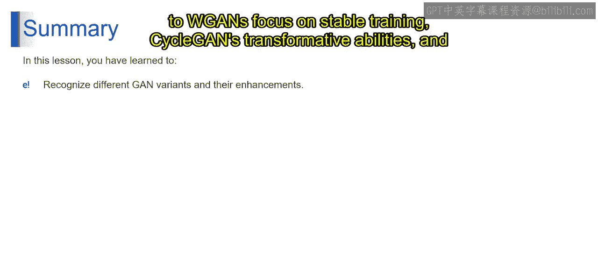

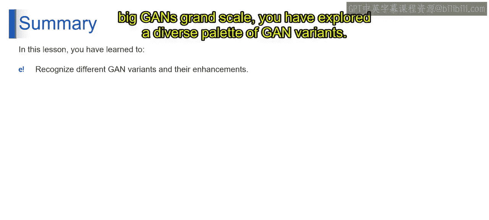

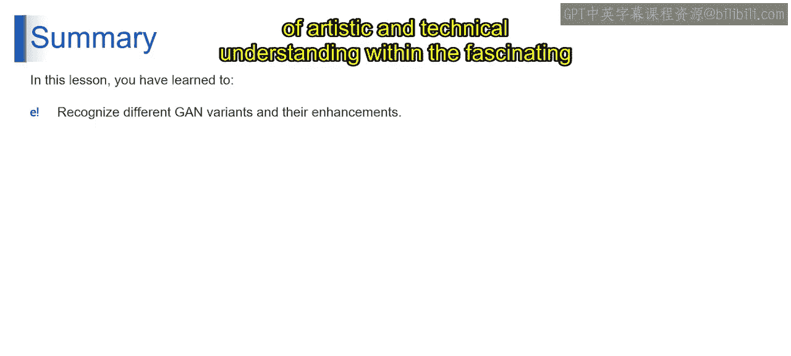

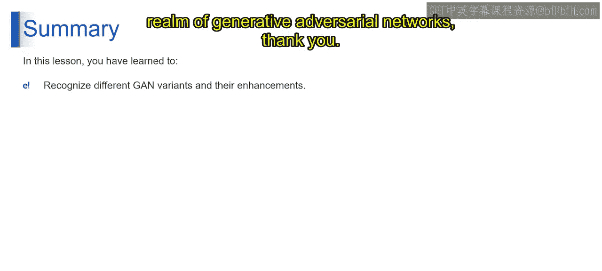