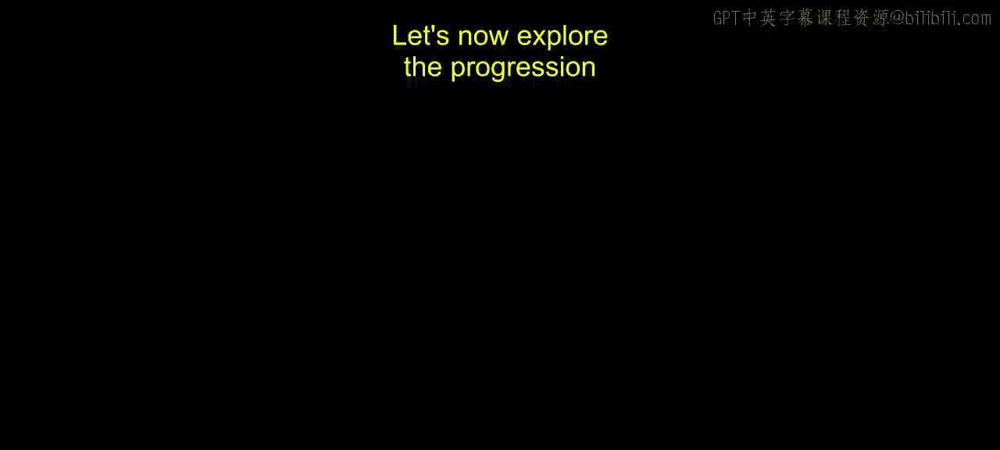
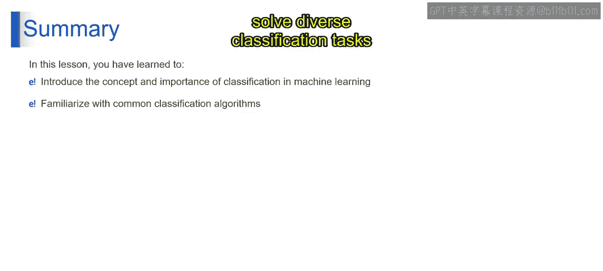

# Edureka《通过LLMs学习生成式人工智能（机器学习和NLP基础，第1课／共4课）｜Learn Generative AI with LLMs》中英字幕 - P23：22_其他类型的分类算法.zh_en - GPT中英字幕课程资源 - BV1q4421Q7qh

So lets now explore the progression from our previous discussion now the k nearest Ns KN n is like asking for advice from yan nearest NBs to make a decision it is a simple yet efficient algorithm for classification and regression task so how exactly it will work so based on the NB search imagine you are trying to classify a new data point kan looks at the k nearest data points that is nothing but the Ns in the training data based on some distance metrics for example you can consider the Euclidean distance and it will consider the majority word for classification kanon takes a majority voting among the k nearest Ns to determine the class of the new data point for regression it averages the values of the k nearest Ns to predict a continuous。

😊，values， for example， suppose you are trying to predict the genre of movie based on its features。

 For example， rating， duration and all these things。

 So Kn N would find the K movies with the most similar features and assign the gene based on the majority So Gen among those Ns K N would find the K movies with the most similar features and assign the based on the majority among those Ns means K and and is a nonparmetric lazy learning algorithm that classifies data points based on the majority class of the K nearest Ns in the feature space So now let's understand the na bias na bias is like making predictions based on the probability of events occurring means using simple assumptions It's a straightforward。

It effective classifier for various tasks so how exactly it will work B theorem so imagine you are calculating the probability of an event given some evidence B theorem helps compute this probability using the prior knowledge and new evidence and what is the assumption of nave so nave bias assumes that features are independent of each other given the class label。

 although this assumption is often violated in the real world data nave bias can still perform well in the practice here the formula is nothing but probability of a given B is equal to probability of B given a into probability of a divided by probability of B so here the probability of a given B is the probability of a class a given the feature B it is nothing but posterior and here the probability。

😊，Of B given a is the probability of features B， given the class A。

 that is nothing but the likelihood and P of a， the probability of a is the prior probability of class A and the probability of B is nothing but the probability of features B。

 that is nothing but the evidences， suppose if you are classifying emails as spam or not spam based on the word represent in the email nave bias calculates the probability of an email being spam or not spam given the occurrence of certain words means nave bias classifiers are probabilitybabilistic borders that calculate the probability of a class given the features by assuming independence among the features given the class the male predictions based on base theorem making them efficient and scalable for classification task so that's。

About na biasas now the summary throughout this lesson you have gained insights into the concept and the significance of classification in machine learning understanding its role in organizing and categorizing the data for predictive modeling Additionally。

 you have become acquainted with various common classification algorithms empowering you to apply these techniques to solve diverse classification tasks effectively Thank you。

😊。

