# Edureka《通过LLMs学习生成式人工智能（机器学习和NLP基础，第1课／共4课）｜Learn Generative AI with LLMs》中英字幕 - P24：23_分类演示.zh_en - GPT中英字幕课程资源 - BV1q4421Q7qh

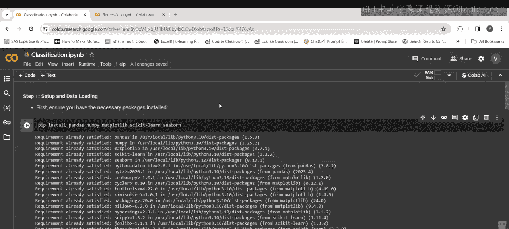

Hello everyone welcome back so now let's understand the practical approach of classification problem statement in this we are going to demonstrate the process of building machine learning model for vine quality classification and evaluating its performance and visualizing feature importance it aims to predict whether a vine is of high or low quality based on its features so let's get started the first step is to import the required libraries。

😊。

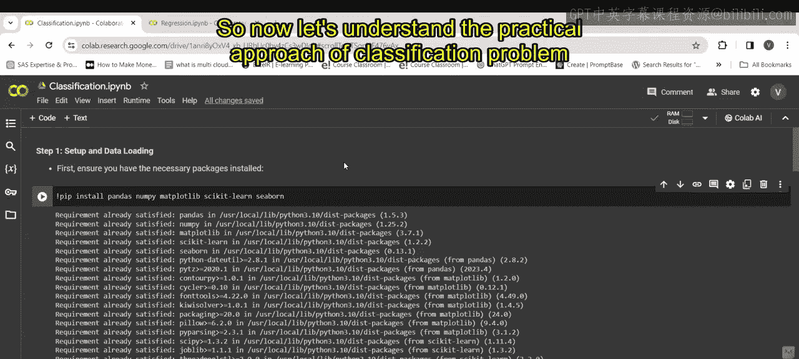

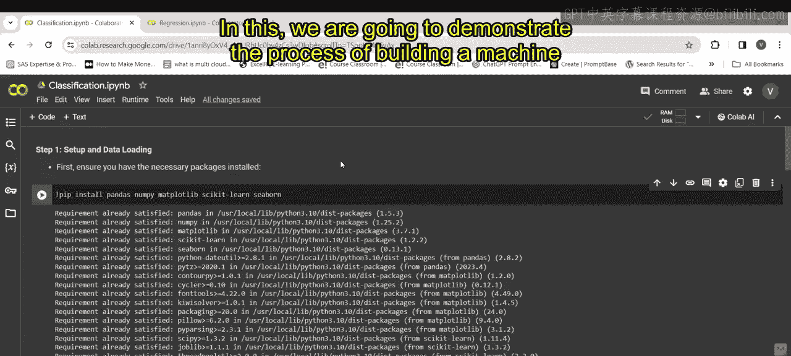

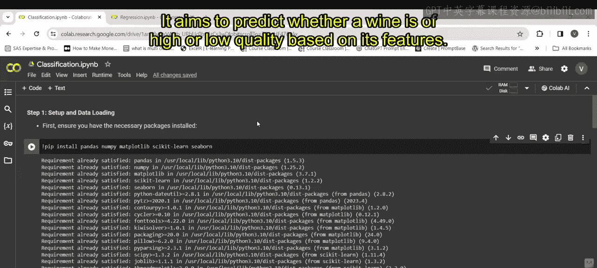

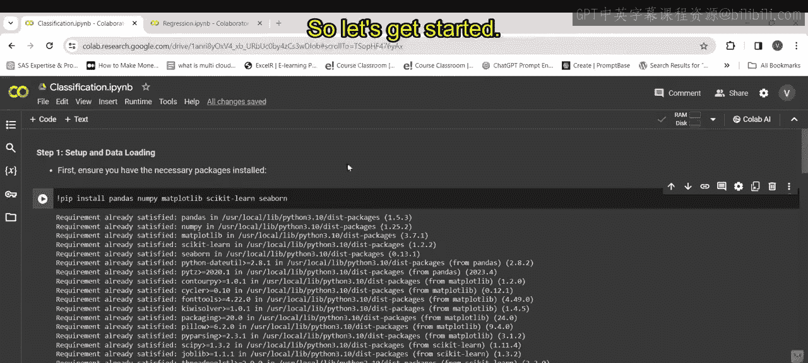

So what we are doing in this case， the code begins with installing necessary libraries such as pandas。

 Numpy， Matt Lodlib， Saigitlon and Seaburn using the PP command in this once if it is done。😊。

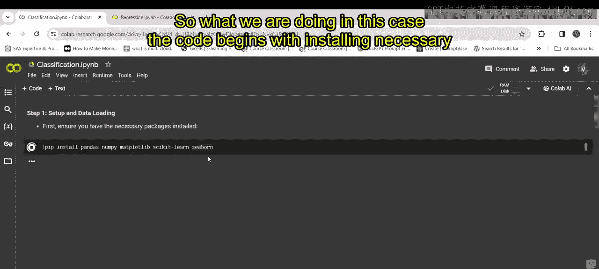

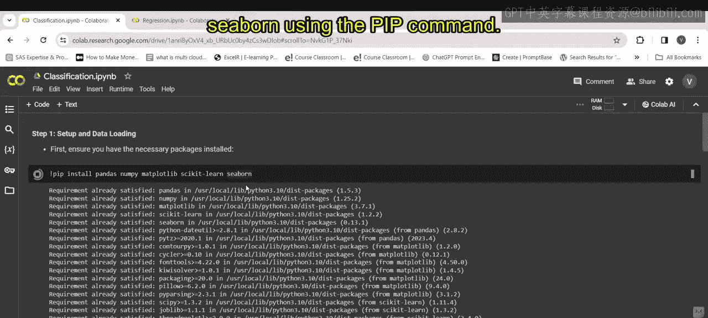

Import pans as PDD so it imports the pandas library and aliass it as PDD for ease of use。

 let's execute it and then we provided this URL this defines the URL from which the data will be loaded。

This block of code is used to load the data into the pans data frame。

 specifically the URL points to a CSV file containing data on white vine quality here we can see the name of the dataset Wine quality white dot CSv。

 so let's execute it and here we can see the format that we provided as CSv here pans read underscore CSV function loads the data from the provided URL specifying that the separator on the data is a semicolon。

 so let's execute this particular block of code and we'll see。So now the data is loaded。

 the next step is to perform preprocessing data of quality underscore label。

Is equal to data quality dot apply Lambda so what exactly this line is doing it adds a new binary column quality label based on the quality column where if the quality is6 or higher its labels as high otherwise low so lets execute it again and now it is done。

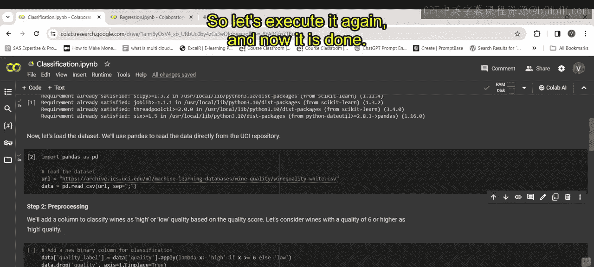

Along with that， we are also performing data dot drop where we are providing the quality and access is equal to one in place is equal to true。

 So this drops the original quality column as it is no longer it needed once if it is done now we can see。

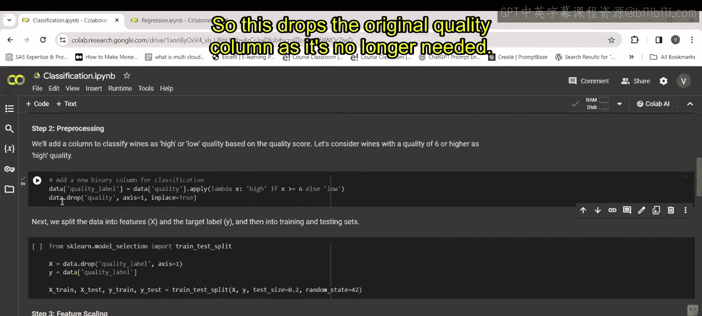

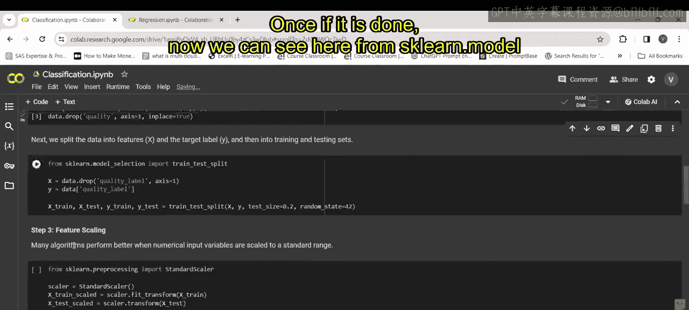

Here from Escale and dot model selection we are importing train test and split then here we are providing x is equal to data dot drop and quality label x is equal to 1 it assigns all columns except quality label as features to x then y is equal to data of quality underscore label it will assign quality label column as the target variable y so next x train x y train y test is equal to train test split of x comma y comma test size 0。

2 and random state 42 this will split the data set into training and testing sets with 80 to 20% ratio so let's execute this nu。

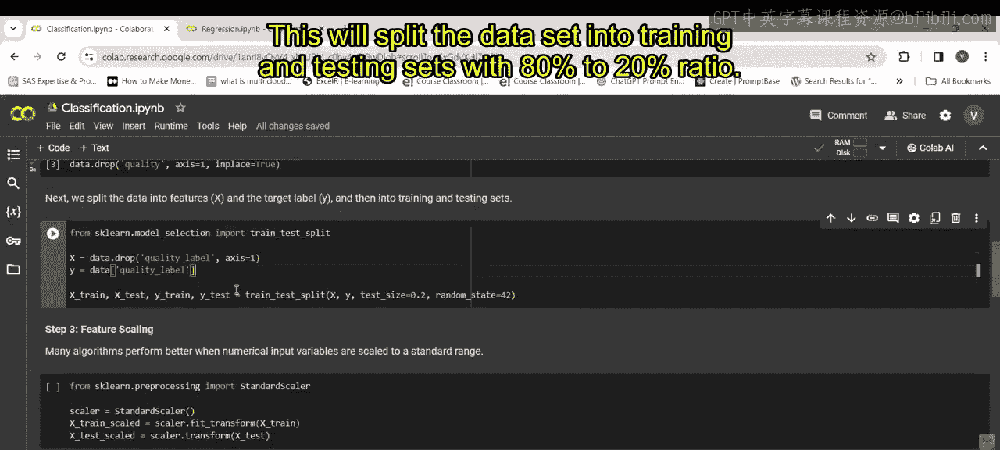

So the upcoming video will delve further into the ongoing discussion。😊。

