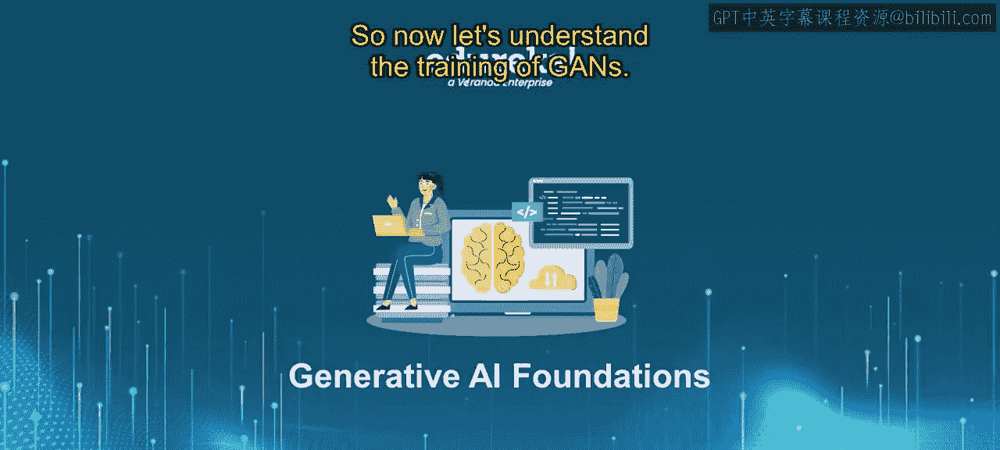
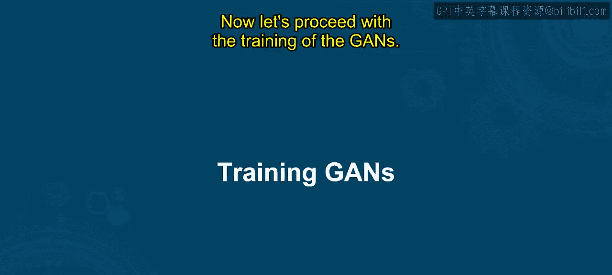
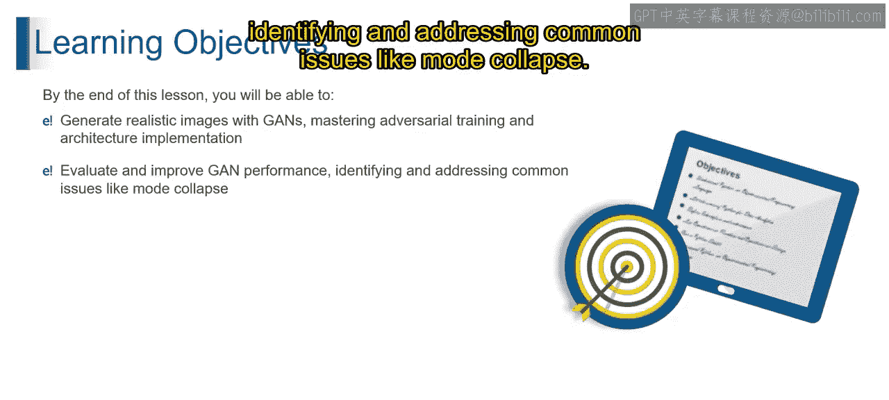
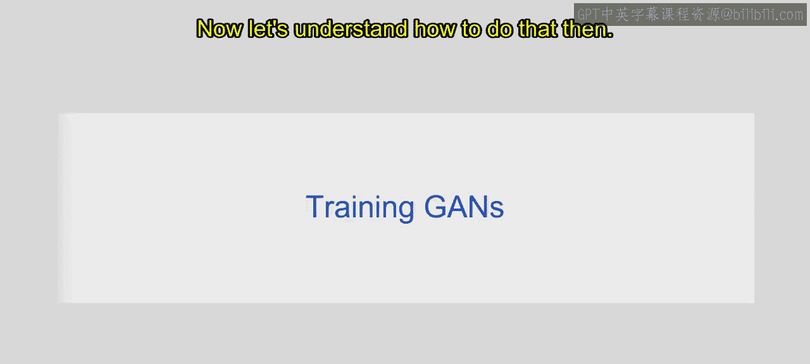
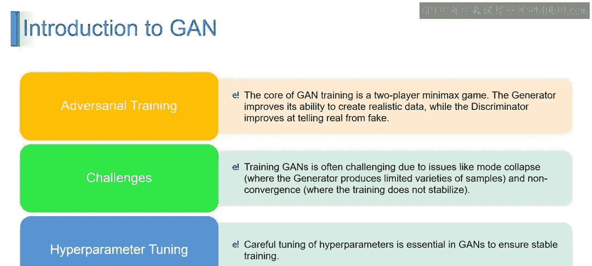

# Edureka《通过LLMs学习生成式AI（基础、应用开发、流行工具，第2、3、4课／共4课）｜Learn Generative AI with LLMs》中英 - P24：23_训练GAN.zh_en - GPT中英字幕课程资源 - BV1ym421V7gx

Hello everyone， welcome to Generative AI Foundations。

So now let's understand the training of GNs in the previous video we have understood what exactly the G and what is architecture offered Now let's proceed with the training of the GNs in this we are going to cover how to train the GNs by the end of the session you are able to generate realistic images with Gs and mastering the adsarial training and architecture implementation and you are also evaluate and improve GN performance identifying and addressing common issues like mode collapse so let's get started first of all training GNs so let's understand why training of GNs even required so training a generative adversarial network is essential to enable the generator and discriminator to learn and improve the respective tasks the primary goal of。

😊。

s are first of all， data generation then discrimination ability and achieving realism。

 So let's understand all this。 So when we say data generalism So GNs are designed to generate new data instances that resemble a given data distribution means training the generator allows it to learn patterns and structures from the real data creating synthetic data that closely mirrors the characteristics of the original data set means it's like teaching an artist to paint in a specific style by exposing them to various artworks and guiding them to create new pieces with similar features。

 So that's about the data generation Now let's understand the discrimination ability。

 So the discriminator training is crucial for it to become at distinguishing between real and generated data as the。

gets better。 The generator needs to improve its data creation to fool the discriminators consistently means think of it as training a detective to spot forced paintings。

 the more they learn about the real art。 the better they become an identifying the fake。

 So prompting the forger， which is nothing but a generator to enhance their skills。

 then finally achieving the realism。 the ultimate aim of G training is to make the generated data indistinguishable from the real data means through the adversarial network or the training process both the generator and the discriminator iteratively refine their capabilities to approach a state where the generated data is realistic means it's like refining an art skill until their creation becomes so life like that even an expert critic this is nothing but a discriminator here。

😊，ugles to tell the difference here。 So that's the reason the training of GNs is very。

 very important means it is all about teaching the generator to create authentic data and the discriminator to accurately distinguish between the real and generated data fostering a dynamic interplay that leads to the generation of high quality synthetic data。

 So what if we are not going to train the GNs then So if the G the generative adversarial networks is not trained it essentially remains in an unlearn state means its gene and discriminator components do not acquire the skills needed for meaningful data generation So there are some implications of not training the G first of all。

 no data generation limited discrimination ability no improvement towards the realism means when we say no data generation the primary purpose of G。

Is to generate the new data that resembles a given distribution without the training data。

 The generator does not learn from the real data。 and as a result。

 it cannot create the meaningful synthesis data instances means it's like having an artist who has never seen any painting but it expected to create masterpieces。

 So without exposure to real examples， the generator lacks the foundation to generate the authentic data。

 So that's the reason it is training of the gene is required。

 then the limited discrimination ability。 So the discriminator remains untrained incapable of efficiently distinguishing between real and generated data means without learning from the adversarial process。

 it cannot provide meaningful feedback to the generator means imagine a detective who has never studied art。

 but is asked to identify forcedged。The lack of training makes it impossible for the discriminator to disc screen between the genuine and the fake data。

 and lastly， no improvements towards the realism I said。

 So the adversarial interplay which drives the G towards creating realistic data does not occur without the training means the generator does not refine it kill and the discriminator does not develop the ability to detect the subtle differences between the real and generated data means in simple words。

 expecting an artist to improve without practice or critic without the learning process。

 the creations remain stagnant and lack of realism desired here。

 So that's the reason training of the G is very， very important Now let's understand how to do that then interaction to the G and adversarial training challenges and hyperchrameter journey So imagine a game between a skilled。

W which is nothing but in our case a generator and the keen art critic in our case it is going to be a discriminator means GANs or the generative adversarial networks turn data creation into thrilling competition the painter strives to make lifelike art while the critic sharpens the ability to tell genuine from the crafted ones so the upcoming video will delve further into the ongoing discussion。

😊。

