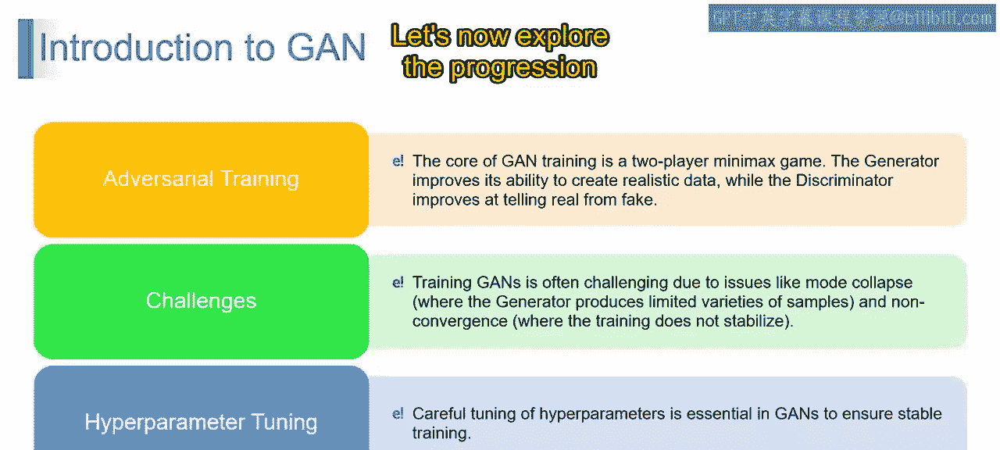
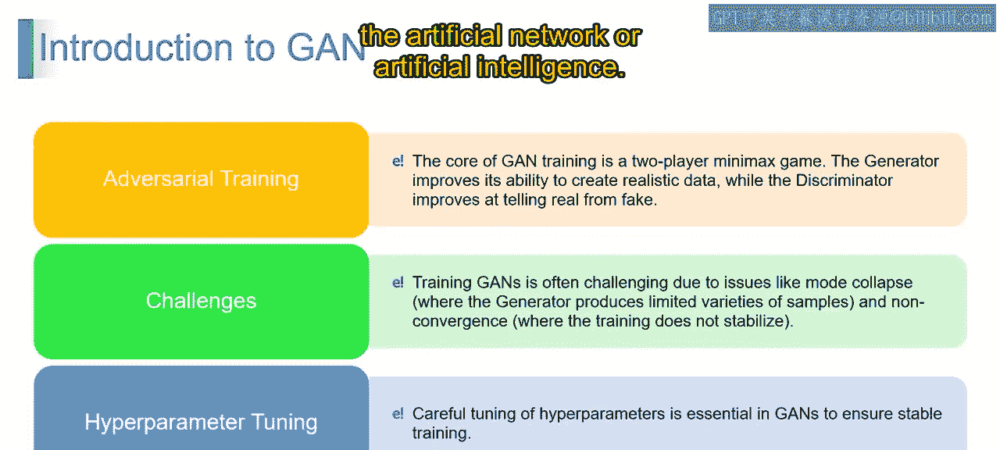
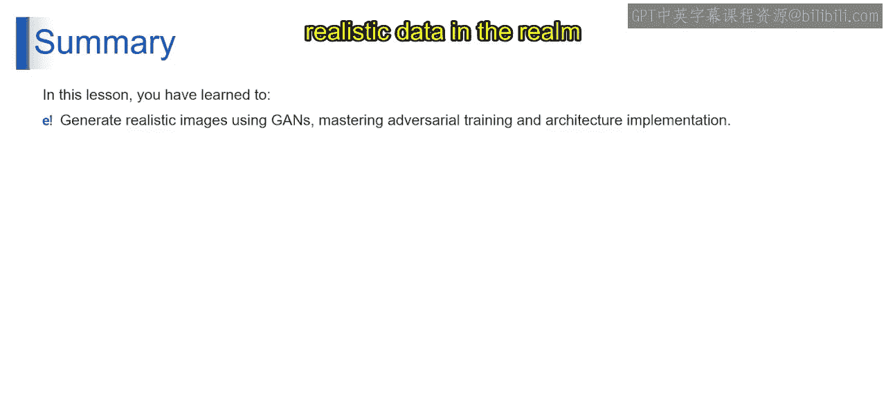

# Edureka《通过LLMs学习生成式AI（基础、应用开发、流行工具，第2、3、4课／共4课）｜Learn Generative AI with LLMs》中英 - P25：24_关于GAN.zh_en - GPT中英字幕课程资源 - BV1ym421V7gx

So let's now explore the progression from our previous discussion means in the adversarial training process what happens here is that in our artistic game the painter who is nothing but a generator in our case and the critic who is nothing but a discriminator so the painter and critic engaged in continuous phase of the painter learns to create more convincing art and the critic hos the skills or spotting the real thing it's like an evolving dance where both get better at their craft so that's about the training adverarial training then the challenges so however this artful game is not without hurdles so sometimes the painter in our case the generator get ch creating similar art repeatedly more collapse that is nothing but a mood collapse or the game does not reach a stable point which is。

😊，But in nonconvergence， these challenges make the training process tricky。

 like trying to find the perfect rhythm in our artistic dial。

 So those are are the challenges means training geness is oftenly challenging due to issues like mode collapse。

 as I mentioned， where generator produces limited varieties of the samples and nonconvergs means where the training does not stabilize。

 Then the next one is of hyperparameter tuning So to ensure the art showdown progresses smoothly meticulously tuning of parameters is very。

 very important。 It's akin to adjusting the paint brush size and canvas texture in a simple words。

 So careful hyperparameter tuning keeps the training stable。

 ensuring our artistic game does not go off the race means in simple technical terminology in this first one。

 adversarial training。😊，The GAN training is mini Maxax game where the generator enhances data creation and the discriminator sharpens its ability to differentiate between the real and generated data So coming to the challenges part mode collapse and nonconvers are challenges in G training where the generator may produce limited varieties of the samples or the training process struggle to stabilize in the hyperparameter tuning the meticulous tuning of hyperparmeters ensures stable G training preventing issues and maintaining the flow of the adversarial game means in the captivative real M of GNs training involves an ongoing artistic dual better the generator and the discriminator overcoming challenges and precise hyperparameter tuning ensures the game evolve smoothly advancing the landscape of the artificial network。

😊。

or artificial intelligence so finally the summary in this lesson you have gained the expertise to generate lifelike images through generative adversarial networks you have mastered the art of adversarial training understanding how the generator defines its skills and the discriminator sharpens its disc ability Additionally you have delved into the implementation of JN architectures unlocking the potential to create realistic data in the realm of artificial intelligence Thank you。

😊。

