# Edureka《通过LLMs学习生成式人工智能（机器学习和NLP基础，第1课／共4课）｜Learn Generative AI with LLMs》中英字幕 - P25：24_特征缩放和分类器训练.zh_en - GPT中英字幕课程资源 - BV1q4421Q7qh

So let's now explore the progression from our previous discussion。

 and then we are going to perform the feature scaling here we are importing。😊。

Standard scalealar from a scaleal and dot preprocessing。

Now we are instantiating we will initialize the standard scalar object for feature scaling and then it will fit the scalar。

😊，This will fit the scalar on training data and transform it and then Scalar dot transform it will transform the test data during the scalar fitted on the original training data。

 so let's execute it again。

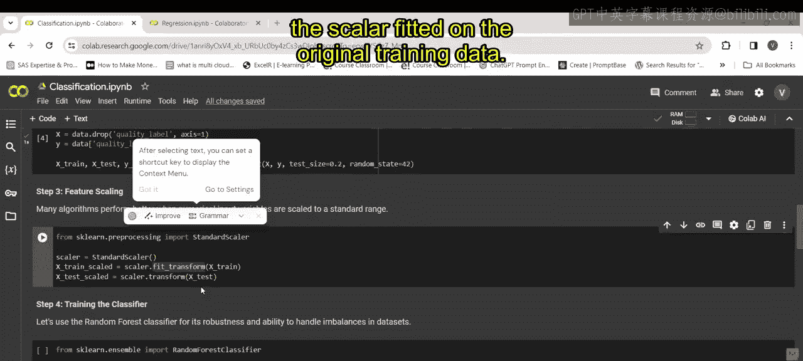

Then training the classifier so once if were done with the feature scaling the next step that we will have to perform is training the classifier and then building the model here we are choosing model is equal to random forest classifier and we are providing an estimators is equal to 100 as well as random state is equal to 42 what it will do it will initialize a random forest classifier with 0 trees and sets a random state for reproducibility then we are performing model training here。

😊。

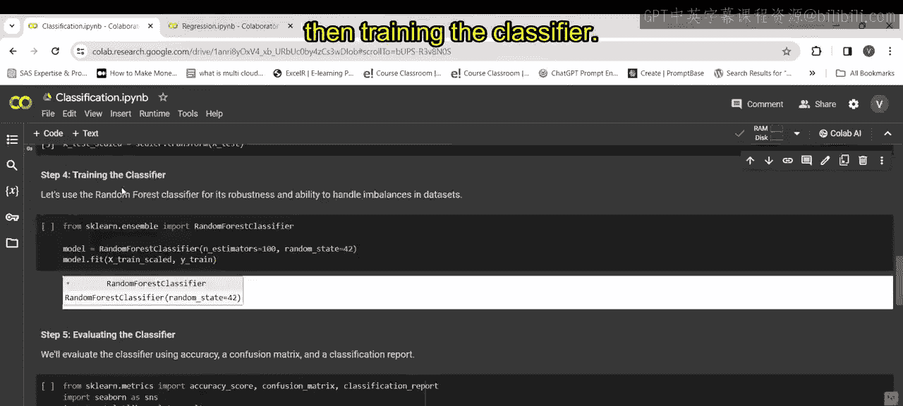

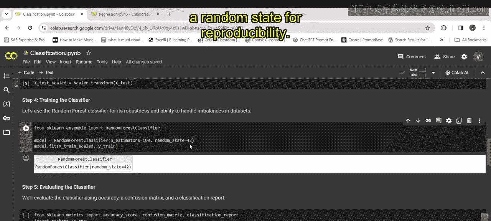

The model dot fit that is x scaled and Ytrain it trains the random forest classifier using the scaled training data that is ex scaled and corresponding target labels nothing but Ytrain once if it is trained we will have to evaluate the classifier so I am executing it Now we can see the output random forest classifier and the random state provided is42。

😊。

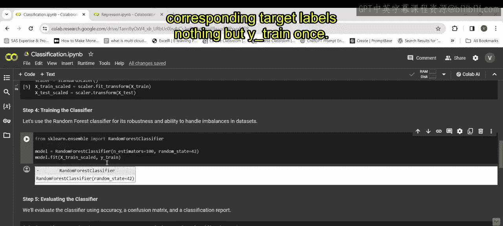

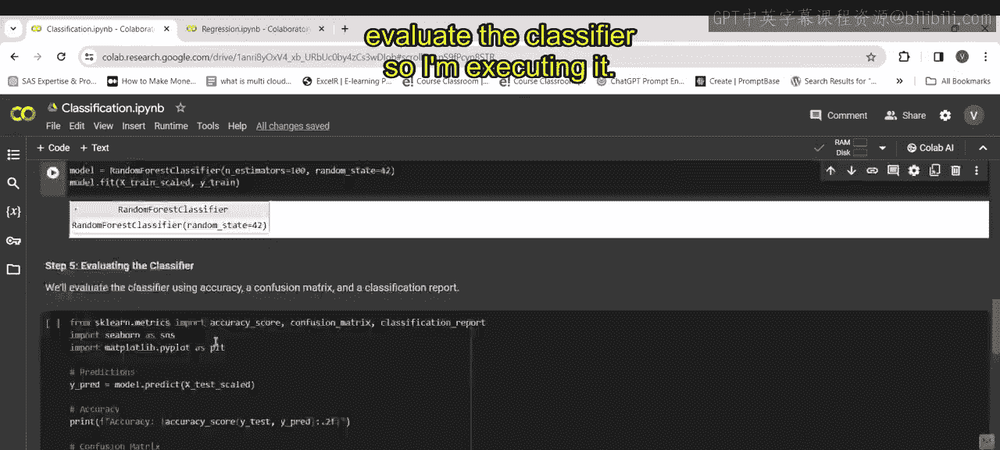

So while this random state is 42， it will ensure reproducibility by fixing the seed for random number generation。

 ensuring consistent results across the different runs， then we will perform evaluation classifier。😊。

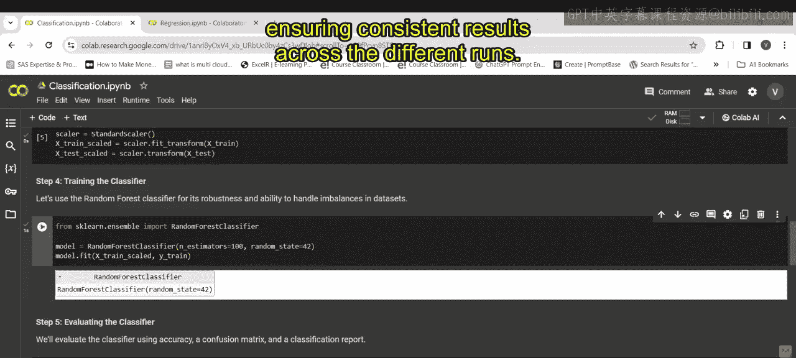

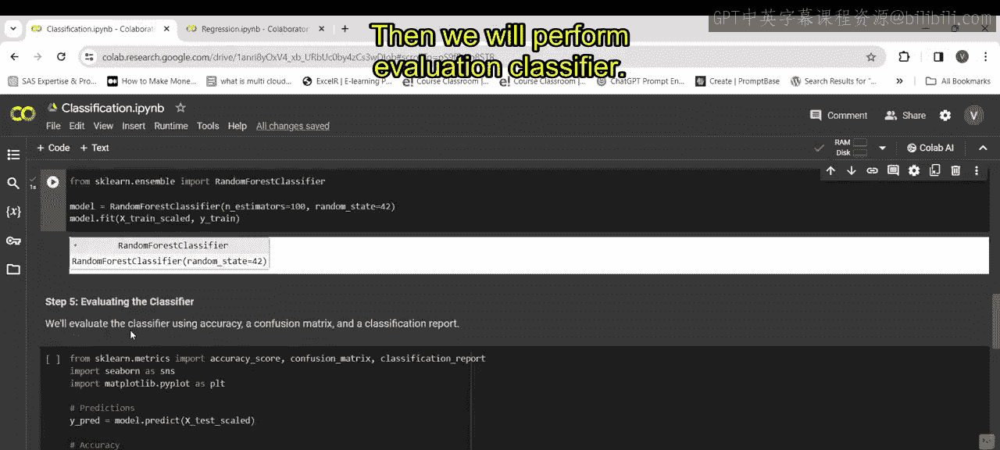

So now we are importing the accuracy score Con metrics classification report from S scale and metrics the first one。

 this line imports specific evaluation metrics from the psychit line including accuracy confusion metrics and classification report this metrics are commonly used to access the performance of classification models。

 then imports Cborn as SNs this line represents the Cborn library which is used for statistical data visualization Cborn provides a highlevel interface for drawing attractive and informative statistical graphs then the next one is of matpl lab so this line imports the matpllib library which is a comprehensive library for creating static animated and interactive visualizations in Python it's often used in conjunction with Cborn for customization and。

😊。

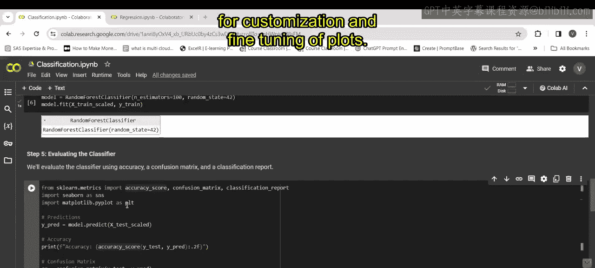

Findine tuning of plots Now， once if it is done， we are performing the predictions based on the training。

 Y underscore pre is equal to model dot predict of x scaled What this line meaning this line uses the training classification model to predict the target variable based on the features of the testing set means the features are scaled using the same scalar that was fitted on the training data。

 Then here we are going to print the accuracy by using the print This line calculates the accuracy of model comparing the predicted labels that is y with the actual labels that is nothing but vitals means here the accuracy score function from psyit learn is used for this purpose。

 The result is printed with two decimal places。 Now we are performing the confusion matrix Cm is equal to confusion matrix that。

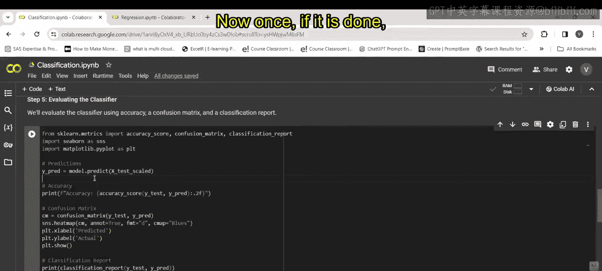

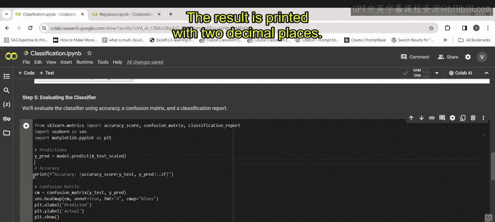

Witeest and virate this line computes the confusion metrics which is a label that summarizes the performance of statistical model each row of the matrix represents the instances in a predictive class while each column represents the instances in an actual data or actual class means the confusion metrics function from psyit learn is used for this purpose so the upcoming video will delve further into the ongoing discussion。

😊。

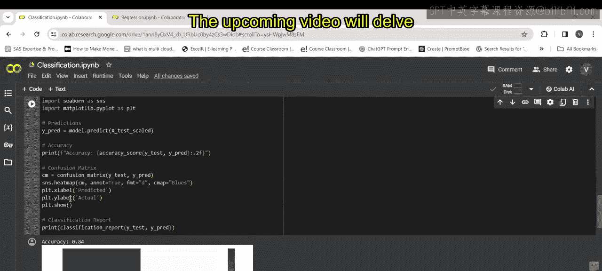