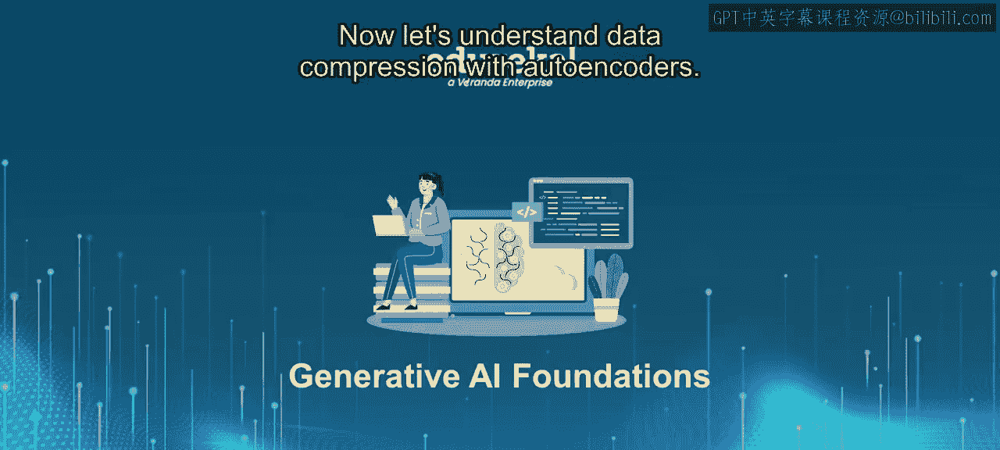
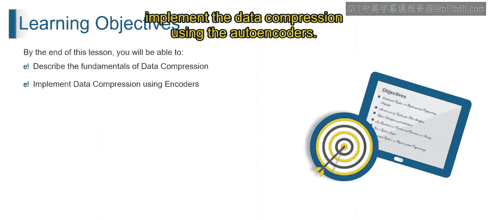
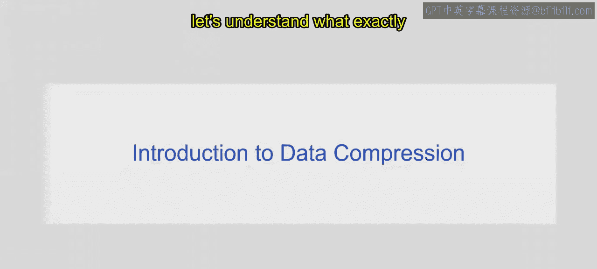
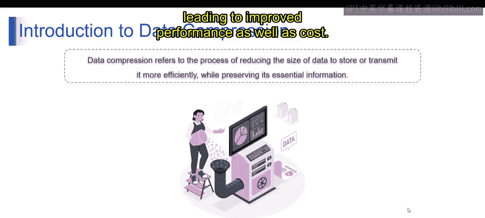
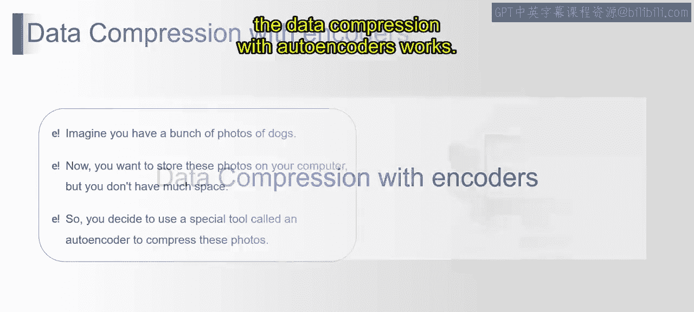
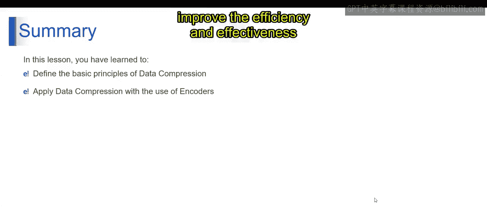

# Edureka《通过LLMs学习生成式AI（基础、应用开发、流行工具，第2、3、4课／共4课）｜Learn Generative AI with LLMs》中英 - P26：25_使用自编码器进行数据压缩.zh_en - GPT中英字幕课程资源 - BV1ym421V7gx

Hello everyone welcome to generative AI foundations So now let's understand data compression with autoenrs so in this we are going to understand the introduction to data compression and data compression with encoders by the end of the session you are able to understand the fundamentals of the data compression and implement the data compression using the autoenrs so let's get started first of all let's understand what exactly a data compression is all about so data compression refers to the process of reducing the size of the data to store or transmit it more efficiently while preserving its essential information means it involves representing the original data using the fewer widths or bys thereby reducing storage requirements and speeding up the transmission times so this compression。

😊。

Techniques aims to eliminate the redundancy redundancy or the irrelevant information from the data while maintaining its fidelity as much as possible。

 this reduction in data size is particularly valuable in various applications where storage space or the bandwidth is actually limited such as digital medium communication system and data storage devices。

 so efficient data compression enables more data to be stored or transmitted with the available resources so leading to improved performance as well as cost so now let's understand。

😊。

How the data compression for with auto encoders works so here let's consider an example imagine you have a bunch of photos of the dog imagine you have a bunch of photos of the dos each photo is very detailed but lots of pixels making them quite large size so now you want to store these photos on your computer but you don't have much space so you decide to use a special tool called an autoencor to compress these photos so now let's understand how it is going to work so first of all encoding the photos so the auto encodecor first looks at each photo and tries to find the most important features of each dog like size color and shape it then represents these features in a various simpler way sort of like drawing a sketch of each dog instead of。

😊。

Keeping the full detail photo then coming to the compression So after figuring out the important features the encoder throws away the less important details so this makes each sketch more smaller in size compared to the original photo so instead of storing the old big photo you only need to save these compact sketches then the next one is of the decoding so later when you want to look at each photo again the auto encoder can take these compact sketches and use them to reconstruct the original photos so it does just by filling in the missing details based on the simplified sketches it created earlier。

😊，Means technically data compression with auto encoders involves using a type of neural network called autoencoder to learn a compressed representation of the provided input data the auto encodeder consists of an encoder network which compress the input data into the lower dimensional representation and the decoder network which represents the original data from this compressed representation。

 so during the training process the autoencoder minimizes the reconstruction error ensuring that the compressed representation retains essential information from the original data this compressed representation allows for efficient storage transmission or further analysis of the data while reducing its size so now let's understand the different data compression techniques So of the prominent techniques include variational auto encoders。

😊，Generrative adversarial networks， the transformers flow-based models and auto encoding variational bias bias auto encoding variational bias so first let's understand what exactly VaE so VAs are type of generative models that learn probabilistic distribution over the data and generates new samples from this distribution so this consists of an encoder network that compress the input data into a lower dimensional latent space and a decoder network that reconstructs the original data from this latent representation means Vas are known for their ability to generate diverse and realistic samples while enabling latent space interpolation and manipulation then coming to the Gs Gs are another popular approach to generate modeling where to。

😊，Uural networks， namely a generator and discriminator are trained simultaneously in a competitive manner means the generator learns to generate the realistic data samples while the discriminator learns to distinguish between the real and generated images。

 So through this adversarial training process， Gs can generate high quality realistic data samples across various domains such as text image and audio。

 then coming to the transformers。😊，These are class of deep learning models that have gained significant popularity in NLP tasks。

 they utilize self-ed mechanism to capture the long range dependences within the input data enabling effective data compression and generation so models such as DPT and BRT has demonstrated embarkable performance in tasks like text generation translation and summarization so coming to the autoencoding variational biasers which is also known as AEVB it is a probabilistic model framework that combines elements of VAs with the bio interface so Bay inference so it leverages the encoded decoder architecture of VAs to learn a latent space representation of the data while incorporating bioation techniques for uncertainty estimation and robustness。

😊，So now the summary， so these are the few examples of how data compression techniques used in generative AI Each technique offers a unique advantage and suitable for different types of data and applications so researchers continue to explore and develop new approaches to provide or improve the efficiency and effectiveness of the data compression in generative modeling Thank you。

😊。

