# Edureka《通过LLMs学习生成式人工智能（机器学习和NLP基础，第1课／共4课）｜Learn Generative AI with LLMs》中英字幕 - P26：25_分类报告的可视化.zh_en - GPT中英字幕课程资源 - BV1q4421Q7qh

So let's now explore the progression from our previous discussion then we are generating the heatmap asN as dot heatmap。

 this line creates a heatmap visualization of the confusion metrics using the Cborn library this heatmap provides a visual representation to the confusion metrics which is where each cell color intensity represents the number of observations Additionallyly the unnote is equal to true argument displays the cell values and FMT is equal to D formats the cell values as integer and then we are plotting xla variable so these lines set the labels for the x axis and y axis of the heatmap indicating the predicted and actual classes respectively then plot dot show this line displays the heatmap visualization。

😊。

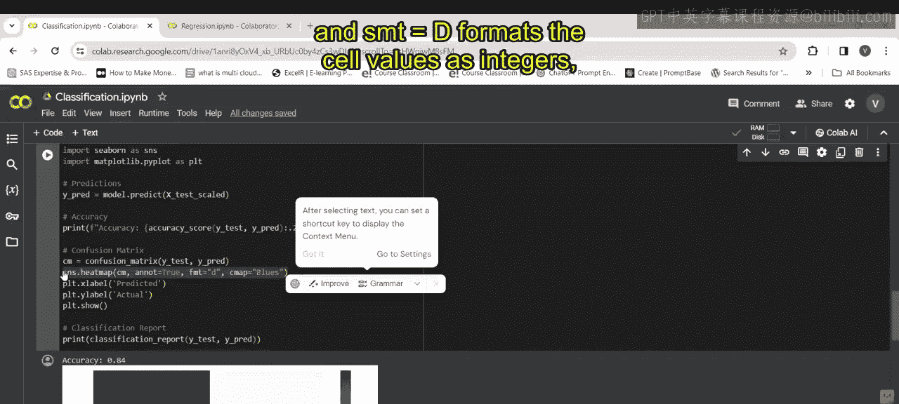

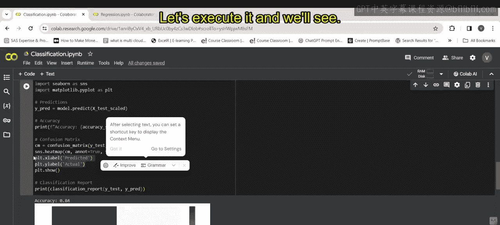

Let's executed and we'll see。 So now you can see the heat map representation。

 along with the accuracy。😊。

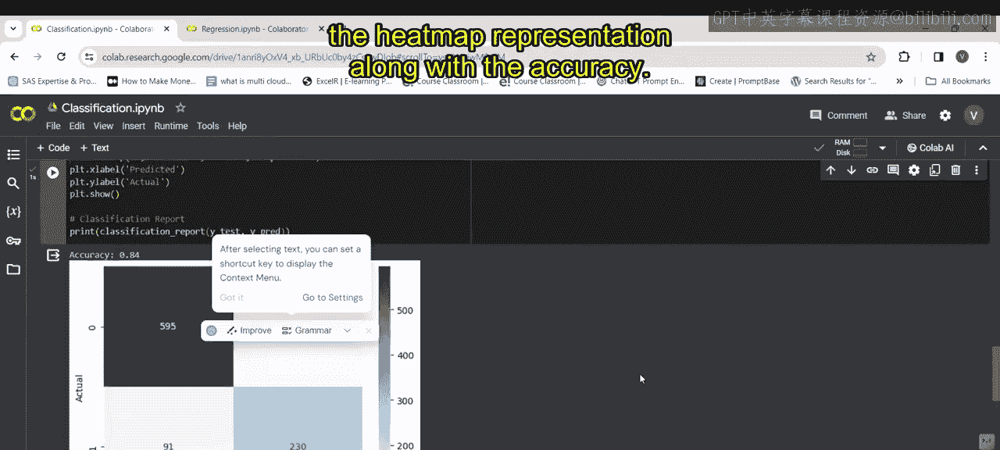

Now we can see the values of predicted values and actual values as we discussed confusion metrics represents the true positives。

 false positive false negative and false positives so that is how the representation works and now next the feature importance so model dot feature importance。

😊。

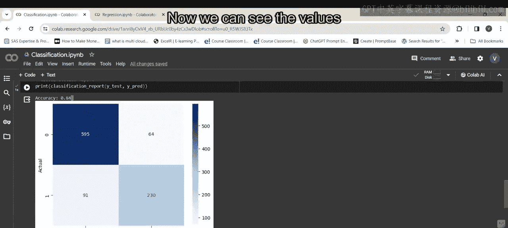

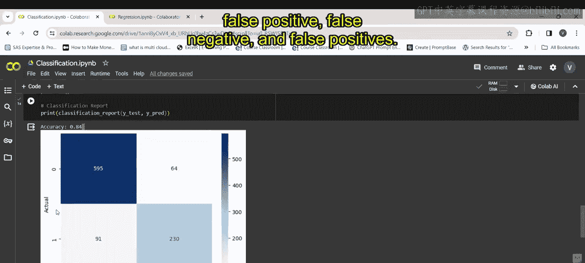

Commer index is equal to xt columns This line calculates the feature importances using the feature importance attribute of the trained random forest classifier that is model and then model dot basically this line returns an array containing the importance of each feature and then period dot series。

😊，It converts this array into panda series where the feature names like extord columns are set as the index。

😊，And now we are performing feature importance dot enlarges of 10 This line selects the top 10 features with the largest importance。

 This enlarest function from pandas is used to retrieve the largest values in the series and then we are plotting the feature importance using the bar H。

 This line plots the selected top features as horizontal bar chart。

 The kind is equal to bar hedge argument specifies the type of the plot to create that is horizontal bar chart Each bar represents the importance of feature and the length of the bar indicates the magnitude of importance Then we are providing the title and then we are performing plot dot show let's execute it and now you can see the output This will display the plot means this code segment provides a visual representation。

😊。

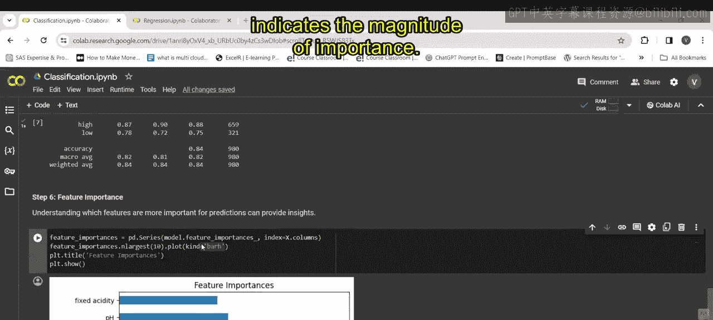

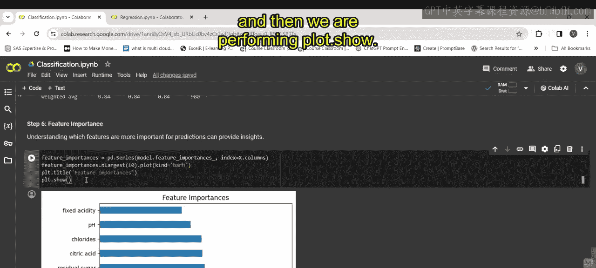

Of feature importances allowing us to understand which features have the most significant impact on the model's prediction it helps in feature selection and understanding the models behavior it means entirely all together this code loads the data preprocess it split it into the training and testing sets build and train a random forest classifier and evaluate performance and visualize the feature importances that is all about this classification problem statement thank you。

😊。

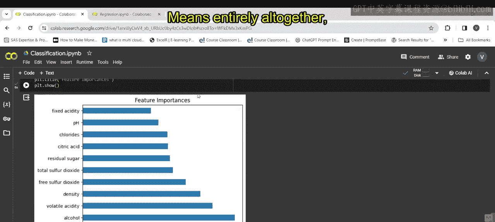

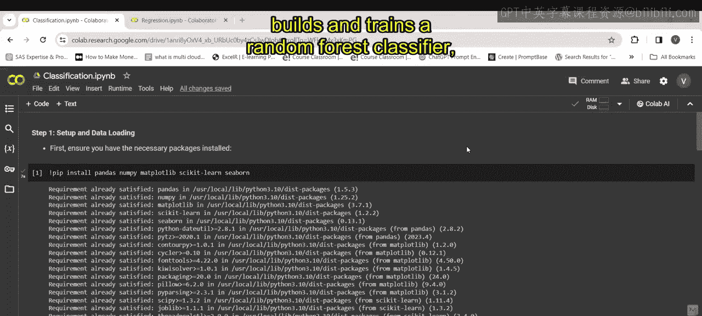

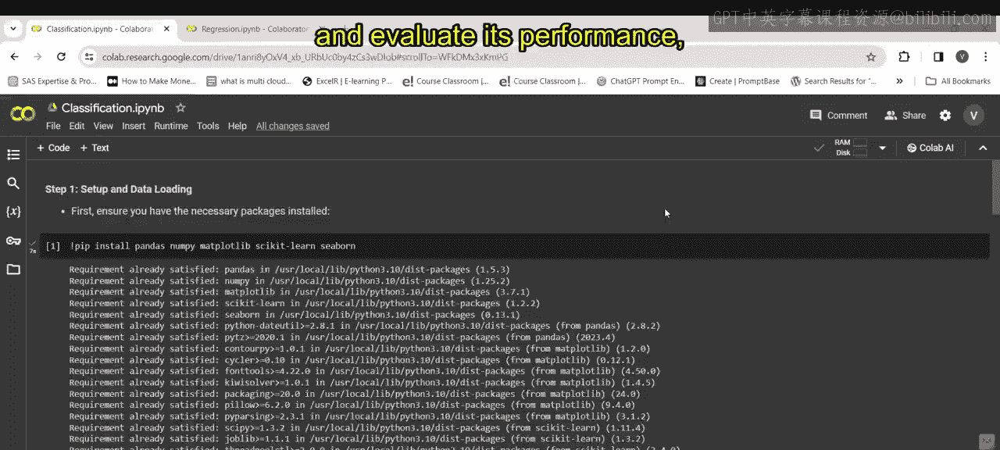

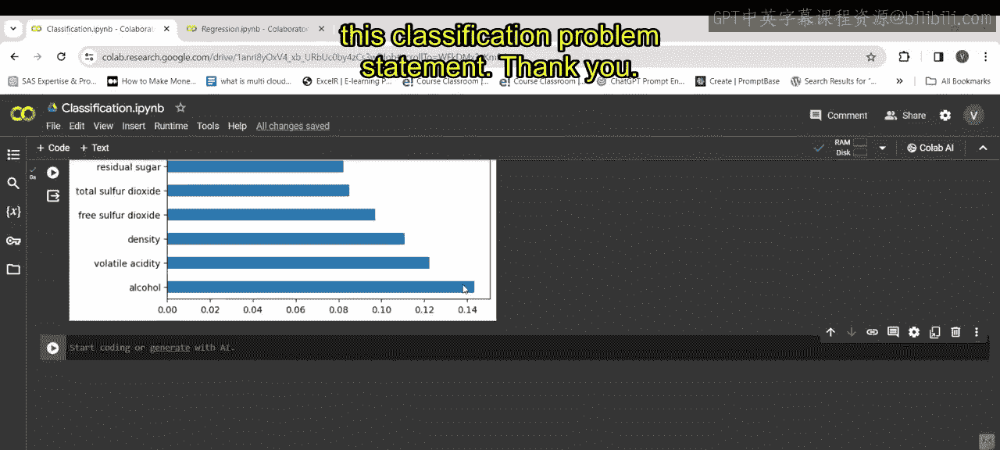