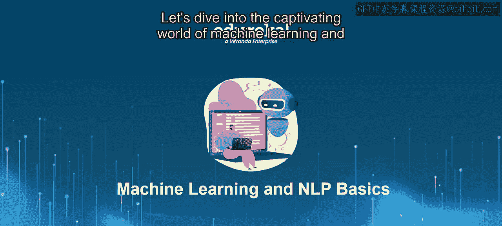
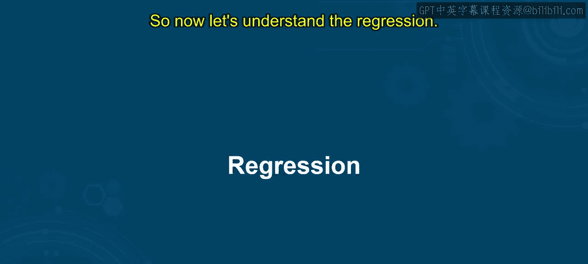
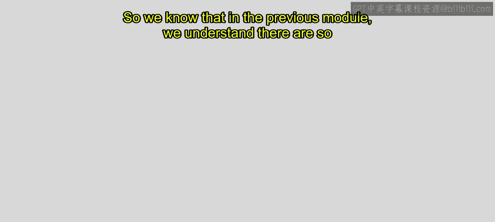
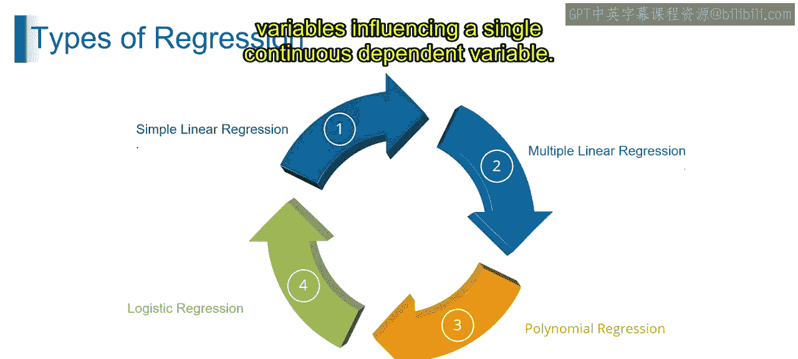

# Edureka《通过LLMs学习生成式人工智能（机器学习和NLP基础，第1课／共4课）｜Learn Generative AI with LLMs》中英字幕 - P27：26_回归.zh_en - GPT中英字幕课程资源 - BV1q4421Q7qh

Hello everyone， let's dive into the captivating world of machine learning and the foundational concepts of NLP together。

 So now let's understand the regression in this we are going to cover what exactly a regression and what are the key concepts and what are the different types of regression by the end of the session you are able to articulate the concept and the applications of regression in the data analysis and also able to identify the fundamental principles that underpin the regression models and you are able to distinguish between the different regression techniques and the users so let's get started the regression so regression is a statistical method used in the machine learning to predict continuous outcomes it involves analyzing the relationship between a dependent variable and one or more independent。

😊。

Varis to estimate the value of the dependent variable based on the independent variables regression models are widely used for forecasting trend analysis and underlying the relationship between the variables in various fields such as finance。

 economics， healthcare and engineering。😊，But how it works first of all。

 so if we consider the example of predicting the house， first of all。

 it will try to capture the data and it will try to understand what are are the dependent variable here in the house price prediction problem statement the selling price of houses is are dependent variables as it is the outcome we want to predict and here the independent variables are the size of the house and the number of bedrooms and area are independent variables as there are factors that may influence the selling price and what it will do then based on the dependent and independent variables it will follow the statistical approach that is regression allows us to model the relationship between the selling price and the size or the number of bedroom means the relationship between the dependent variables and the independent variables and then by analyzing。

😊，Historical data of the houses we can use regression to estimate how changes in the size and the number of bedrooms affect the selling price。

 For instance， regression may reveal that on average each additional bedroom increases the selling price by into exc and each additional square foot increases the price by dollar5 means once the regression model is built we can input the size and number of bedrooms of the new house to predict its selling price based on the established relation so that's the example of regression problem statement so now let's understand the key concepts in this the key concepts include predictive modeling continuous output。

 linear and nonlinear coefficients intercept error terms use cases coming to the predictive modeling it's a process of using the data and statistical algorithms。

😊，To make the predictions about the future outcomes， for example。

 predicting the stock prices based on the historical data。

 then the next one is continuous output so it refers to the type of outcome variable that can take any numerical value within a range。

 for instance， predicting the house prices where the price can be any positive number then the linear and nonlinearar so linear relationships are those where the change in the outcome variable is proportional to the change in the predictor variable so the nonlinear relationships are more complex and do not follow a straight line。

 for example， the relationship between the temperature and the ice cream sales is nonlinearar and then coefficients in regression model coefficients represent the strength and the direction of the relationship between the independent variable and the。

😊，Depenent variable so they indicate how much the dependent variable changes when the dependent variable changes by one unit。

 so that's about the coefficients then intercept。 so intercept is the value of the dependent variable when all independent variables are0 in regression models it represents the baseline value of the dependent variable then error term it is also known as residual it represents the difference between the observed value of the dependent variable and the value predicted by the regression model it captures the unexplained variability in the data so that's about the error term then use cases the real world applications or scenarios where these concepts are applied for instance。

 predictive modeling is used in healthcare for disease prediction in the finance。

Stock price forecasting and in the marketing for customer churn prediction。

 So these all are the key concepts of regression problem statement。

 Now the different types of regression。 So we know that in the previous module。

 we understand there are so many different types in it like linear regression polynoial regression。

 rich regression laso elastic net logistic regression。

 poison regression and ornal regression and time regression and nonlinear regression。

 So considering all this， I am focusing only on particular important things。

 those are simple linear regression first of all。 So simple linear regression works in such a way that it predicts a continuous outcome variable based on are more independent variables。

 it assumes a linear relationship better the dependent and independent variable Then coming to the multiple。

😊。

ar regressionSo multiple linear regression extends the concept of simple linear regression to cases where there are multiple independent variables influencing a single continuous dependent variable。

😊。

