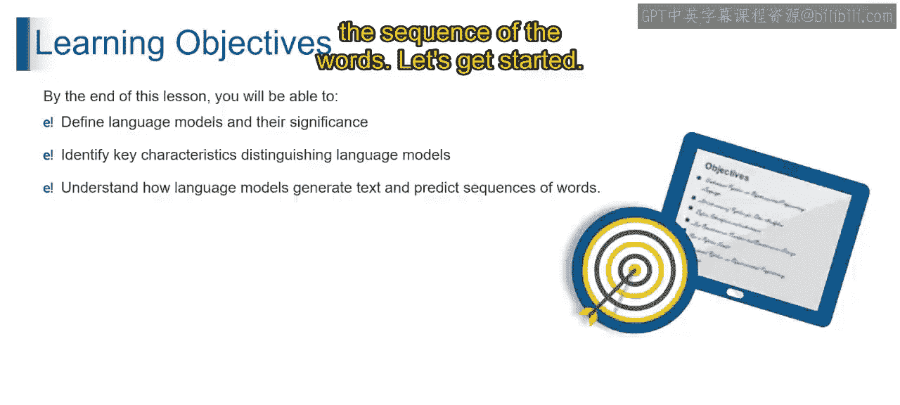
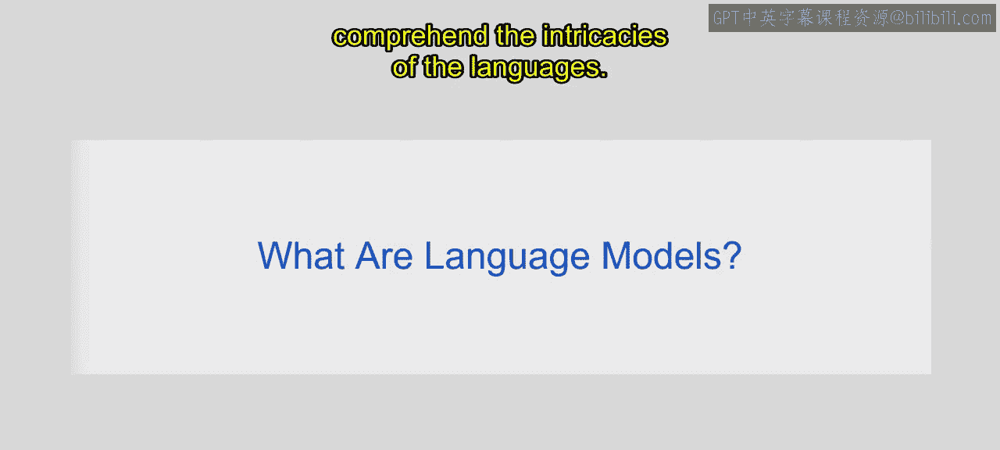
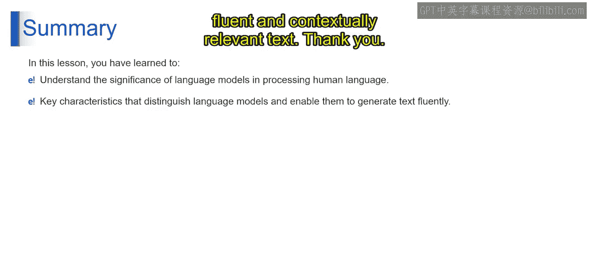

# Edureka《通过LLMs学习生成式AI（基础、应用开发、流行工具，第2、3、4课／共4课）｜Learn Generative AI with LLMs》中英 - P27：26_探索语言模型.zh_en - GPT中英字幕课程资源 - BV1ym421V7gx

Hello everyone welcome to generative AI foundations So now let's understand exploring the language models In this we are going to cover what are language models and then what are the key characteristics of the language models by the end of the session you are able to understand and define the language models and their significance and then you are able to identify the key characteristics distinguishing language models and then you are able to understand how language models generate text and predict the sequence of the words so let's get started so what are the language models first of all so language models are computational models designed to understand generate and predict the human language these models utilize statistical patterns and structures within vast amounts of the text data to comprehend the intricacies of the languages so let me explain about it more so the。

😊。

age model， a corner store in AI specializes in comprehending and producing the human languages。

 So first of all， understanding and generation picture a model delving into vast libraries of text to master language intricacies means the language models aptly understand and generate the text。

 harnessing the insights from the extensive training data when we say extensive training。

 So envision the model， immersing itself in ocean of written words grasping shades through the exposure means training on vast data sets。

 sharpens a language models ability to understand intricate language patterns。

 then contextual and coherent text means think of the model。

 crafting text that seamlessly fits into a given conversation maintaining flow means the language models Excelel。

😊，Generating coherent and contextually relevant text， ensuring efficient communication。

 then Pboal role in NLP。 So consider chatbo's language translation tools or content summarization systems powered by the language models。

 So the language models are instrumental in advancing natural language processing transforming various applications In the essence。

 language models are AI powerhouses that navigate the intricacies of human language enabling them to understand generate and contribute to a wide array of applications within the real and of natural language processing。

 So now let's understand the key characteristics of the language models。

 The first one is of the applications of the NLP。 So chatbos and virtual assistants first of all。

 when we see chatbos and virtual assistants language models power conversational。😊。

Agents facilitating natural and contextually relevant interactions means enhanced user engagements and means what is the impact of it it will enhance the user engagement and seamless communication in the chat based applications then the next application is language translation this language models Con to accurate and context away language translation systems。

 Then what is the impact of it it improves the translation quality and broader language coverage in multilingual application then the other application is content summar means language models assist in condensing lengthy text into concise summaries while preserving key information So what is impact of it the efficient extraction of the essential content aiding in information retrieval then the next application is sentiment analysis。

😊，Provide the valuable insights of a business means this allows for creative content generation。

 storytelling and versatile language applications。 Then the next one is of sequential dependencies。

 the sequential dependencies refers to the relationships and the patterns that exist between elements in a sequence。

 where the order of elements matters means the significance here that understanding sequential dependencies is crucial task involving time series data language processinging and any domain where the arrangement of elements conveys meaningful information。

 So that's about sequential dependencies。 Then the last one is of pretrained models。

 The pretde models are neural network models that are trained on large data sets for specific tasks before being fine tuned on a smaller task specific dataset means。

😊，The leveraged knowledge learned from the extensive data accelerating training and enhancing performance on the downstream task。

 So there are some examples like bird imate pretrain models and G models and many more。

 So these all are the key characteristics of the language models。

 So now the summary in this lesson you have grasped the essence of the language models recognized the pihu role of language models in comprehending and generating human languages and also explore the key characteristics empowering the language models to produce fluent and contextually relevant text。

 Thank you。😊。

