# Edureka《通过LLMs学习生成式人工智能（机器学习和NLP基础，第1课／共4课）｜Learn Generative AI with LLMs》中英字幕 - P28：27_回归演示.zh_en - GPT中英字幕课程资源 - BV1q4421Q7qh

Hello， everyone。Welcome back。 So now let's understand the regression problem statement， demo。

So now the aim of this code is to demonstrate a simple linear regression problem in machine learning using the synthetic data specifically the code accomplishes like data generation model training model evaluation and visualization so overall this aim to introduce process of building and evaluating a simple linear regression model which is one of the fundamental techniques in machine learning for solving regression problems so now let's understand all this step by step the very first step is install the required libraries using the PP these libraries include Ny psyitL matpllip and pandas they are essential for data manipulation data visualization and machine learning tasks once if it is done so let's perform generating the synthetic data so let's create a data set where the relation。

😊。

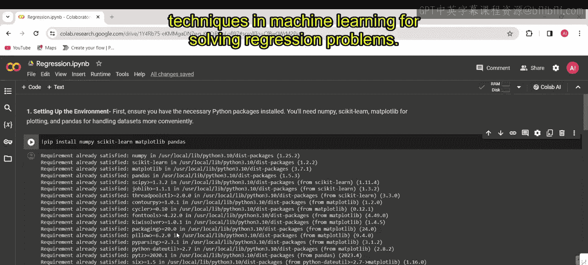

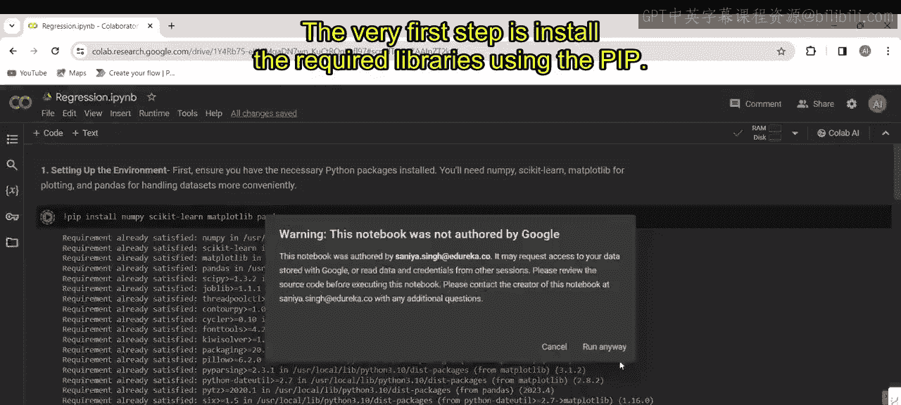

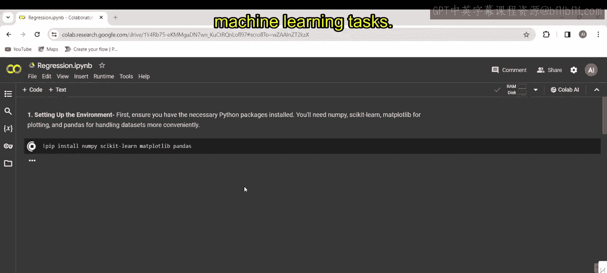

Between the input variable x and the target variable y is linear。

 but we will add some noise to simulate the real world data imp perfectction。

 So now in this we are importing the required libraries into the Python framework。

 These include Python for numerical computations。😊。

Pandas for data manipulation and mapplly for plotting and specific modules from psychicle for machine learning algorithms and evaluation metrics。

 and then we are providing the random state for ensuring the reproducibility and then we are performing the synthetic data generation we generate synthetic data for our regression problem X represents the input variable which is a random array of shape0 comma1 and y represents the target variable which is generated using a linear equation with some random noise added to it this simulates a scenario where there is a linear relationship between the input and target variables but it is not perfect due to the noise and then we are performing the visualization of the data。

😊。

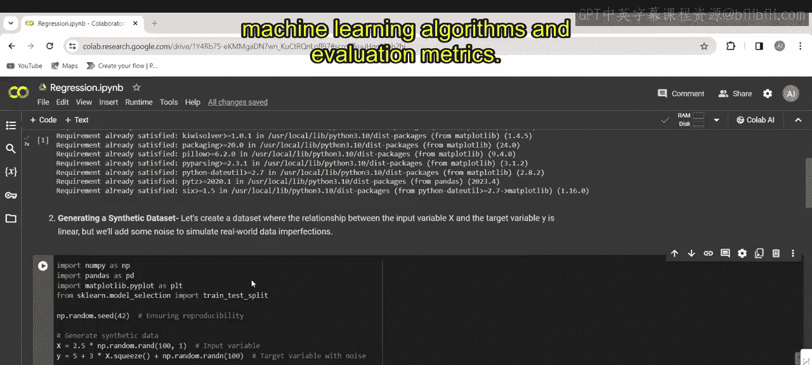

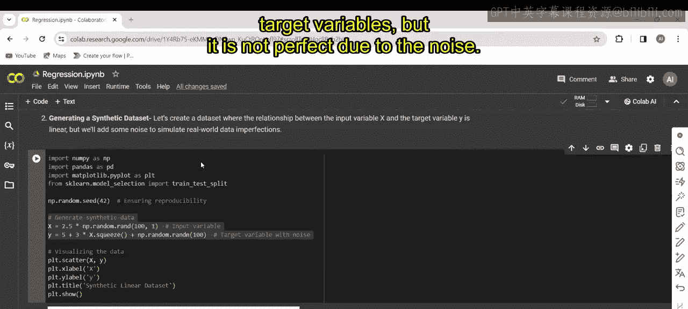

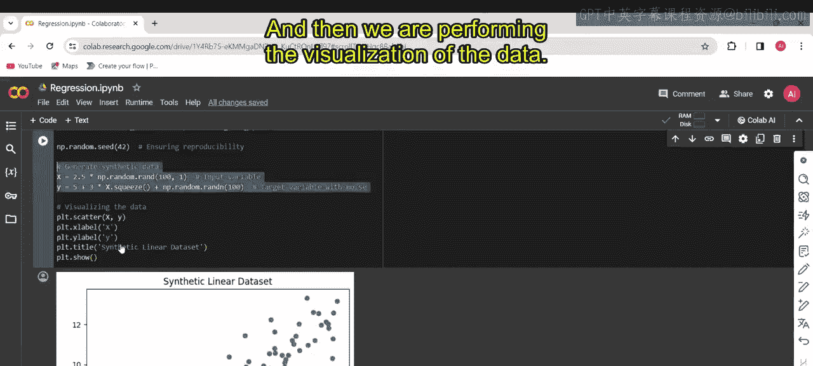

We plot the synthetic data using the matpl loop and the x axis represents the input variable x and the y axis represents the target variable each point in the scatterpl represents data points from our synthetic data so let's execute it and then we'll see the output。

😊。

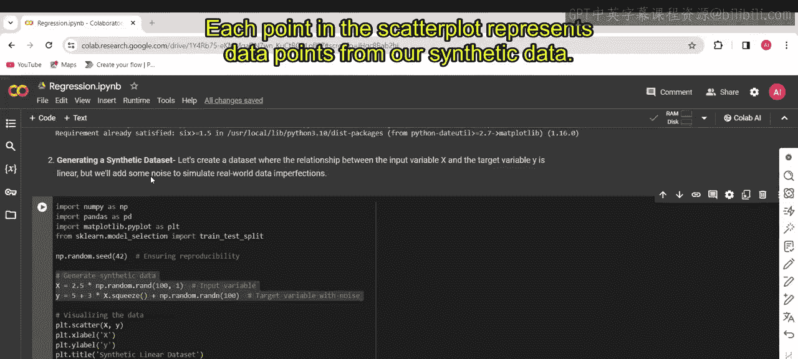

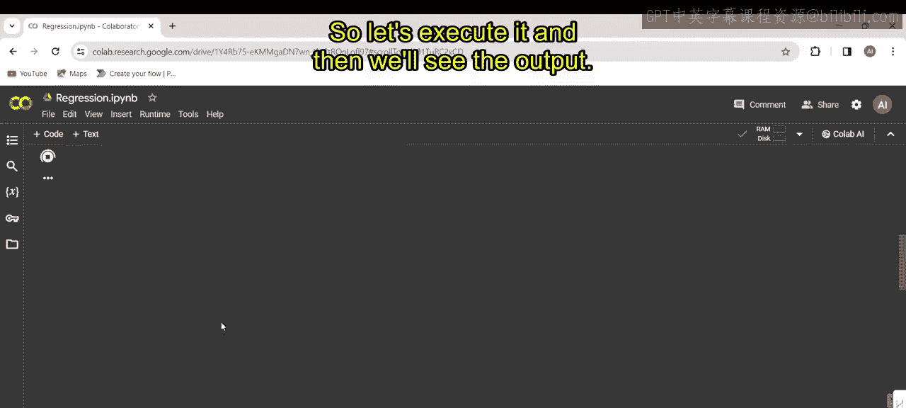

Here you can see as because we mentioned linear data and x is the input variable and y is the target variable。

 so each data point in the scatter plot represents a data point from our synthetic data and then we need to perform splitting the data into train and test sets here we split the data into training and testing sets using the train test split function from psychit learn so 80% of the data is used for training and 20% is used for testing so it's executed once it is done initialize and fit the linear regression model in this we initialize the linear regression using the linear regression class from psychit learn and then to fit the model to our training data that is xtrain and ytrain using the fit method and then we are printing the model coefficient。

😊。

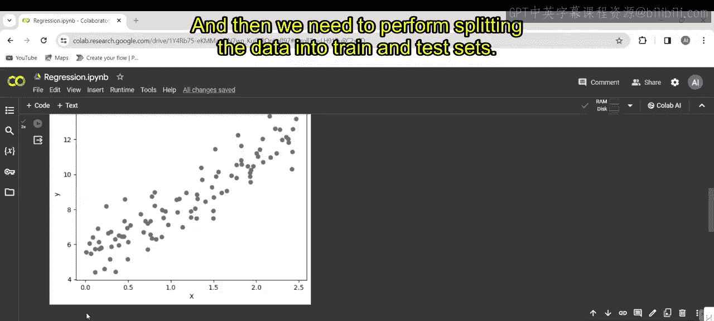

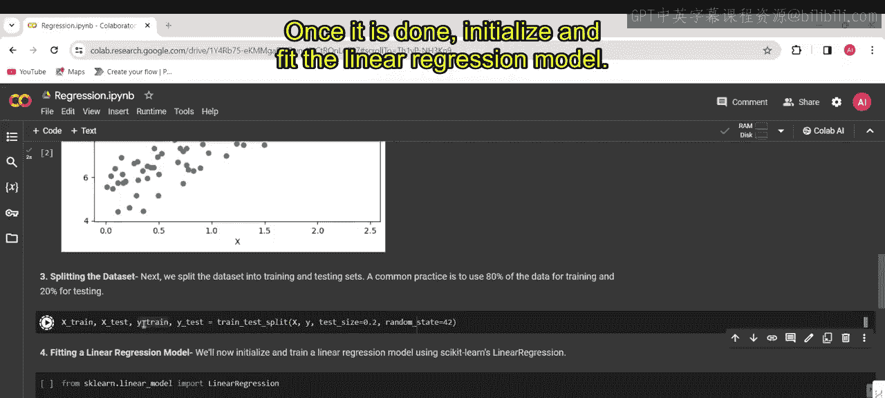

Model coefficients that is nothing but the slope and intercept of the linear regression model。

 So let's execute this and we'll see the what is a coefficient and intercept。

 you can see the output coefficient is 2。83 and intercept is 5。

14 Once if it is done We can make the predictions out of the model。

 We calculate the mean squared error that is nothing but MS。😊。

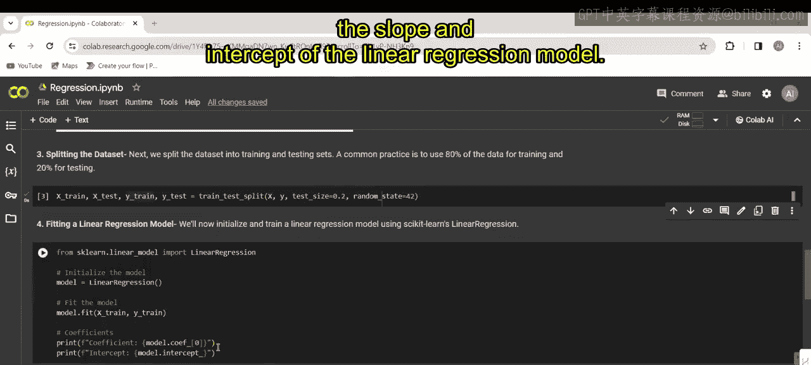

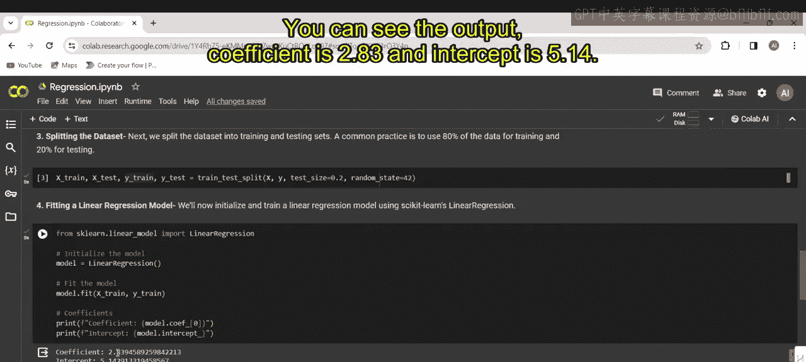

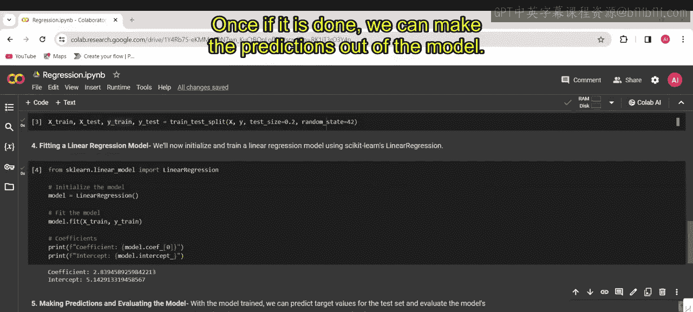

And R square score to evaluate the performance of our model on the test data。

 MSc measures the average squared differences between the actual and predicted values。

 R square score indicates the proportion of the variance in the dependent variable that is predictable from the independent variable S。

 Let's execute this and then we perform visualizing model outcome。

 We can see the mean squared error we are having is 0。65 and the R score is 0。87。

 So MSc value approximately 0。65 suggest that on average the squared difference between the actual and predicted value is around 0。

6537 General MSc measures， the average squared between the actual and predicted value by the model it quantifies。

😊。

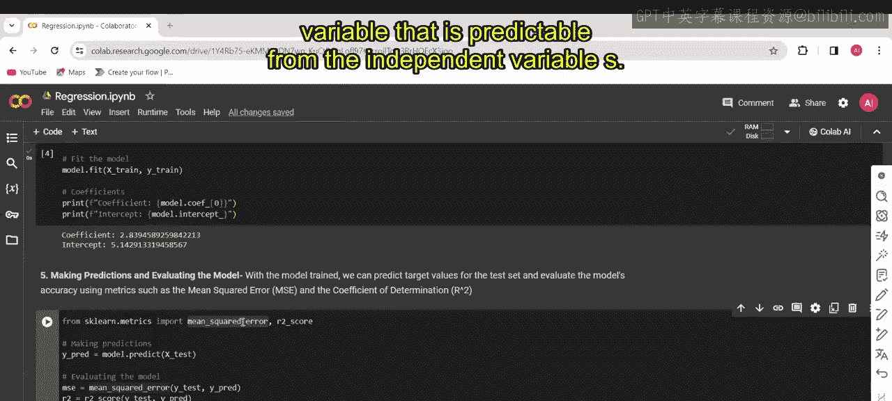

The overall quality of the model's prediction lower MSc values indicates that the models predictions are closer to the actual values and then R square the R square score measures the propagation of variance in the dependent variable that is white test that is predict from the independent variable that is expressed It indicates how well the independent variable explain the variability of the dependent variable R square score ranges from 0 to 1 where0 indicates that the model does not explain any variable in the target variable and one indicates that the model perfectly explains the variability in the target variable in the specific case R square score approximately is equal to 0。

8740 It indicates that the model。😊，plainplains around 87。

40 percentage of the variance in the target variable。

 which suggests that the model provides a reasonably good fit of the model means lower MS values and higher askqua values indicates better performance of the regression model these metrics help assess the accuracy and effectiveness of the model in making predictions。

 Now let's visualize it。 this code visualizes the synthetic data。

 the trained regression line and the actual versus predicted values on the testing data。

 This visualization provides a clear understanding of how well the model fits the data and makes predictions so now here is the outcome you can see so that is all about the regression problem statement means overall the aim is to introduce about the simple regression model like。

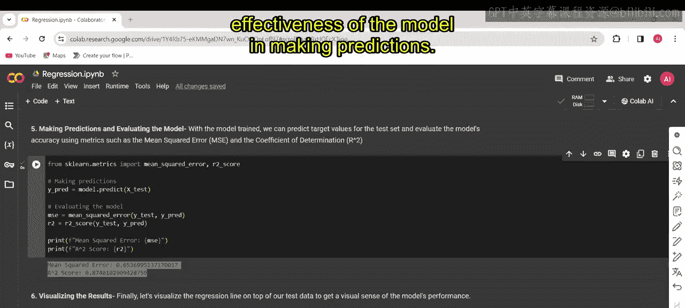

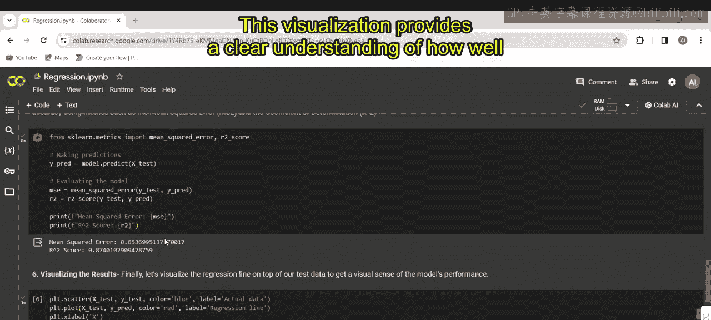

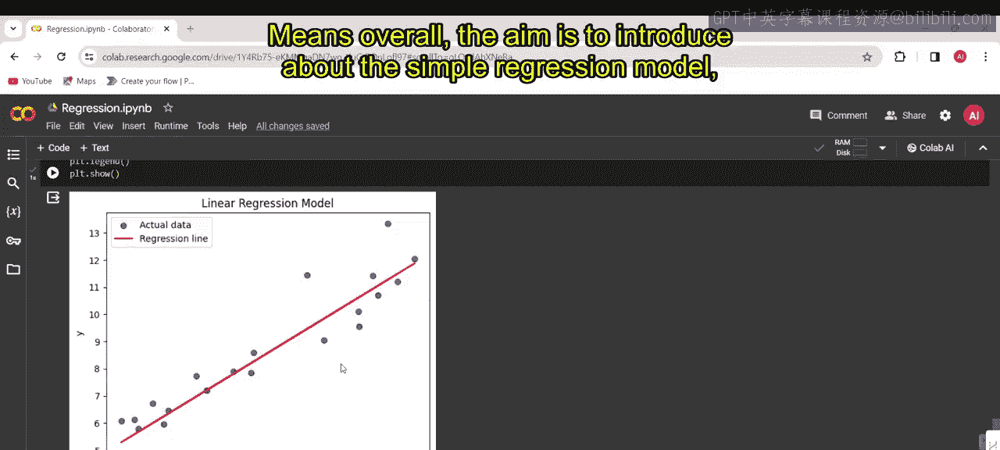

How it is going to work and how it is going to make the predictions and all。 Thank you。

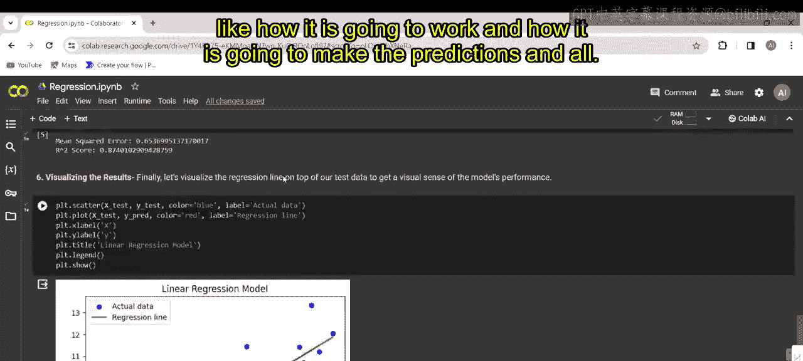