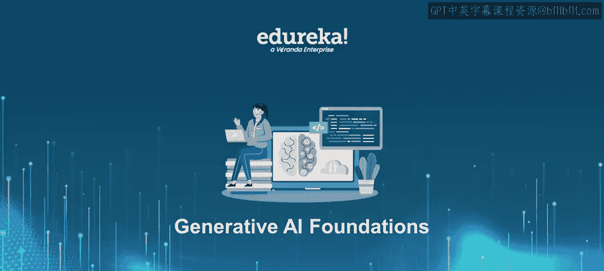
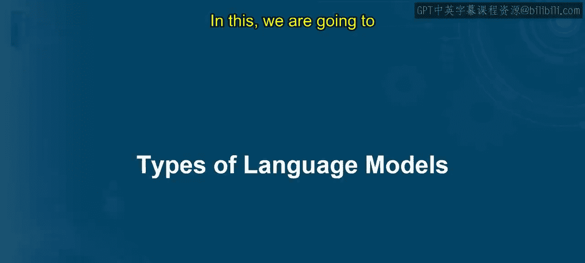
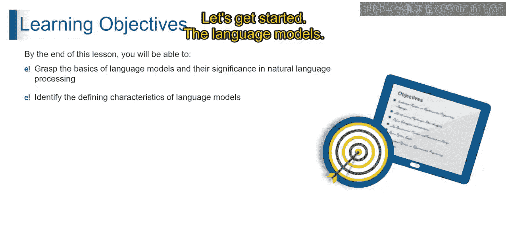
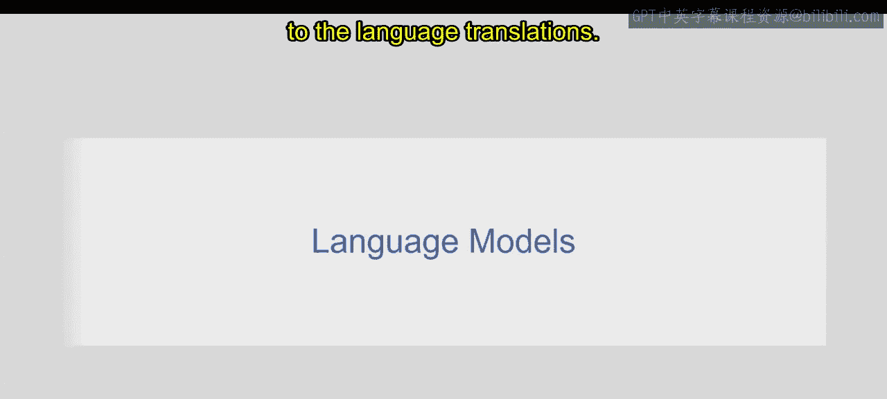
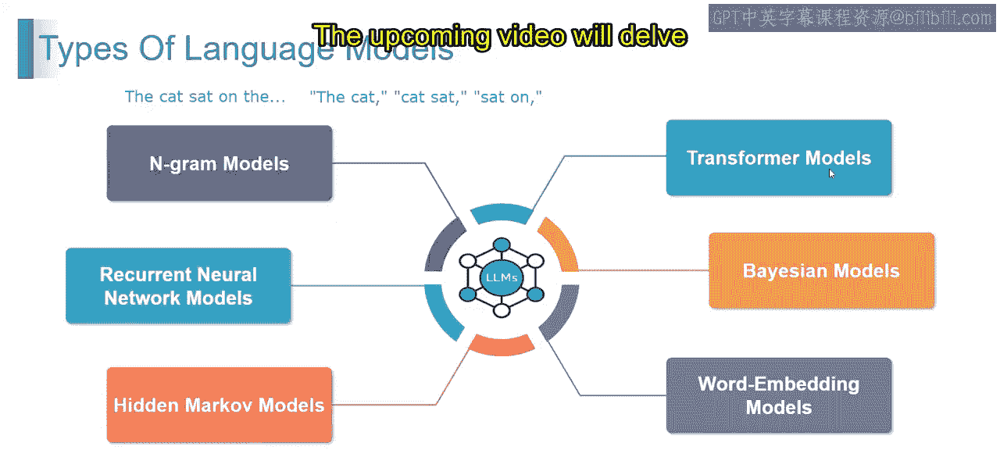

# Edureka《通过LLMs学习生成式AI（基础、应用开发、流行工具，第2、3、4课／共4课）｜Learn Generative AI with LLMs》中英 - P28：27_语言模型的类型.zh_en - GPT中英字幕课程资源 - BV1ym421V7gx

So now let's understand the types of language models in this we are going to cover the different language models by the end of the session you are able to understand the basics of language models and the significance in language natural language processinging and then you are able to identify the defining characteristics of the language models so let's get started the language models。

😊。

Language models are computational models designed to understand。

 generate and predict human language They play a pivotal role in various applications from chat wordss to the language translations。

 Now let's understand its different types of language models。

 The first one is of Ngram models Ngram models are a foundational concept in natural language processinging offering a structured way to understand and generate the text So let's delve into this concept step by step Imagine you are reading a sentence the cat sat on the in Ngram model you can take n is equal to whatever the number you want you may choose one2 or three or many more for example。

 in our case， let's say n is equal to two two means two gra it is also known as bygram。

 it would focus on pay of consecutive words。 so for this sentence。😊。

It would consider the cat CAd S sat on and so forth means Ngram models analyze the sequence of n items of n words in a given text predicting the likelihood of the next item based on the preceding n minus1 items are bygram example illustrates the essence of capturing dependencies between the adjacent words。

 So what are the different applications of this Ngram models then So there are so many applications language modeling speech recognition spell shaking。

 So there are still this Ngram model is having some limitations the limitations are limited context。

 sparse data issues and lack of semantic understanding So the ingram models have a finite window of context struggling with long term dependencies in a language and as n increases。

 the occurrence of specific ngrams diminisher。Leading to sparse data problems。

 these models may not capture deepest semantic relationship between the world。

 So that's about Ngram models means the ingram models provide simple yet powerful framework for language analysis as for language analysis that's about ingram models So now let's understand RNN regular neural network models RNs as formidable tools for tasks evolving sequential dependencies such as language understanding translation and speech recognition means the architecture empowers RnN to capture and leverage information from entire input sequence making them proficient in handling the sequential data So coming to the applications of the RNN it can be used in natural language understanding language translations and speech recognition。

 but still it is also having some limitations the first one is of short term。😊。

RNs encounter challenges in retaining information over extensive sequences。

 posing limitations for tasks with prolonged dependencies。

 Then the next limitation is vanishing and exploding gradients training rNs may face issues with vanishing or exploding gradients。

 impeding effective learning then difficulty in capturing long term depends despite internal me RNNs might struggle to effectively capture relationships between the elements separated by substantial sequences。

 so that's about the rNs Now let's understand the hegem hidden markover models。

 It is a powerful framework for understanding and modeling the sequential data。

 so hegems are probabilistic models designed to present the systems that evolve over the time where the observed data is a result for of underlying hidden states Think of hegems as。

😊，ry tellellerers of sequential patterns where each state generates observable outcomes and transitions between the states dictate the narrative flow。

 Imagine whether men predicting the weather condition daily the weather。

 which is a hidden state in our case influences the observable Even like ray or sunshine。

 Similarlyly in hegems hidden states influence observable outcomes and transitions between the states mimic the dynamic nature of the process。

 Hegems excel in scenarios where understanding the hidden structure between the observable data is crucial。

 such as speech recognition， bioinformatics and natural language processing。

 the elegance of hegems lies in their ability to model sequences and make predictions based on the underlying hidden states。

 So coming to the applications of the hegems， they can be used in speech recognition。😊。

Bioinformation like ina sequence analysis， HMM's model。

 hidden biological states influencing observable sequence then it is also used in natural language processing but still it is also having some limitations like assumption of stationity means HMMs assume that the underlying processes are stationary which might limit their effectiveness in dynamic environment and the next one is of difficulty in capturing long- term dependencies so similar to other sequence models HMMs may face challenges in capturing dependencies over extended sequences then the sensitivity or initialization the performance of HMMs can be sensitive to the initial parameters requiring careful tuning so that's about HMM then the next one is of transformer model so the upcoming video will delve further into the ongoing discussion。

😊。

