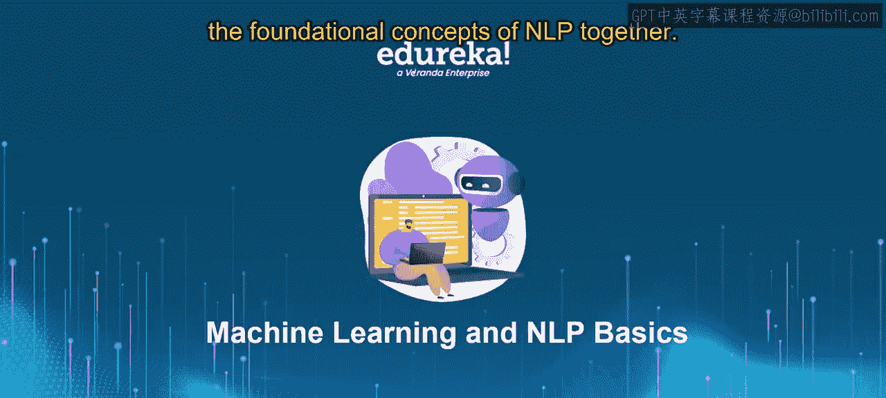
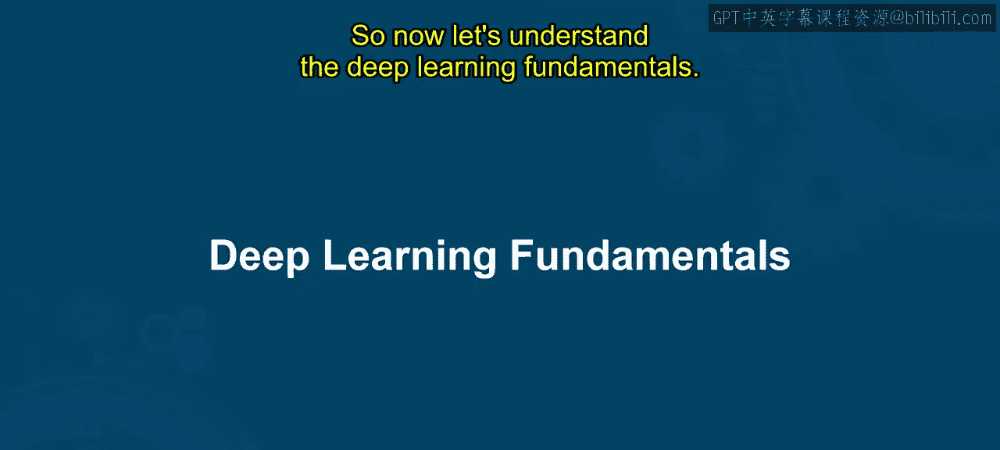
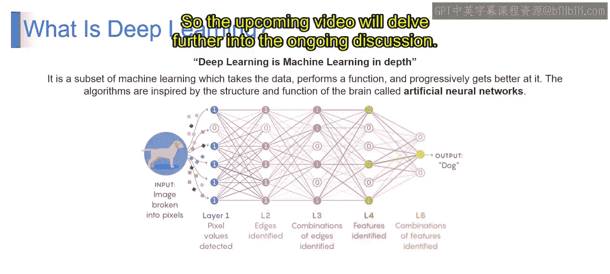

# Edureka《通过LLMs学习生成式人工智能（机器学习和NLP基础，第1课／共4课）｜Learn Generative AI with LLMs》中英字幕 - P29：28_深度学习基础.zh_en - GPT中英字幕课程资源 - BV1q4421Q7qh

Hello everyone， let's dive into the captivating world of machine learning and the foundational concepts of NLP together。

 So now let's understand the deep learning fundamentals in this we are going to cover what is deep learning and what is the main difference between the machine learning versus deep learning By the end of this session you are able to understand and analyze the concepts of what is deep learning and you are able to learn how deep learning differs from machine learning So let's get started understanding the deep learning first of all。

 before understanding how exactly it works and all。 first of all。

 what is definition So deep learning is a subset of machine learning where artificial neural networks inspired by the structure and function of the human brain。

 So the learn from the large amount of the data It's particularly powerful for tasks like image and speech。

😊。

ognition natural language processinging and decision making for example imagine you want to build a system to recognize the handwritten digits in deep learning you would train a neural network using a large data set of images of handwritten digits along with their corresponding label means the digit they represent the neural network learns to identify the patterns in the images such as shapes and curves that make up each digit Btrain the network can accurately recognize handwritten digits in new unseen images technically deep learning involves training neural networks with many layers hence the term called deep to automatically learn representations of the data at multiple levels of abstraction These networks use techniques like back propagation and gradient descent to iteratively adjust their parameters。

Weights and biases until they can accurately perform a given task so that is all about the deep learning so now let's understand by deep learning here the first situation is no manual feature engineering means in traditional machine learning engineers often spend a lot of time handcrafting features from the raw data to make it understandable fur algorithms deep learning eliminates much of this manual effort by automatically learning relevant features from the data during the training process for example。

 in image recognition tasks， deep learning models can automatically detect edges shapes and textures without explicit instruction then the next one easezo ability to handle large amount of the data so the deep learning models are capable of handling vast amount of the data efficiently with the advent of big data。

😊，Where datas are often massive and complex deep learning Excels due to exccalalability it can extract meaningful insights from the large data sets which might overwhel traditional machine learning approaches or algorithms then the next one is of high performance and accuracy so deep learning models are also known further ability to achieve highle of performance and accuracy especially in complex stars such as image recognition natural language processing and speed and speech recognition these models can capture intricate patterns and relationships within the data leading to superior performance compared to the traditional approaches for instance considering scenario where you are building a system for sentiment analysis of customer reviews deep learning models can automatically learn the shared features from the text。

😊，ta such as sentiment la words and phrases resulting in more accurate predictions compared to manually engineered features used in traditional machine learning models Now here is the pictorial representation So as I mentioned it is a subset of machine learning which takes the data performs functions and progressively gets better at it the algorithms are inspired by the structure and the function of brain called artificial neural networks here we have a pictorial representation the computer first break down the picture into tiny dots called pixels here we are taking the picture as dog image here you can see the tiny dots Then in the next step we are spotting basic shapes means in the first layer it looks further simple things like lines and curves。

 then building complexity as information goes through。😊，layers it combines those lines and curves。

 find edges and shapes， then recognize the features so the deeper the layer it will start recognizing the bigger the paths means like eyes and even ears then once it is done it will put all together means by putting these paths together it figures out of its seeing a dog so deep learning gradually learns to understand pictures by breaking them down into simpler pieces and combining them to make sense of what it is seeing So that is how it will perform the task So the upcoming video will delve further into the ongoing discussion。

😊。

