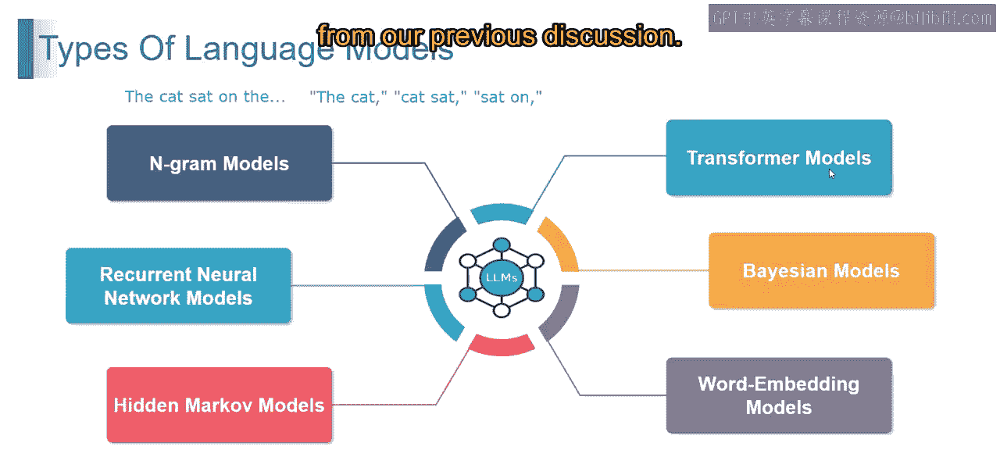
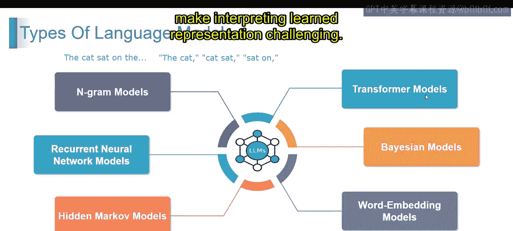
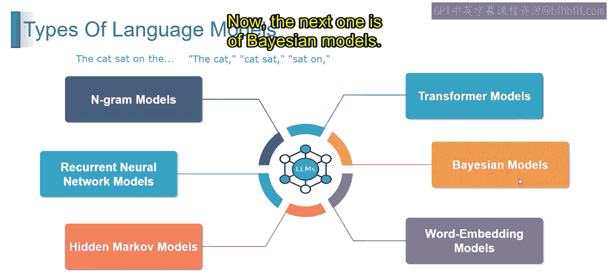
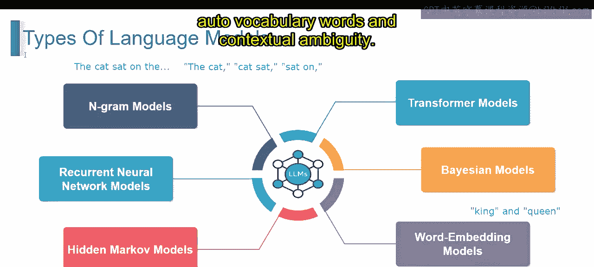
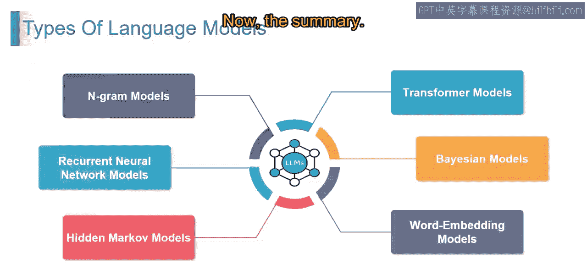
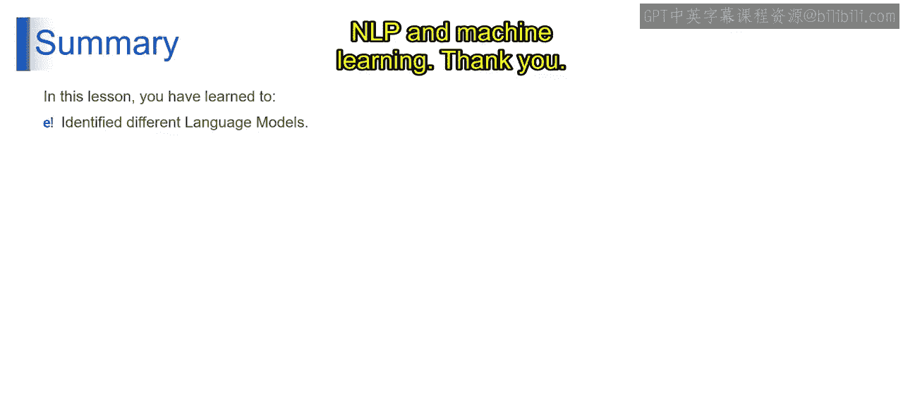

# Edureka《通过LLMs学习生成式AI（基础、应用开发、流行工具，第2、3、4课／共4课）｜Learn Generative AI with LLMs》中英 - P29：28_迁移模型.zh_en - GPT中英字幕课程资源 - BV1ym421V7gx

So let's now explore the progression from our previous discussion Transformer models represent a novel neural network architecture designed for sequential data processinging relying on the self-atten mechanism to capture contextual relationship unlike traditional sequence model Transers leverage parallelization and attention mechanism for effective and efficient learning。

 so picture a classroom where each student pays attention to others based on relevance Transers operates similarly with each element in a sequence attending to other based on the significance the self-ed mechanism allows transformers to understand contextual depends effectively Transers have reshaped NLP tasks natural language translation and various sequential applications by capturing the longrange dependencies。

😊。

and contextual nuances， the unique attention mechanism enables transformers to excel in scenarios where understanding relationships across the entire sequence is paramount So coming to the applications of the transformer model。

 it is used in the natural language processinging and image processinging and speech recognitionogni。

 So some there are advantages also because of its parallellyization。

 Transers used in acceleratingating the training compared to the sequential models and it will be able to capture long range dependencies and verility。

 Transers exhibit this verility versatility excelling in various domains beyond NLp techniques。

 so but still it is also having some limitations computationally complex So transformers can be computationally intensive。

 especially for large models and data sets and interpretpreability， the complex nature of。😊。

Selfattention mechanism can make interpreting learned representation challenging So that's about transform models。

 Now the next one is of pasian models pasian models are a class of statistical models that incorporate biasian inferences allowing for the qualification of uncertainty in representing benefits as probability distributions Unlike the deterministic models。

 Biasian models provide a framework to update beliefs based on new evidences making them adaptive and robust pasian models excel in scenarios where uncertainty plays a very crucial role such as medical diagnosis risk assessment and decision making the elegant interaction of pasian interface allows these models to update predictions as new information becomes available So there are some applications of these biasasian models like medical diagnosis。

😊。

Risk assessment and decision making and what are the advantages by using this So uncertainty qualification。

 adaptability to new evidence and robustness in small the sitting but still we are having some challenges here computational complexity and subjectivity in prior selection so that's about by Asian models then the last one is word embedding models so word embedding models are techniques in NLP that map words into multidimensional vectors positioning words with similar meaning closer together so imagine words as points in a high dimensionional space where proximity signifies semantic similarity So picture words as points on a map in word embeddings words with similar meanings are like neighboring cities reflecting semantic closeness for instance in the embedding space the words like king and queen would be spatially。

😊，Due to the semantic relationship means the word embeddings revolutionize the language processing by capturing the semantic shades allowing models to understand the relationships and context between the words the vectors associated with these words encode semantic information providing a powerful foundation for tasks like sentiment analysis and language translations the applications for this is sentiment analysis language translation information retrieval and the advantages the semantic richness word embeddings capture semantic relationships enabling models to understand context and meaning and dimensionality reduction and transfer learning but still it is also having some challenges like out of vocabulary words and contextual ambiguity so that's about word embeddings。

😊。

Now the summary in this lesson we covered a spectrum of language models each offering a unique perception on browing and generating human languages from the sequential mastery of RNANN to the transformative probabilities of transformer until up to word embeddings we gained insights into the versatile toolkit these models provide for NLP and machine learning。

 thank you。😊。

