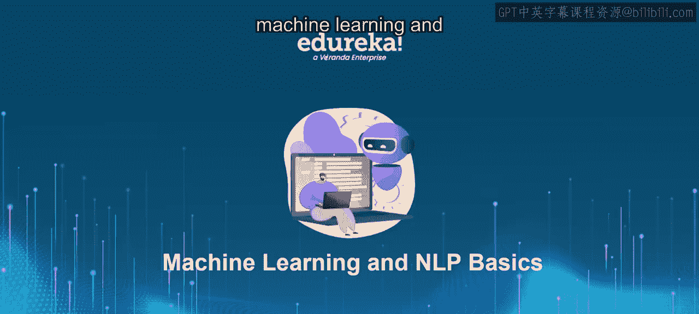
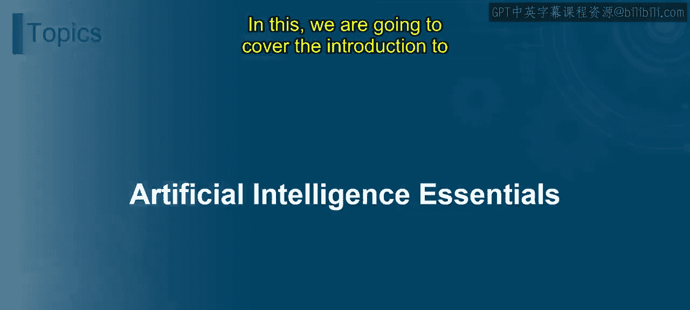
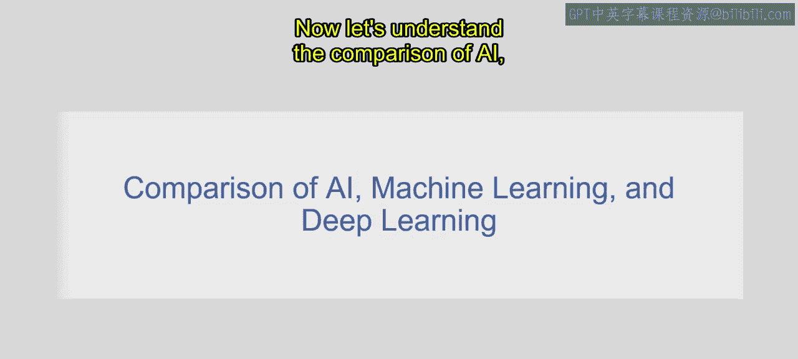
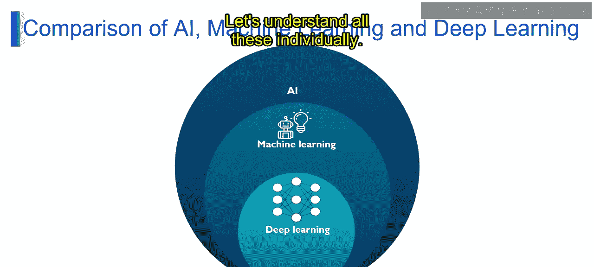
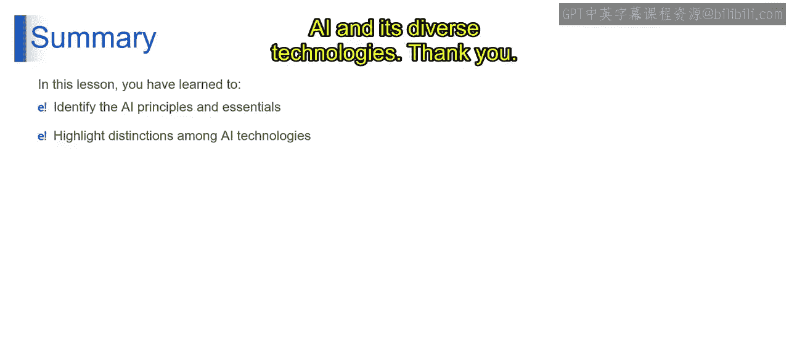

# Edureka《通过LLMs学习生成式人工智能（机器学习和NLP基础，第1课／共4课）｜Learn Generative AI with LLMs》中英字幕 - P2：1_人工智能基础.zh_en - GPT中英字幕课程资源 - BV1q4421Q7qh

Hello everyone， let's dive into the captivating world of machine learning and the foundational concepts of NLP together。

 So first， let's understand the most important topic。

 the artificial intelligence essentials in this we are going to cover the introduction to artificial intelligence essentials and the comparison of AI MLl and deep learning By the end of this session。

 you are able to understand。😊。

Haveb to apply the fundamental concepts of artificial intelligence and articulate the distinctions between the AI。

 ML and the learning， so let's get started introduction to artificial intelligenceEssentials。😊。

Imagine you are chatting with a customer service representative online sometimes that person might actually be a chatbo that should be an AI power program designed to understand your questions and provide a helpful response these chatbos are trained using the vast amount of the data to recognize the patterns in human language and respond accordingly means artificial intelligence is a branch of computer science that focuses on creating systems that can perform tasks that typically require human intelligence these tasks include things like problem solving understanding language recognizing patterns and making the decisions in this example of chatbo the AI behind them is designed to mimic the human conversations by analyzing and interpreting the user input。

😊，And generate the responses accordingly this involves several technical concepts。

 especially artificial intelligence has four main capabilities。 Those are learning， reasoning。

 problem solving and perception when we say learning AI systems learn from the data using the algorithms to spot patterns and gain the insights。

 This helps them improve over time without explicit programming。

 then coming to the reasoning AI can reason and draw the conclusion or the logical conclusion from the available information。

 enabling it to make informed decision and solve complex problems based on the rules and the data。

 then coming to the problem solving AI Excel set solving difficult problems across the various domains by leveraging algorithms and computational techniques to optimize the processes and find the solutions。

😊，Then coming to the perception， AI systems can perceive and interpret sensory data like humans too。

 techniques such as computer vision and natural language browing enable them to understand and interact with the world。

 enabling applications like autonomous vehicles and virtual assistants。😊。

So now let's understand the comparison of AI ML and deep learning so first here is the representation ML and deep learning are part of the AI so let's understand all these individually first of all the AI AI refers to the broader field of computer science aimed at creating system capable of performing tasks that typically requires human intelligence these tasks include recognizing objects in the images understanding natural language and making decisions based on the complex data for example AI enable smart voice assistance like Amazon's Alexa Apple Siri or Google assistant which allows users to control home appliances play music set reminders and answer questions using the natural language commands then the next one is machine learning so machine learning is a subset。

😊。

Of AI focused on developing algorithms that allow computers to learn from the data and improve their performance over the time without being explicitly programmed。

 for example， in image recognition an ML algorithm could be trained on the data containing thousands of labeled images of cats and dogs through exposure。

To these examples， the algorithm learns to differentiate between the cats and dogs based on the features such as shapes。

 colors and even the textures。 So that's what the machine learning coming to the deep learning。

 deep learning ease subfilled of machine learning that utilizes artificial neural networks with multiple layers they are also known as deep architectures to learn the complex patterns and representations from the data。

 For examples， chatbos leverage deep learning techniques to provide conversational interfaces for interacting with the users means Debased chatbos such as those used by customer service departments or virtual assistance on the website employ deep learning networks to understand and generate the humanlike responses to user queries。

 inquiries and requests the。😊，ly learn from the interactions to improve their conversational abilities and provide more accuratecurate responses over the time In this example。

 AI encompasses the broader goal of creating intelligent systems while Ml and deep learning represent specific approaches within the AI toolkit for achieving the tasks like image recognition Ml focuses on learning from the data to improve the performance while D employees。

 deep learning networks to learn complex patterns and representations directly from the raw data。

 Now， the summary， in this lesson， you have gained insights into the principles and essentials of AI。

 including its goals and fundamental concepts Additionally。

 you have learned to distinguish between the various AI technologies such as artificial intelligence。

 machine learning and deep learning understanding。😊。

roles and applications in solving real world problems。

 This knowledge equiates you with a foundational understanding of AI and its diverse technologies。

 Thank you。😊。

