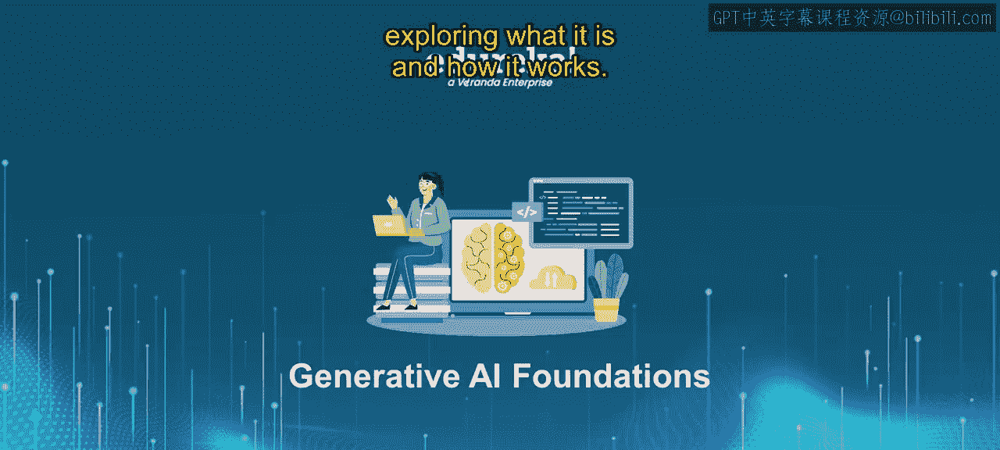
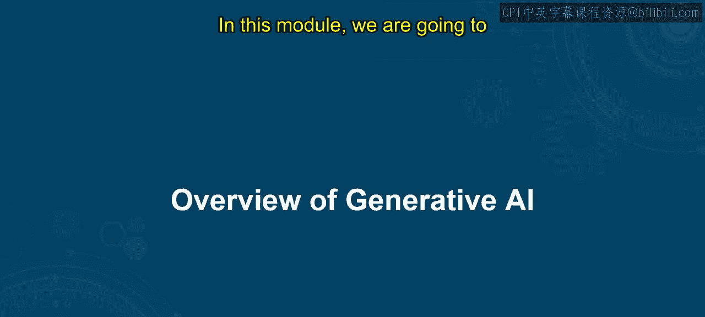
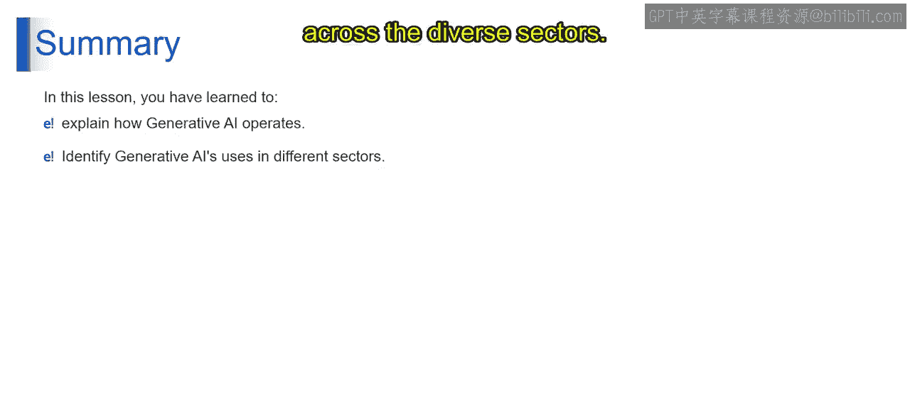

# Edureka《通过LLMs学习生成式AI（基础、应用开发、流行工具，第2、3、4课／共4课）｜Learn Generative AI with LLMs》中英 - P2：1_生成式AI概述.zh_en - GPT中英字幕课程资源 - BV1ym421V7gx

Hello everyone， welcome to Generative AI Foundations。So in this。

 we will dive into the fascinating worldbe generative AI exploring what it is and how it works。

 So let's get started In this， the first module is of overview of generative AI in a world filled with various technological advancements。

 Why is generative AI stealing the spotlight。 So let's explore the reasons behind the overhype and understand why am the plethora of technologies generative AI has emerged as a front runner in the global attention Now let's understand the immense hype surrounding this generative AI why is the world so captivated by this technology and what makes it a game changer So let's uncover the excitement together in this module we are going to cover the introduction to generative AI by the end of this session you are able to understand and recognize the different generative AI techniques and capabilities in creative。

😊。

Content generation。 So let's get started。 The introduction to generative AI generative AI stands out for its unparleled creative process。

 crossing industry boundaries with humanlike capabilities in art， music and content creation。

 its adaptability feelss global interest， promising innovation in various fieldss。

 the technology's revolutionary personalization caters to individual preferences。

 making it a key player in the quest for human centric experiences。

 The constant evaluation and innovation in generative AI maintain an atmosphere of anticipation for groundbreaking advancements beyond this technology tool it addresses societal challenges。

 offering solutions in medical research and environmental concerns。 Also， this dynamic nature。

 coupled with its potential for positive global impact。😊。

Contributes to the overhype and captures imaginations worldwide。

 So now let's understand the technical definition of what is generative AI。

 So what exactly it is in simple terms， generative AI refers to artificial intelligence applications that have the incredible ability to generate new and diverse content。

 This could include anything from text and images to music and even the code also。

 what makes it truly remarkable is its capacity to produce content that often appears indistinguishable from what humans create。

 So to better grasp this concept， let's consider a practical example Now。

 let's understand the key aspects of the generative AI。

 These aspects play a very important role in understanding how generative AI achieves its incredible feeds。

 So let's jump right in The first one is of complex。😊。

Models think of these as brain power behind generative AI。

 Imagine a neural network with layers and layers of interconnected nodes， much like human brain。

 These complexity allows the AI to capture intricate patterns and details from the data it learns。

 technically， these complex models refers to sophisticated neural networks。

 often using architectures like Gs， which is nothing but generative adversarial networks or LsTam。

 which is nothing but long short term memory。 These models enable generative AI to understand and replicate the content it's exposed to during the training process。

 So that's about the complex models。 Now let's talk about the innovative output。

 Generative AI is not just about replicating。 It's about creating something new and innovative picture an AI system generating。

😊，A piece of art or music that pushes the boundaries of what we have seen before means this aspect aligned with the AI's ability to not only mimic existing patterns。

 but also generate novel and creative outputs。 The complexity of the models allows generative AI to explore and experiment producing content that goes beyond what it has seen in its training data。

 So that's about innovative output。 Next on our list is large data sets。

 think of these as fuel for generative AI。 the more diverse and extensive the data。

 the richer the AIs understanding and consequently， the more impressive its output absolutely。

 So technically， large data sets are essential for training generative AI models effectively these datasets serve as the foundation providing the AI with vast array of examples to learn from。

😊，Helping it generalize and create content that captures essence of the data。

 So that's about large data sets。 Now let's talk about tailored content。

 generative AI is not a one size fits all tool it can be trained to generate content specific to s styles。

 generates or themes。 It's like having a personal assistant that understands your preferences and creates content accordingly means this involves fine tuning the AI models to produce content that aligns with specific criteria through targeted training。

 generative AI becomes capable of tailoring its output to meet specific requirements showcasing its ability to customization capabilities So that's about tailored content Now let's delve into the ethical considerations while generative AI opens up exciting possibilities it also brings about ethical challenges。

An AI system generating content that could potentially be used maliciously or for unethical purposes also means from a technical standpoint。

 ethical considerations evolve building safeguards and responsible AI practices into development process This might include implementing mechanisms to prevent the generation of harmful or inappropriate content and ensuring transparency in how AI systems operate。

 Then the last but not the least that is scalability scalability refers to the ability of generative AI models to handle increased complexity and workload。

 This involves optimizing algorithms and infrastructure to ensure that the AI can scale up its performance as the demands on the system grow means these key aspects provide holistic view of what makes generative AI。

😊，From the intricacies of its model to the ethical considerations and scalability。

 each element plays a vital role in shaping the capabilities and impact of generative AI。 In summary。

 we explore how generative AI operates leveraging complex models， innovative output。

 large data sets and tailored content creation。 So we highlighted key aspects。

 along with multiple features and followed by key considerations and scalability as crucial aspects。

 Additionally， we covered its practical applications across the diverse sectors showcasing generative AIs transformative potential in just few lines。

 Thank you。😊。

