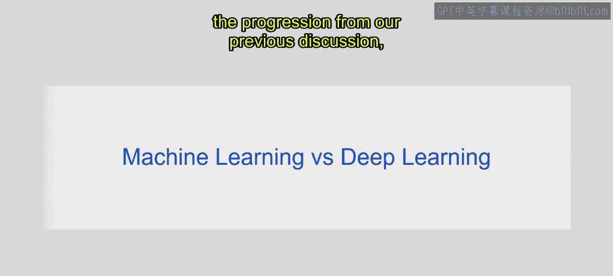
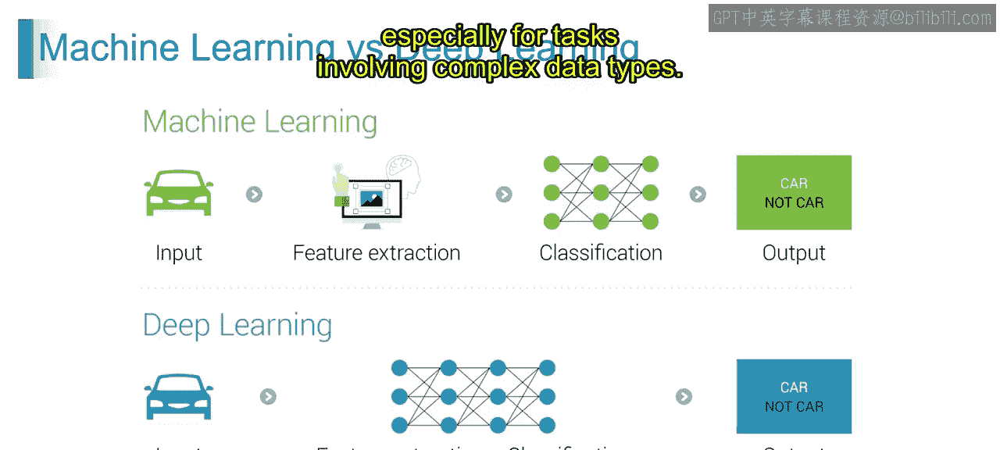
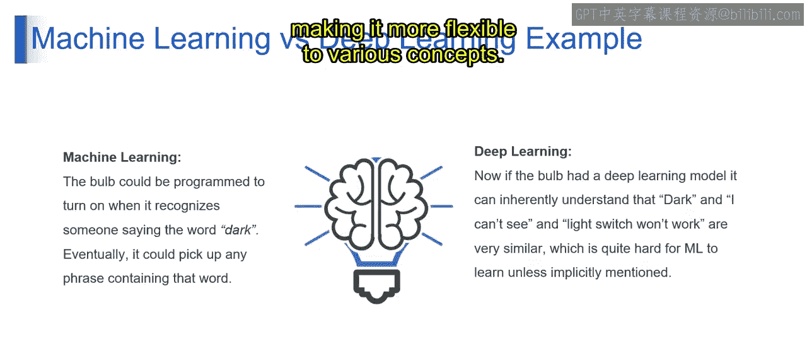
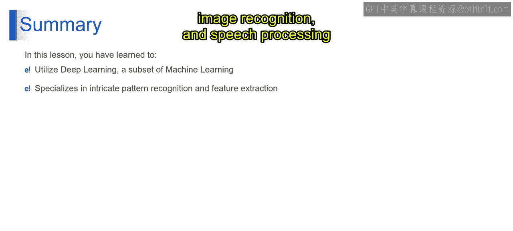

# Edureka《通过LLMs学习生成式人工智能（机器学习和NLP基础，第1课／共4课）｜Learn Generative AI with LLMs》中英字幕 - P30：29_机器学习vs深度学习.zh_en - GPT中英字幕课程资源 - BV1q4421Q7qh

So let's now explore the progression from our previous discussion then machine learning versus deep learning so machine learning generally relies on handcrafted features and the sampler models suitable from smaller data sets and tasks with well-defined features coming to the deep learning it utilizes neural networks with multiple layers to automatically learn hierarchical representations of the data excling with large data sets and complex tasks involving unstructured data like images and text so now let's understand it with this example here we are having the machine learning and deep learning here in both the cases the input is going to be the car in traditional machine learning you start with input data such as images of car so in the feature extraction process engineers manually select or design the features。

😊。

That they believe are relevant for the tasks at hand。 for example。

 in the case of recognizing cars and images， these features might include the presence of the wheels。

 windows and specific shapes， then coming to the classification once the features are extracted machine learning algorithms use them to classify the input data into predefined categories such as car or not car common algorithms used for the classification in Ml include logistic regression。

 support vector machine and decision trees。 Now the output whether if it is of car or not car final output of the machine learning model is a prediction or classification of the input data based on the extracted features。

 For example， if the features extracted from an image。

 indicate the presence of the wheels Windows and car like shape。😊。

The model might classify it as a car then coming to the deep learning here the input is going to be the car image similar to ML deep learning also beginss with the input data such as images of the car then here feature extraction plus classification can combine together means however in deep learning the process of feature extraction and the classification is combined into a single step instead of manually selecting the features。

 deep learning models automatically learn relevant features directly from the raw data during the training process then the output once the data is trained the deep learning models can directly provide the predictions or the classifications based on the learned features it does not inquire explicit feature engineering like in traditional machine learning model。

😊，🤢，Means while both machine learning and deep learning aim to make predictions or classification from the data。

 deep learning distinguishes itself by automatically learning features from the data。

 making it more flexible and often more powerful， especially for tasks involving complex data types。

😊。

So now the machine learning versus deep learning machine learning requires explicit programming of rules and features。

 for instance， to make a bulb turn on when it hears the word dark the ML system would need to be explicit programmed to recognize that specific word are the phrase while it can learn to recognize the exact phrase of dark it may struggle to generalize similar phrases like I cannot C without additional explicit programming in the essence machine learning relies on predefined rules and features to make the decisions then coming to the deep learning deep learning inherently learns features from deep learning inherently learns features and patterns from the data with the deep learning model the bulb can learn to associate various phrases with darkness without explicit programming。

😊，For example， deep learning model can understand that phrases like I cannot see or light switch won't work。

 convey we similar meaning to dark deep learning Excels at capturing complex relationships and can generalize well to unseen variations of the input data in the essence。

 deep learning can learn implicit relationships and the patterns directly from the data。

 making it more flexible to various concepts。 Now， the summary， in this lesson。

 you have discovered how deep learning a subset of machine learning Excels in indicatetricate pattern recognition and feature extraction making it adept at understanding complex relationships in data without explicit programming by leveraging deep learning。

 you can unlock the capability to tackle the sophisticated tasks such as natural language understanding。

😊。

Image recognition and speech processing with greater efficiency and accuracy。 Thank you。😊。

