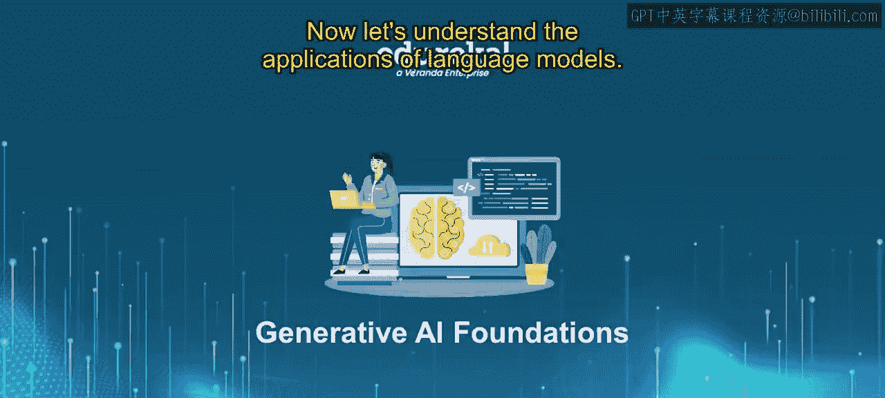
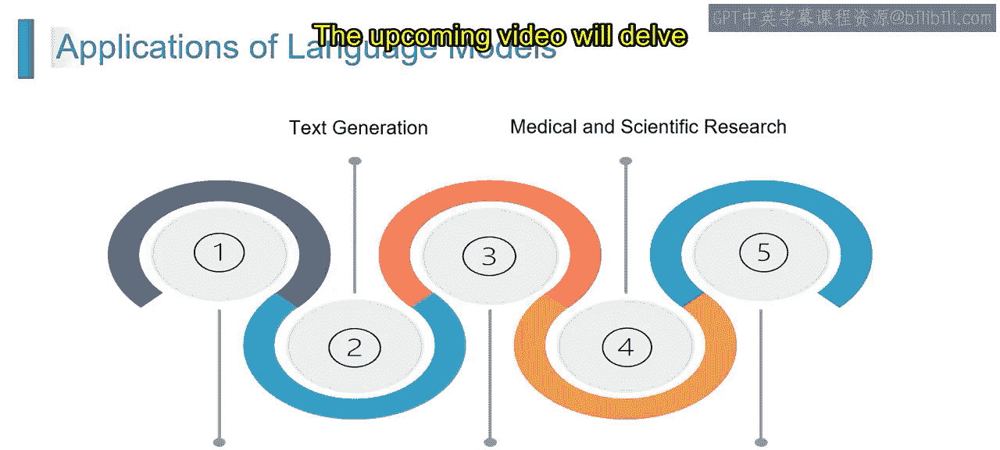

# Edureka《通过LLMs学习生成式AI（基础、应用开发、流行工具，第2、3、4课／共4课）｜Learn Generative AI with LLMs》中英 - P30：29_语言模型的应用.zh_en - GPT中英字幕课程资源 - BV1ym421V7gx

Hello everyone welcome to Generative AI foundations so now let's understand the applications of language models in this session we are going to cover the applications of language models and by the end of this session you are able to understand the practical applications of language models in the various fields so let's get started the applications of language models。

😊。

These language models revolutionize industries， enhance user experience and contribute to the ever evolving landscape of artificial intelligence。

 There are multiple applications here。 The first one is of conversational AI and chatbo conversational AI is a subset of artificial intelligence focused on enabling computers to understand。

 interpret and respond to human language in natural and contextual ways chatbos are applications of conversational AI designed to simulate conversation with users providing information assistance or performing tasks through textual or spoken interactions。

 Imagine texting a virtual assistant to schedule a meeting this assistant powered by conversational AI understand your request and response initiating a dynamic conversation to finalize the details means the conversational AI leverages NLP and Ml to。

😊，Comprehend user inputs， enabling chatbos to engage in meaningful and contextually relevant conversations coming to the applications of this conversational AI chatbos。

 they can be used in customer services。 virtual assistance， ecommerce-commerce assistance。

 information retrieval and many more coming to the advantages they can be utilized 24 by7 availability and the scalability and user engagement。

 but still we are having some challenges with this。

 The challenges are understanding the context means ensuring chatbos understand and maintain context throughout a conversation can be a challenging one。

 Then the next challenge is of natural language variability。

 coping with the diversity of human language expressions and variations poses a conual challenge for conversational AI。

 So that is about conversational AI and chatbo。 Then the next one is of text generation T generation is a branch of natural language processing that。

😊，Involves using machine learning algorithms including neural networks to produce humanlike text based on given prompts or context。

 So imagine asking an AI system to generate a short story about a magical journey the AI utilizing text generation crafts and narrative with characters。

 Even and descriptive details mimicmakingking a human storyteller means the text generation algorithms analyze patterns in existing text data and learn to generate new content that aligns with the style tone and context of the training data So what are the applications of this text generation then so we can use it for content creation chatboard response。

 language translation， creative writing assistance and many more coming to the advantages efficiency and speed consistency and idea generation but still we are having some challenges with this that is contextual understanding and ethical consideration。

😊，So， when we say contextual understanding， ensuring AI models understand and generate text to with context specific relevance remains a challenging thing so that is about contextual understanding then ethical consideration addressing ethical concerns such as potential misuse for disinformation or biased content generation requires a careful attention these all are the two challenges in the text generation process。

😊，Then the next application is of languagegu translation languagegu translation involves the use of artificial intelligence and machine learning to convert text or speech from one language into another preserving the meaning context and shapes of the original content means just imagine typing a message in the English and instantly receiving a translated version in the Spanish language translation AI makes this realtime conversation possible。

 breaking down language barriers effortlessly means the language translation algorithms leverage neural networks and statistical models to comprehend and accurately reproduce the semantic meaning of text or speech in different languages So coming to the applications of this language translations they can be used for multilingual communication travel assistance global content accessibility and language learning support coming to the。

😊，addvantages， cultural exchange， business expansion and global collaboration。

 but still we are having some challenges even with the language translation also one is contextual shades means capturing and reproducing contextual shades。

 idioms and cultural expressions， expressions accurately remains a challenge for language translation models and then the next challenge is of rare language representation some languages pay some language payers may have limited training data affecting the accuracy of translation for less commonly spoken languages So these all are the two challenges when we are dealing with the language translation then the next application is of medical and scientific research medical and scientific research with AI involves the integration of artificial intelligence into healthcare and specific practices to enhance the diagnosis drug discovery personal medicine data。

😊，Alysis and other crucial aspects， AI driven technologies contribute to efficiency。

 precision and breakthroughs in medical and scientific ins coming to the applications of the medical research they can be used in the disease diagnosis drug discovery personalized medicine patient care optimization and the applications。

 data analysis and interpretation applications in the scientific research data analysis and interpretation。

 hypothesis generation， climate modeling， automated laboratory processes so these are the applications in the scientific field so coming to the advantages efficiency and speed precision and accuracy and data integration but still we are having some challenges with this that is interpretable AI ensuring transparency and interpretability of AI models in critical healthcare care and research context remains。

😊，Challenging one， then ethical consideration means so the upcoming video will delve further into the ongoing discussion。

😊。

