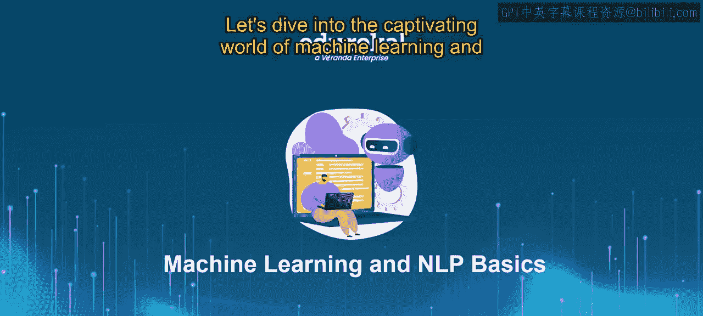
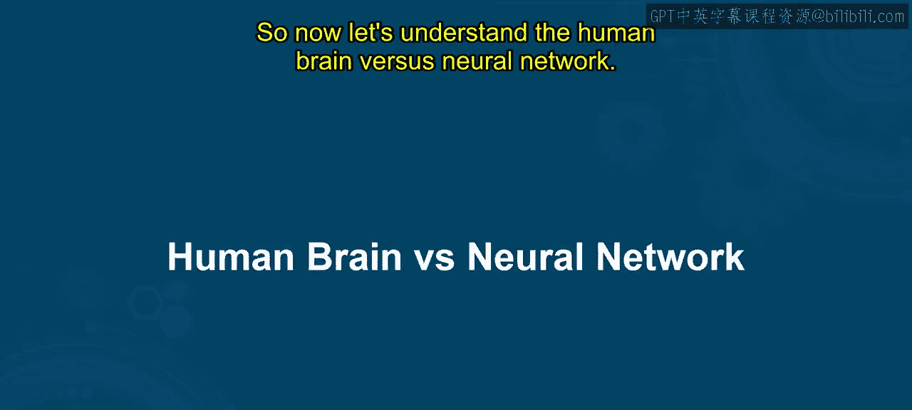
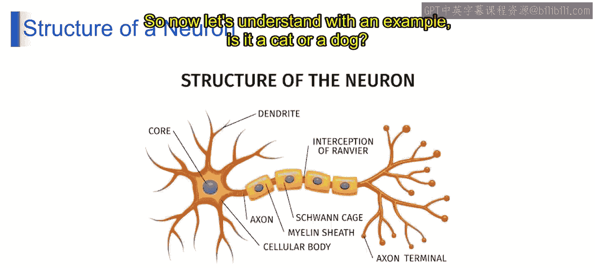

# Edureka《通过LLMs学习生成式人工智能（机器学习和NLP基础，第1课／共4课）｜Learn Generative AI with LLMs》中英字幕 - P31：30_人脑vs神经网络.zh_en - GPT中英字幕课程资源 - BV1q4421Q7qh

Hello， everyone， let's dive into the captivating world of machine learning and the foundational concepts of NLP together。

 So now let's understand the human brain versus neural network。 In this。

 we are going to cover the structure of neuron and neural network architecture。

 by the end of the session， you are able to figure out the relationship of human brain with artificial neural network and know how a neural network helps in recognizing an image。

 So let's get started。 first of all， understanding how the human brain works。

 So imagine you are learning to identify the different types of fruit。

 your brain analysis various features like color texture and shape to distinguish betweenin an apple。

 a banana and an orange， Similarlyly， a neural network， In by the brain structure can be trained on。

😊。

Images of roots as it learns， it identifies the patterns in the data to accurately classify them means technically human brain is the complex organ responsible for processing information through interconnected neurons forming intertricate networks that enable functions like perception。

 memory and decision making， Similarlyly， a neural network in the context of deep learning comprises interconnected artificial neurons organized in the layers。

 these networks learn from the data through a process called back propagation。

 adjusting weights to minimize the errors and effectively perform the tasks like classification regression and pattern recognition so while the human brain and artificial neural networks share similarities in their structure and function。

😊，They operate on different scales and principles with neural networks aiming to mimic the brain's abilities in computational tasks。

 So let's understand how exactly the structure of the neuron is going to be so it mainly consists of these parts the first one is of core the neurons genetic material acts like a parameters in deep learning models influencing its function and behavior then the next one is of dendrite。

 So similar to the input layer in the deep learning dendrites receive and process the initial signals initiating information processing then the cellular body So integration of signals in the cellular body mirrors the computation occurring in hidden layers of deep learning models where features are combined and processed Then the next one is of axon transforming signals a。

😊，To the output layer in deep learning， the axon delivers final predictions or classifications to downstream the systems。

 then myelin sheath here， like optimization techniques in deep learning the myelin shape optimizes signal transmission。

 enhancing the efficiency and the speed， then the sh cage， So providing support and production。

 this cells are akin to regular methods in deep learning， ensuring model stability and robustness。

 then the interception of ranry， it is like gaps facilitating rapid signal transmission。

 enemble activation function in the deep learning introducing nonculineity of complex computations。

 then the final one of axon terminal the new it focus on releasing the neurotransmitters axon terminal。

😊，Deliver final output， providing meaningful predictions or classifications similar to the deep learning models。

 So now let's understand with an example， is it a CA or a dog So in the traditional machine learning when determining whether an image contains a CA or a dog traditional machine learning struggles due to sheer number of features that might be relevant so manually selecting these features from a vast array of possibilities becomes impractical leading to challenges in accurately classifying the images then coming to the deep learning so here is where deep learning shines deep learning models can automatically learn and extract indicatecate features from the image data without the need for manual feature engineering by analyzing the patterns at various levels of abstraction deep learning can effectively distinguish。

😊。

The cats and dogs with higher accuracy overcoming the limitations faced by the traditional machine learning methods。

 so the upcoming video will delve further into the ongoing discussion。😊。

