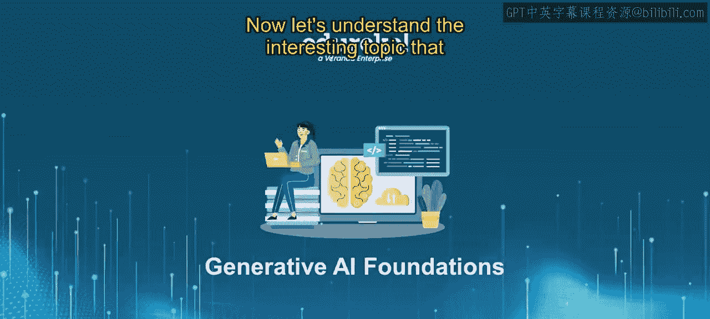
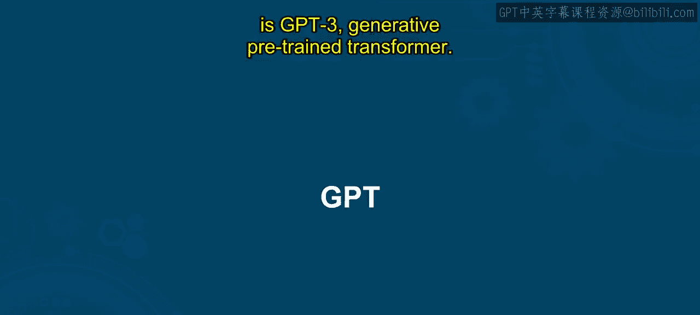
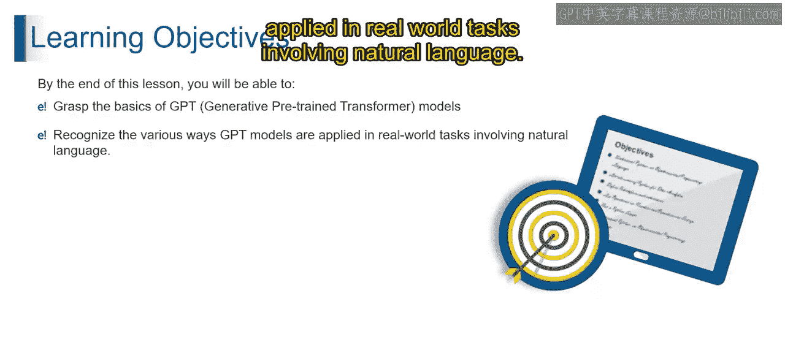
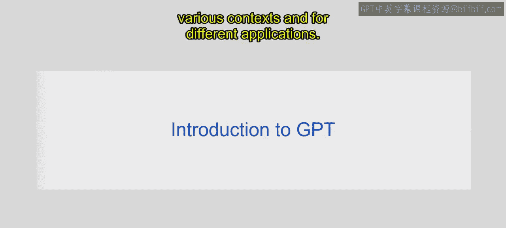
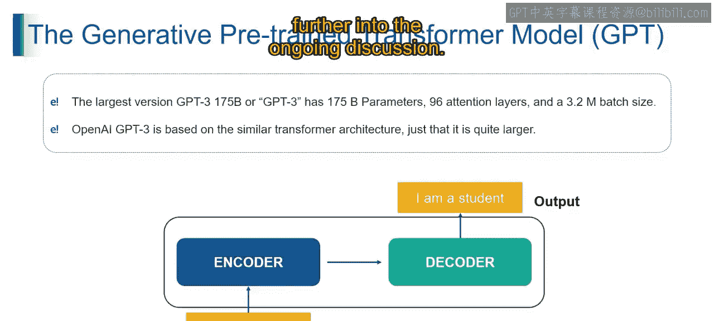

# Edureka《通过LLMs学习生成式AI（基础、应用开发、流行工具，第2、3、4课／共4课）｜Learn Generative AI with LLMs》中英 - P32：31_GPT介绍.zh_en - GPT中英字幕课程资源 - BV1ym421V7gx

Hello everyone， welcome to Generative AI Foundations。

So now let's understand the interesting topic that is GT3 generative pretrain transformer in this session we are going to understand the introduction to generative pretrain transformers and what are the different applications of it by the end of the session you are able to grasp the basics of the G models and you are able to recognize the various ways G models are applied in real world tasks involving natural language so let's get started first of all introduction to G so G with the artificial intelligence reaches new heights in the language understanding generation and comprehension the generative pretrain transformer is an advanced language model that utilizes transformer architecture and is pretrain on vast data sets to understand generate and manipulate humanlike text imagine having a conversation with an AI that not only understand。

😊。

Sts your language， but response with contextually relevant and coherrenent sentences mimicking human conversations means this G achieves language mastery through pretraining on diverse data sets enabling it to generate humanlike text in various context and with different applications。

 Now let's understand the introduction how the generative pretrain transformer model is built。

 So G is a language wizard powered by deep neural networks and cutting edge transformer architecture in simple terms G3 learns the secrets of language by understanding vast amounts of text without any direct supervision。

 The core concepts of this G3 is。😊。

The GPT was introduced by Open AI results。Means the GT is a brainchild of open AI wizard from GT1's model beginning in 2018 to the language artistry of GT2 in 2019 the saga reached its peak with a marvelous GT3 in 2020 the language superhero apt a poetry and coding GT learns by understanding vast text a into immersing oneself in language through books and conversations its impact is revolutionary enhancing chatbo and aiding writers as a super smart language champions companions as the future uns open AIs continues refining GT making a perpetual language evaluation in the essence GT is not just at all it's a dynamiclinguistic Odys shaping the future of AI language processinging here we are having the core concepts。

😊，Like transformer architecture， the transformer architecture is like a brain cell that helps G3 process and grasp the intricacies of how we talk and write and then the unsupervised learning G3 becomes a language expert by studying tons of text learning robes without someone telling it what's right or wrong and the family of models G3 is not just one model It's a whole family with various members each having a unique set of abilities that differ in the number of things they learn open AIs G3 is more than just a fancy name it's a language superhero family Each member equipped with the power of understanding and generating humanlike language It's like having an entire league of language champions ready to tackle any linguistic challenge So here is the table it provides details on each model's architecture and paramount count。

😊，Here is more information of the colossal landscape of G3。

 a language gained boasting unparalleled features， the largest version that is GP3175 fls staggering 175 billion parameters the gazes and levels orchestrating language prowess envisionvis GPT3 as a grand library with 9 to6 attention layers each acting like a superabservant librarian capturing language shades。

 its bad size of 3。2 million in aikkin to a chef handling vast ingredients at once establishing GP3 as a true language jaggant。

 GPT3 shares size grounded in the transformer architecture so the upcoming video will delve further into the ongoing discussion。

😊。

