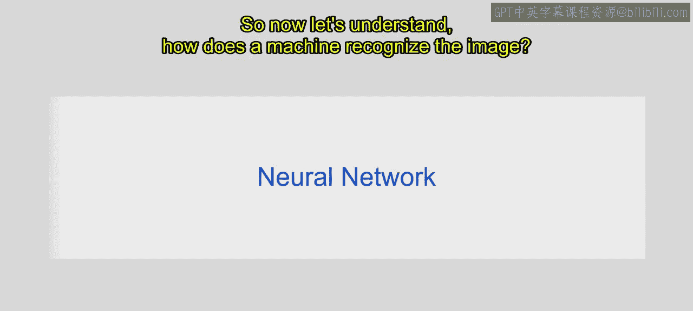
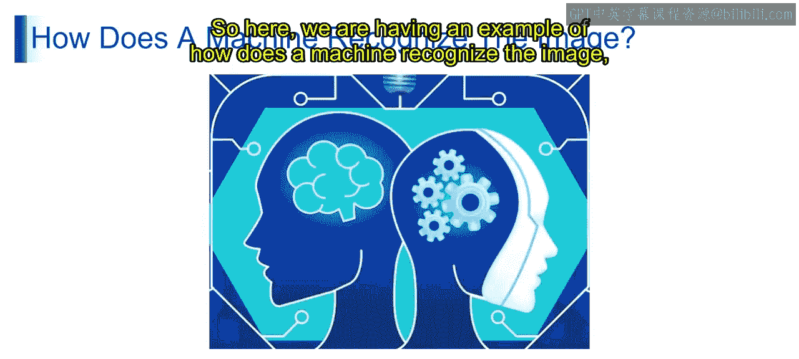
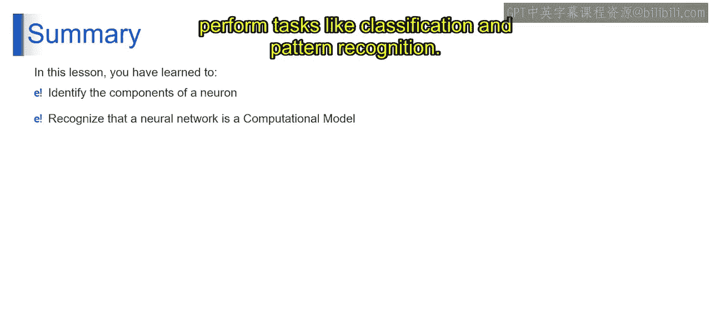

# Edureka《通过LLMs学习生成式人工智能（机器学习和NLP基础，第1课／共4课）｜Learn Generative AI with LLMs》中英字幕 - P32：31_神经网络介绍.zh_en - GPT中英字幕课程资源 - BV1q4421Q7qh

So lets now explore the progression from our previous discussion。

 so now let's understand the neural network imagine you are trying to teach a computer to recognize handwritten numbers you show it lot of images of handwritten digits along with their labels。

😊，For example， like this。Here the7 is represented as number then written in English Likewise。

 you show a lot of images of handwritten digits along with their labels。

 so now you want the computer to figure out on its own how to recognize these numbers so a neural network is like virtual brain that you train to do this task each neuron in the network is like a tiny decision maker as the computer sees more examples it adds these decision makers to get better at recognizing the digits means technically a neural network is a computational model inspired by the structure and the function of the human brain it consistses of interconnected notes called neurons organized in layers each neuron receives input signals performs a computation and generates an output signal。

😊，Learning neural networks with multiple layers learn to extract features from the raw data and make predictions or classifications through a process called back propagation the neural network adjust its parameters。

 nothing but the weights and the biases， iteratively during the training to minimize prediction errors and improve the performance So now lets understand how does a mission recognize the image。

😊。

So a machine recognizes images by using the algorithms that analyze pixel values and patterns in the image data。

 it breaks down the image into smaller components and compare them to known features or the patterns with deep learning the machines can automatically learn and extract meaningful features from the images enabling it to make accurate predictions or classifications based on the learned representations so now let's understand it with an example so here we are having an example of how does a recognize the image by the repeats of the dog cat hen rabbit or etc so the first step is going to be the training strap a neural network is trained with thousands of labeled images of animals learning to classify them based on the features then the next part is of input so here we are feeding。

😊。

image of dog， it is an unlabeled images， such as a picture of dog is represented to the pretrainer network for classification。

 then it can be sent to the first layer。 the neurons in the first layer detect the basic shapes or edges present in the images it will try to understand the shapes in the first layer。

 Then coming to the inner layer neurons in deep layers Re to more complex structures formed by combinations of the edges and shapes。

 then coming to the top layer。 the neurons in top layer represent highly abstract concepts such as specific animal features learned during the training。

 Then the last one is of output。 the network predicts the objects in the images by coming across all these first inner and top layers。

😊，And this layer or this network predicts the object in the image。

 such as identifying it as a cat or dog based on the features learned during the entire training process that is how the neural networks work so now the summary In this lesson you have grasped the components of a neuron understanding how its core denites cellular body axon and the other structures contribute to information processing Additionally you have recognized neural networks as computational models inspired by the human brain where interconnected node simulate the behavior of neurons to perform tasks like classification and pattern recognition Thank you。

😊。

