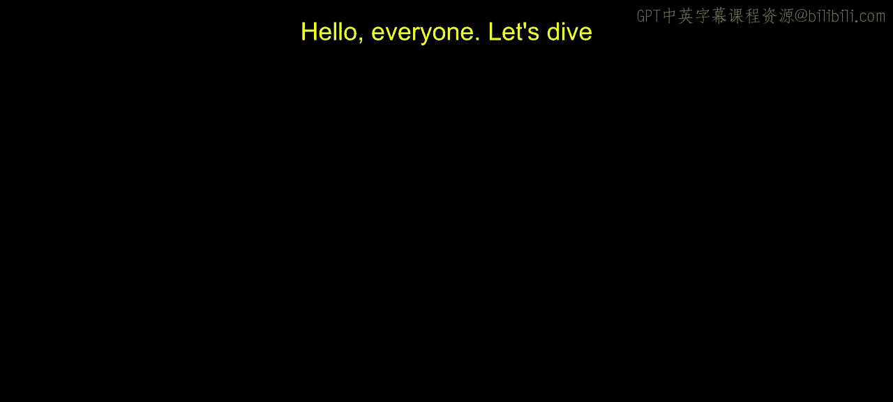
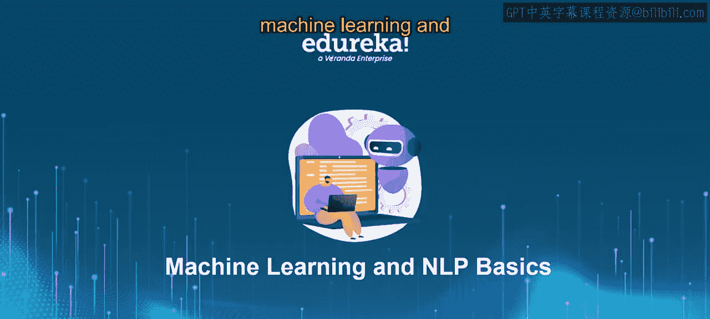
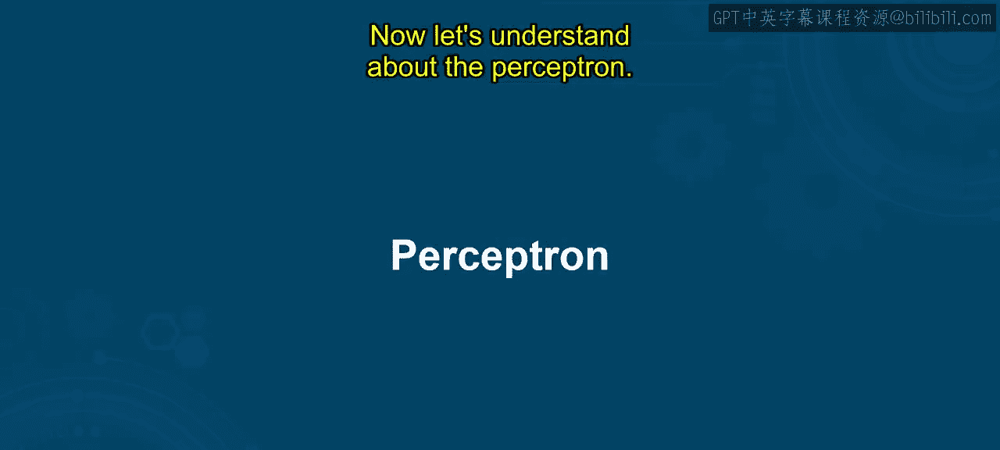
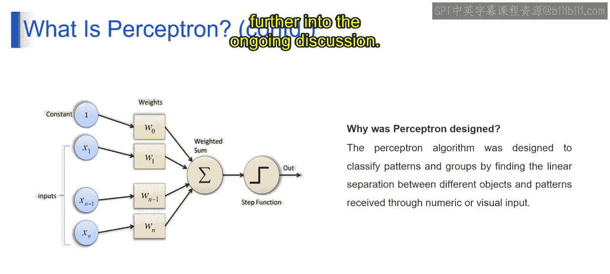

# Edureka《通过LLMs学习生成式人工智能（机器学习和NLP基础，第1课／共4课）｜Learn Generative AI with LLMs》中英字幕 - P33：32_感知器.zh_en - GPT中英字幕课程资源 - BV1q4421Q7qh

Hello everyone， let's dive into the captivating world of machine learning and the foundational concepts of NLP together。

 So now let's understand about the perceptron in this we are going to cover what exactly a perceptron and what are the different components of perceptron and what is the use of them by the end of the session you are able to understand and describe the fundamental principles of perceptron and able to identify the key components of the perceptron。

😊。

So let's get started what exactly a perceptron is all about so imagine you have a friend who is trying to decide whether to go for a walk based on the weather condition so they have absorb that they are more likely to go for walk when it's sunny and less likely when it's raining so now they want to create a simple decision making model to help them decide a perceptron can act as this exactly same like this it takes input like the current weather conditions like whether if it is of the sunny or rainy an outputs a decision that is whether to go for a walk or at home means technically a perceptron is the simplest form of a neural network transing of a single neuron with multiple input node and one output node each input node is associated。

😊，With the weight representing the importance of the input。

 the perceptron computes eed some of its input and applies a threshold function to produce the output so during the training the perceptron are just its weights based on the error bit its predictions and the true outputs using techniques like gradient descent its capable of learning linear decision boundaries and performing binary classification tasks。

😊，In simple words， perceptron serves as both a simple model of a biological neuron in an artificial neural network and the name of an early algorithm for supervised learning of binary classifiers。

 Let's understand how exactly it is going to work with an example。

 these diagrammatic representation of perceptron algorithm typically contains the inputs。

 constant weights， weighted sum and step function。 and finally the output。

 Now let's understand all this。 So first of all， inputs。

 These are the features or the attributes of the input data in a diagram they are usually represented as nodes or the circles。

 Each corresponding to a specific feature。 Then coming to the constant。 It is also known as biass。

 the biass term is a constant value that。😊，addeded to the weighted sum of inputs。

 it allows the perceived drawn to capture the patterns that do not pass through the origin in the feature space it is often represented as a node with a fixed value typically it is going to be the one so it is known as constant then the next one is of weights。

 Each input is associated with weight which determines its importance in the decision making process。

 these weights are multiplied by the corresponding inputs and somewhat together here in the weighted sum the weighted sum is the result of multiplying each input with its weights。

And summing them together this calculation represents the combined influence of the inputs on the perceptrons decision then the next one is of step function the output of the perceptron is determined by applying a step function to the weighted sum if the weighted sum exceeds a certain threshold the perceptron outputs one class example1 otherwise it outputs another class that is example0 means in our condition as I mentioned it should be either0 or1 here it is represented as the node or the balls with the step function applied to the weighted sum overall diagrammatic representation illustrates how the perceptron combines input features with the corresponding weights cas weighted sum and supplies a step function to produce a binary classification。

😊，Output， so the upcoming video will delve further into the ongoing discussion。

