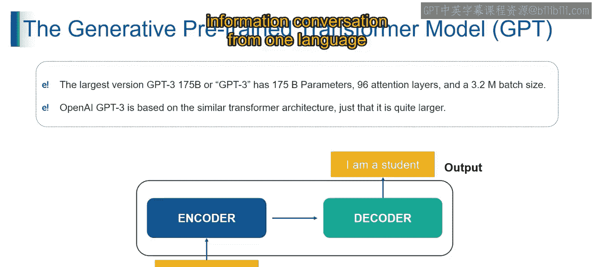
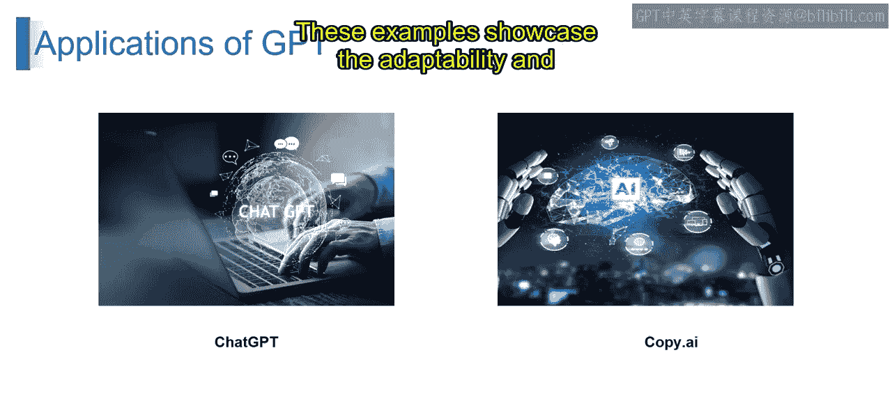
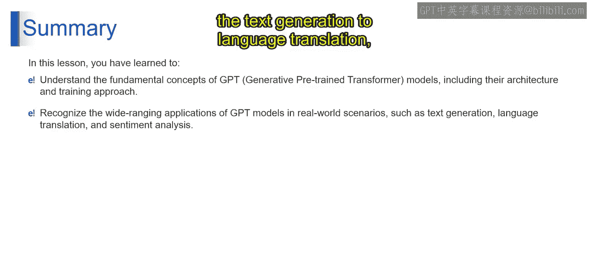
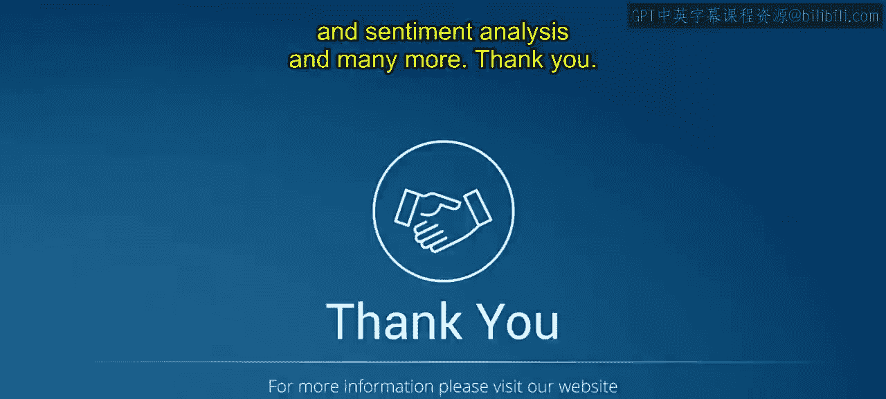

# Edureka《通过LLMs学习生成式AI（基础、应用开发、流行工具，第2、3、4课／共4课）｜Learn Generative AI with LLMs》中英 - P33：32_理解GPT.zh_en - GPT中英字幕课程资源 - BV1ym421V7gx

So let's now explore the progression from our previous discussion transforms it into a linguistic skyscraper compared to its predecessor G2 the increased parameter attention layers and the bad size contribute to G3 ability to comprehend and generate intricate language with fitness。

 this colusal model is not just big show it's big to achieve a deeper understanding of context shade and varied language intricacies G3。

 the 175 billions is not a language model， it stands as a model redefining its boundaries of AI language processinging emphasizing that in this linguistic realm size indeed matters Now let's understand this transformer architecture here here we have provided some input and we are expecting some output in the normal English so the transformer architecture。

😊，IThe powerhouse behind the language translation turning words from one language to other seamlessly so let's understand it with a quick look at the encoder and decoder how exactly it works。

 First of all， encoder。 Imagine the encoder is a bilingual to guide it takes a sentence in Spanish language or whatever the language it is breaking it down into a key elements and encoding the information。

 It's like jotting down essential notes for the translator。 then it can be sent to the decoder。

 Now picture the decoder as a skilled translator armed with encoder notes。

 It deciphers the information and crs the corresponding sentence into the English language。

 the decoder ensures the translation is not just accurate but also captures the essence of the original language into the required sentence as an output。

😊，Means the encoder and decoder work hand in hand passing information back and forth。

 It's like a well choreographed dance where encoder provides the raw material and the decoder transforms it into a new masterpiece means what exactly is happening here。

 it is going with the parallel processing， Unlike traditional translation methods。

 the transformer architecture allows for parallel processing。

 multiple parts of the sentence can be translated simultaneously Sping of the translation dance means why the transformer excs here。

 the brilliant soft transformers lies in its ability to understand the relationships between the words in a sentence it's not just a word by word translation it captures the context and shades delivering a more natural and current translation means in the realm of language translation。

 the transformer architecture。😊，Its encoder and the decoder deal acts like a linguistic matro orchestratrating a seamless dance of information conversation from one language to the other language。

 Now， the applications of the GT first of all， Cha GpT and the other one is of copypit AI the GpT GpT you all know as your virtual conversation companion always ready for a chat whether you seek advice or information or just a friendly chat。

 Chad GpT engages in a meaningful and context of conversation by the what is impact them revolutionizing online interactions Cha GpT showcases versatility of language models in providing personalized and dynamic conversational experience Now the next one is ofpi AI Copi AI as your creative writing assistant helping you generate compelling and persuive content from crafting catchy headlines to。

😊。

Drafting making copy cop AI a wordsmith sidekick that understands your writing style。

 So what is the impact of it It transforms the content creation Co AI demonstrates how G can be valuable tool in generating diverse and high quality written content G's applications extend beyond conventional users powering innovation like Cha G for interactive conversations and cop AI for creative content generation These examples showcase the adaptability and effectiveness of G across diverse domains Now the summary So in this we explore G models core concepts delving into their architecture and training methods and also identify versatile world real world applications of G from the text generation to language translation and many more and sentiment analysis and many more。

Thank you。

