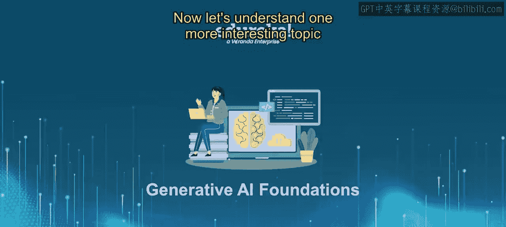
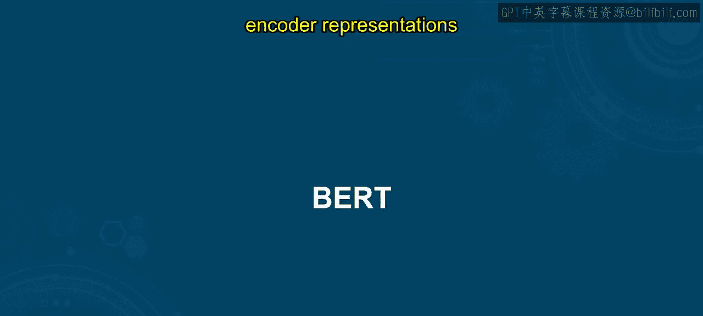
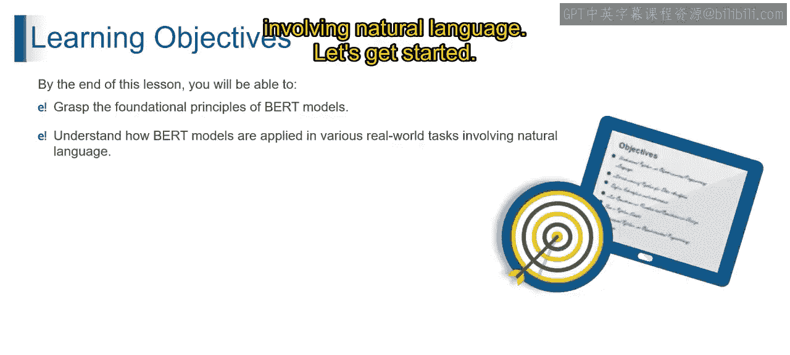
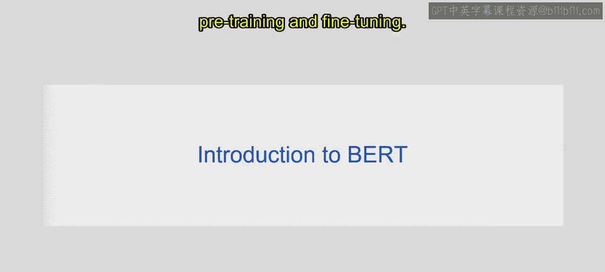
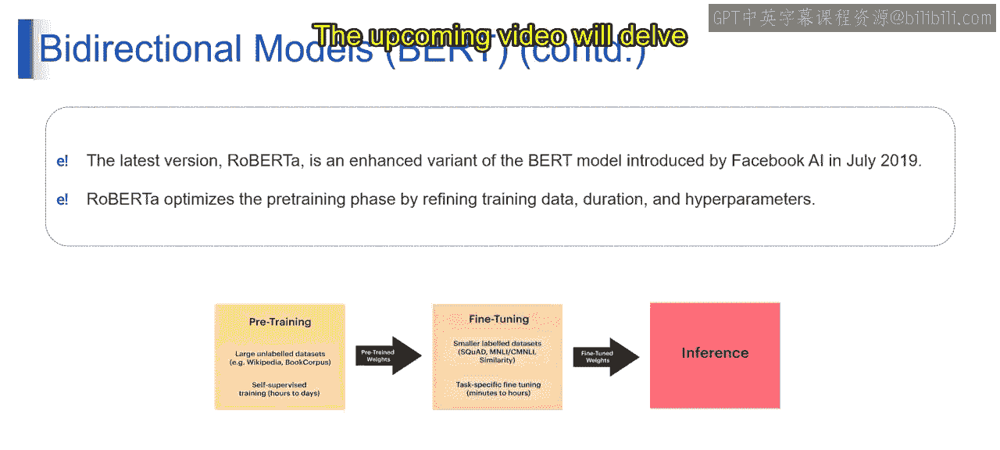

# Edureka《通过LLMs学习生成式AI（基础、应用开发、流行工具，第2、3、4课／共4课）｜Learn Generative AI with LLMs》中英 - P34：33_BERT.zh_en - GPT中英字幕课程资源 - BV1ym421V7gx

Hello everyone welcome to Generative AI foundations so now let's understand one more interesting topic that is B which is nothing but bidirectional encoder representations from the transformers so in this we are going to cover the introduction to bird and what are the different applications of it by the end of the session you are able to understand the foundational principles of the bird models and also。

😊。

You are able to understand how bird models are applied in various real world tasks involving natural language so let's get started introduction to B B is a power house in deep learning designed for natural language understanding B effectiveness lies in its ability to navigate contextual intricacies in text achieving through a meticulous two step process pretraining and fine tuning so now let's understand what exactly the bidirectional models here As mentioned B stands for bidirectional encoder representations from transformers is a prominent deep learning model for natural language understanding so it employs two step process pretraining and fine tuning so B stands out for its focus on bidirectional context modeling Unlike traditional models B does not merely consider words in isolation it comprehend their meaning by analyzing。

😊。

Conext from both preceding and succeeding words， this bidirectional approach equips bird to grasp the shades of language。

 enhancing its contextual understanding。 So what exactly this two step process here So the journey of B involves three training phase where it learns the fundamental language patterns from the vast text data and a fine tuning phases tailoring its understanding for specified task this just process in those bird with the versatile understanding of language。

 making it a go to model for for a natural language processing applications next made the robot a latest rendition of bird model introduced by Facebook AI in July 2019 robots A stands as an enhanced period building upon foundations laid by bird and fine tuning。

😊，Its capabilities for even greater language understanding means this robot a takes the bird legacy to new heights of optimizing a pretrain phase。

 This involves meticulous refinement of training data duration and hyperpara。

 The result is a model fine tuned to capture the intricacies of language with enhanced precision and efficiency。

😊，Just like it predecessors bird robot A undergoes a two step magic again a pretraining and a fine tuning however。

 the robot A's optimization in the pretraining phase sets the stage for fine tuning excellence。

 ensuring it emerges a power house in a natural language understanding means bird emerges as a game changer in the landscape of deep learning for language understanding。

 revolutionizing how models interpret and comprehend contextual relationship and text its bidirectional context modeling and two step learning process showcase the indricacies of bird design making a significant advancement in the field of natural language processinging。

 but where this robot a the evolved sibling of bird brings forth a refined and optimized approach to language understanding its enhancement in pretraining with a key。

😊，Focus on the data， duration and hypopara position robot A as a cutting edge model。

 pushing the boundaries of words achievable in the realm of natural language processing。

 So now let's understand the learning process of the bird。 the pretraining。

 fine tuning and inference。 first of all， pretraining。 So the birds learning journey。

 The initial phase involves pretraining on vast unlabeled data set， such as Wikipedia and bookcar。

 This process equips bird with a foundational understanding of language patterns。

 The model learns to predict missing words within the sentence。

 fostering and unsupervised grasp of contextual relationships。

 The weights obtained during the pretraining lay the groundwork of birds language。

 understanding effectiveness。 So the next one is of fine tuning。 So building on its。😊。

Pretrain foundation bird enters the fine tuning phase here。

 the model encounters model labeled data sets like squd mli Cmnli and similarity data sets task specific fine tuning takes place customizing birds understanding for specific applications。

 This phase lasting from minutes to hours means refines birds knowledge ensuring it becomes adept it specialized tasks The weights obtained after fine tuning encapsulates birdss tailored expertise So the upcoming video will delve further into the ongoing discussion。

