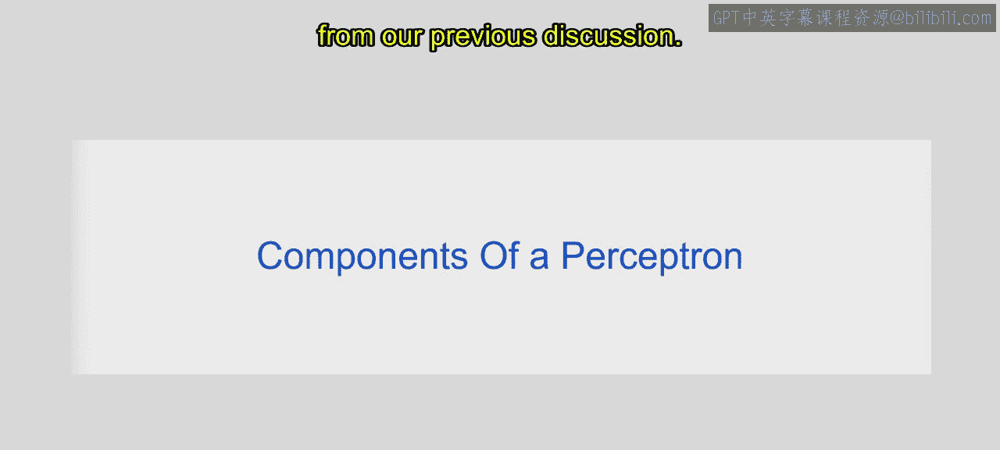
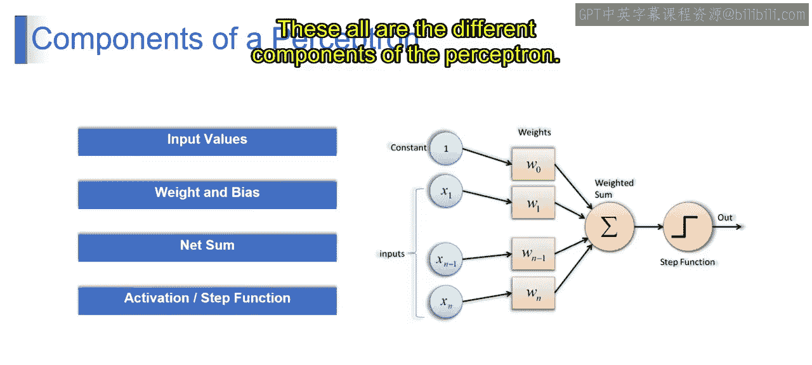
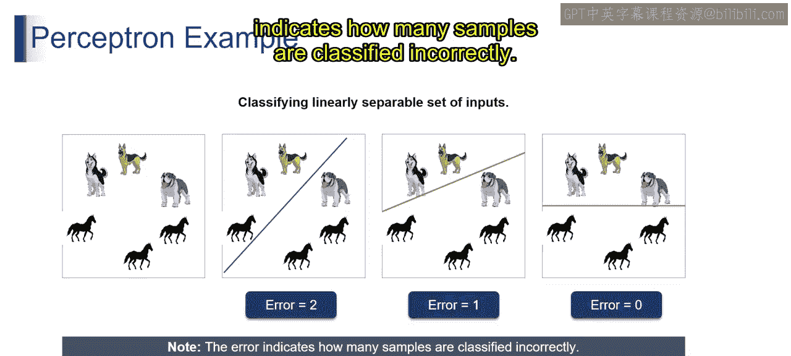
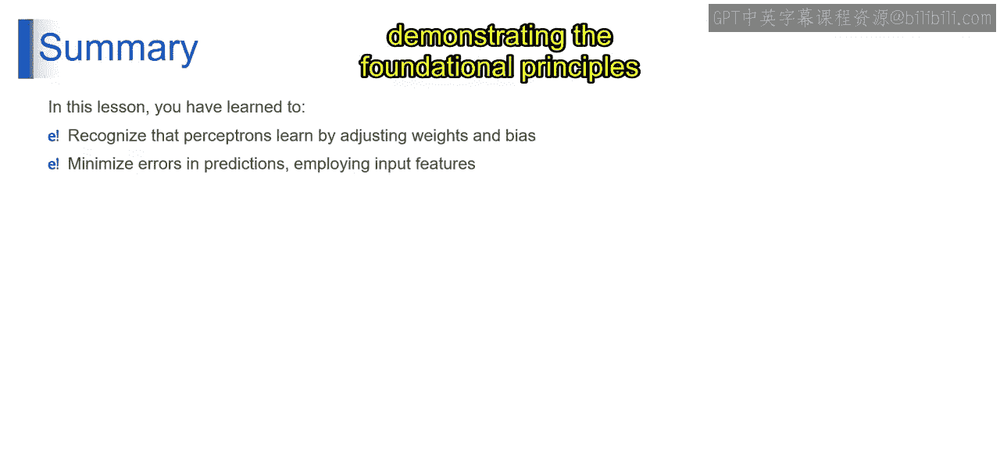

# Edureka《通过LLMs学习生成式人工智能（机器学习和NLP基础，第1课／共4课）｜Learn Generative AI with LLMs》中英字幕 - P34：33_感知器的组成部分.zh_en - GPT中英字幕课程资源 - BV1q4421Q7qh

So let's now explore the progression from our previous discussion so now let's understand the components of a perceptron here we are having input variables weight and bias netum and activation or step function so what exactly the input values as we have already discussed input values represents a features or the attributes of the data being processed by the perceptron then coming to the weight and biass weights represent the importance of each input while the biass allows the perceptron to capture the patterns not passing through the origin then coming to the net sum what exactly it will represent the net sum is the weightted sum of input plus the biasom representing the combined influence of inputs on the perceptron decision then the last one is of activation or step function the activation or。

😊。

Step function determines the output of the perceptron based on the net sum typically producing a binary classification result。

 either0 or one based on the predefined threshold so these all are the different components of the perceptron so here is the example classifying linearly separable set of inputs the image shows the concept of linear separability in machine learning where the data points represents dogs and horses all categorized using a straight line the image showcases the concept of linear separability in machine learning where the data points representing dogs and horse so here is the classification in the first image we are having the representation of dogs and horses in the second case they tried to separate linearly by using a line where we are having。

😊。

The two misclassified images。 One is horses and the dog。 these two are misclassified。

 So the error here is represented as two。 Then coming to the next one， it is adjusted。

 and now the error is one because the dog is misclassified。 then again。

 after doing the clear understanding or the clear linear separation here now you can see all the horses are segregated correctly and the dogs also segregated correctly。

 So that's where the error is represented as zero So means while this demonstrateds a simplified approach to classification。

 human perception is multifaceted process here in this case。

 the data points represented the dogs and the horses are categorized using a straight line。

 it involves integrating sensory input with the past experiences。

 Exp and emotions to comprehend the world in。😊，The shades that extend beyond the linear boundaries。

So here the note is that the error term indicates how many samples are classified incorrectly now the summary in this lesson you have gained an understanding of how perceptrons learn through the adjustments of weights and bias defining their ability to make accurate predictions by minimizing the errors by considering the input features and iteratively optimizing the patterns perceptrons enhance their capacity to class the data demonstrating the foundational principles of neural network training Thank you。

😊。

