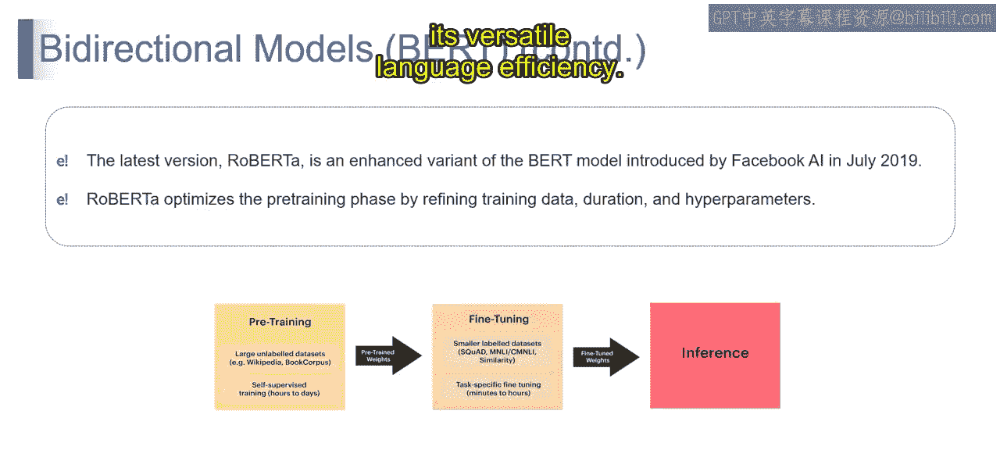
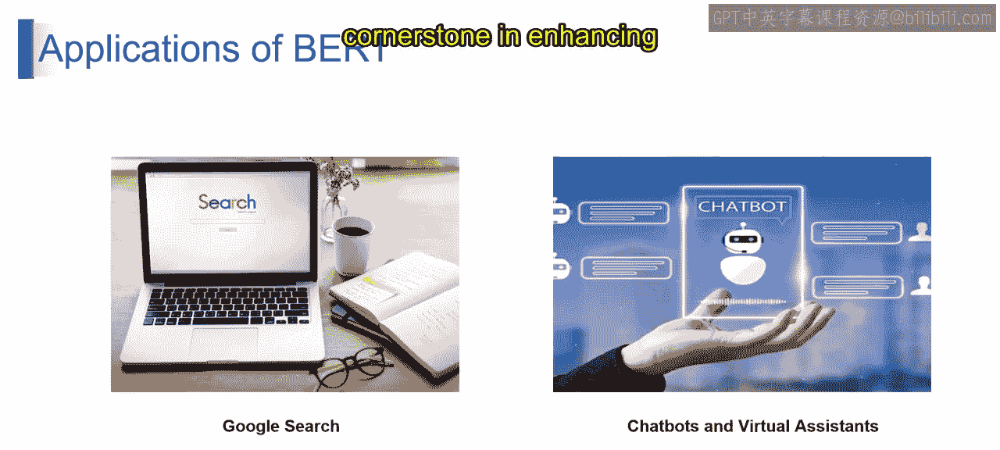
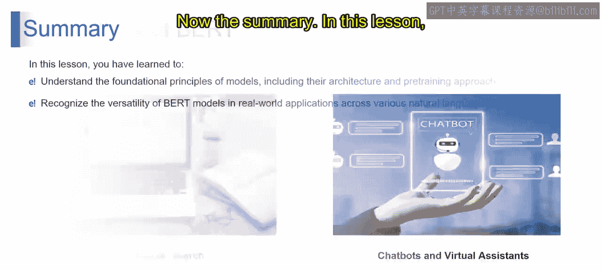
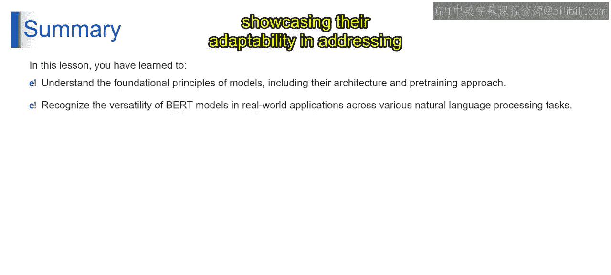

# Edureka《通过LLMs学习生成式AI（基础、应用开发、流行工具，第2、3、4课／共4课）｜Learn Generative AI with LLMs》中英 - P35：34_BERT中的推理.zh_en - GPT中英字幕课程资源 - BV1ym421V7gx

So let's now explore the progression from our previous discussion so the next one is of inference with its pretraining and fine tuning con bird enters into the inference stage this is where the model applies its learned understanding to new unseen data whether answering questions recognizing sequence similarities。

 or performing various NLP tasks B inference phase showcases the practical applications of its acquired knowledge。

 the pretrained un fine tuneed weights work the pretrained un fine tuneed weights work in harmony during the inference allowing birth to excel in diverse language related challenges means bird strength rate of pretraining fine tuning and inference represents a comprehensive learning process from unsupervised。

😊，Turningning on vast data sets to tailored refinement of specific tasks bird journey unveils a dynamic approach to natural language understanding with each phase contributing to its language efficiency。

 So now let's understand the applications of the bird there is so many applications like question answering text classification similarity task specific fine tuning named entity recognition sentiment analysis textual similarity and inference in real time。

 So let's understand and focus on the Google search andbo virtual assistant at this moment。

 First of all， the Google search means enhanced search relevance B aids Google search in understanding the context of search queries more accurately this results in more relevant and context away search results improving the overall user experience and also bird exc in。

😊。

Comprehending the shades of logger more conversational search queries。

 this capability ensures that users achieve search results that precisely match the intent behind their queries means birds contribute to improved multilingual search comprehension allowing Google search to understand and provide relevant results for queries in various languages That's about the Google search Then chatbo and virtual assistance the birds's bidirectional context modeling makes it a powerful tool for chatbos and virtual assistants to understand user queries in more conversational and natural language manner by leveraging birds fine tuned capabilities chatbos can generate more cur and contextually relevant responses。

 This is particularly crucial in maintaining engaging and effective conversations。

 Bs versatility shines。😊，In adapting to a wide range of queries and the user inputs。

 this adaptability ensures that chatbos and virtual assistants can handle diverse conversations effectively and B understanding of contextual relationships is instrumental in managing multi turn dialogues。

 chatbos equipped with B can maintain context across multiple turns delivering more current and powerful interactions。

 B's ability to comprehend user intent contributes to personalized assistance。

 allowing chatbos and virtual assistance to tailor their response based on the unique needs and preferences of individual users in the realm of Google search and chatbo virtual assistant interactions B plays a pivot role in elevating the quality of results and responses。

 its contextual understanding and adaptability make it a cornerstone in。😊。

Enhancing user experience across these applications now the summary so in this lesson we explored the core principles of the models delving into their architecture and pretrain methodologyology furthermore we recognized the diverse applications of the bird models showcasing their adaptability in addressing various natural language crossing tasks Thank you。

😊。

