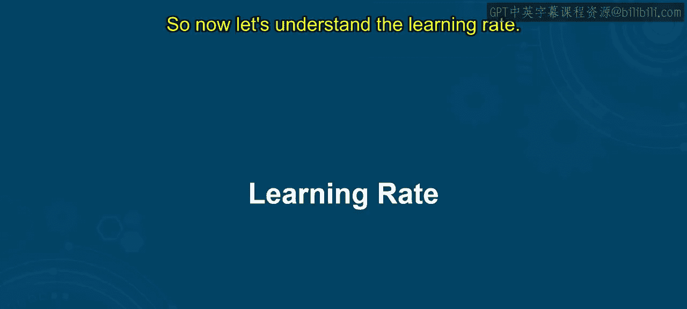
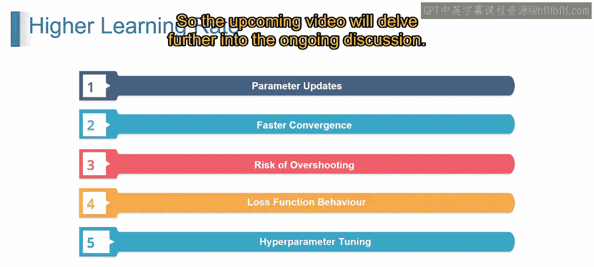

# Edureka《通过LLMs学习生成式人工智能（机器学习和NLP基础，第1课／共4课）｜Learn Generative AI with LLMs》中英字幕 - P35：34_学习率.zh_en - GPT中英字幕课程资源 - BV1q4421Q7qh

Hello everyone， let's dive into the captivating world of machine learning and the foundational concepts of NLP together。

 So now let's understand the learning rate In this。

 we are going to cover what is learning rate and what if we are having the higher learning rate as well as lower learning rate。

 So by the end of the session， you are able to understand the significance of learning rate in the machine learning algorithms and you are able to grasp the effects of higher and lower learning rate in machine learning models。

 So let's get started what is learning rate is all about first of all。😊。

Think of learning to cook a new recipe。 You are trying to make the perfect pasta sauce。

 Let's say the learning grade is just like adjusting how much you tweak the ingredients。😊。

Each time you taste the sauce means technically in machine learning when you are training a neural network to say classify the images like recognizing whether if it is of cat or dogs。

 the learning rate controls how much you adjust just the parameters of the network like adjusting the amount of ingredients in your sauce based on the errors it makes when predicting if the learning rate is too high you might make big changes to the parameters after each prediction potentially overshooting the best recipe here best accuracy if it's too low。

 you make very small changes， but it could take a long time to find the best recipe。

 so just like in cooking where finding the right amount of adjustment to your recipe leads to the perfect sauce in machine learning finding the optimal learning rate is essential。

😊，For the neural network to converge to accurate predictions effectively。😊，In simple terms。

 learning rate is a key parameter in ML that determines how much the weights of neural network are adjusted during the training based on the deviation betweenin。

 the predicted as well as actual data it controls the speed of learning balancing between faster convergence and the stability in model training but what is the use of it。

 so the learning rate is used to optimize the training process of machine learning models particularly neural networks。

 it controls the rate at which the models parameters are updated during the training。

 in our case the parameters are nothing but the weights， helping to find the optimal solution。

 while balancing between the convergence speed as well as stability means adjusting the learning rate effectively is crucial for achieving faster convergence and better performance of the model。

😊，Now let's understand what exactly higher learning rate。

 So a higher learning rate means the model adjusts its parameters like weights more drastically during the training this can speed up convergence to the best solution but to high rate risks overshooting or causing instability so choosing the right learning rate is vital for effective and stable model training so now let's understand more about higher learning rate here we are using the parameter updates pass to convergence risk of overshooting loss function behavior。

 hyperparmeter tuning so these all are the things we are going to face when we are making the learning rate as high so parameter updates so with the higher learning rate the models parameter。

 nothing but weights are updated more aggressively during the training process which will lead to a larger adjustments in each。

Iteration then coming to the faster convergence， a higher learning rate is typically results in faster convergence of the model during the training。

 where it reaches an optimal solution in fearR iteration then coming to the risk of overshooting however。

 there is a greater risk of overshooting the optimal solution with the higher learning rate where the model's parameters may oscillate or divish away from the optimal values。

 then coming to the loss function behavior the behavior of the loss function can be more erratic with a higher learning rate。

 potentially exhibiting larger fluctuations or instability during the training process then the last one is of hyperparameter tuning。

 So setting an appropriate learning rate is crucial during the hyperparameter tuning as a higher learning rate can affect。

😊，The training dynamic and overall performance of the model means while a higher learning rate can accelerate the convergence it also increases the risk of overshooting and instability during the training necessitating careful tuning to find the optimal balance for efficient model training so that's about the higher learning rate Now let's understand the lower learning rate so the upcoming video will delve further into the ongoing discussion。

😊。

