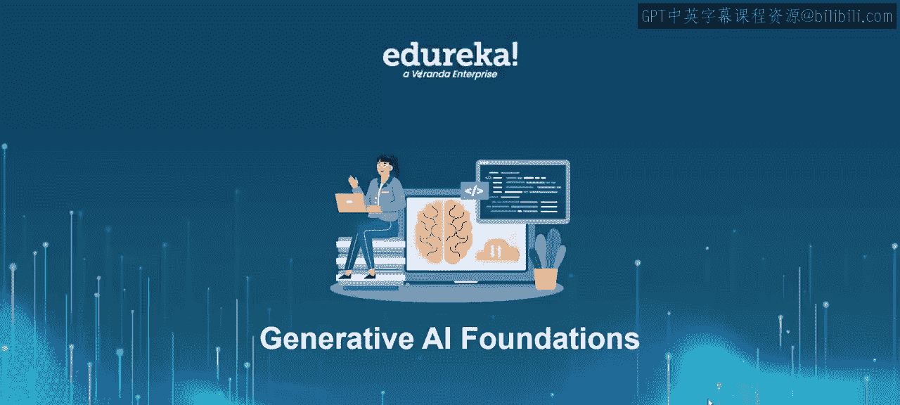
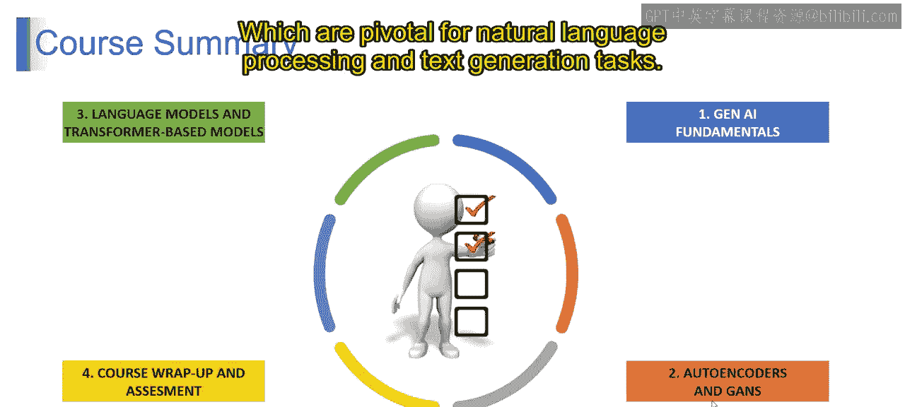
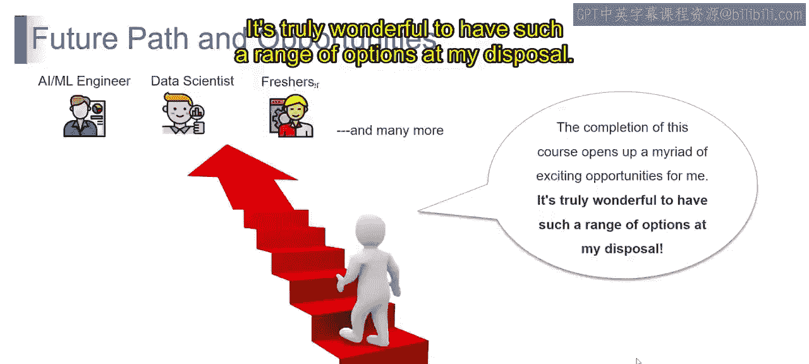
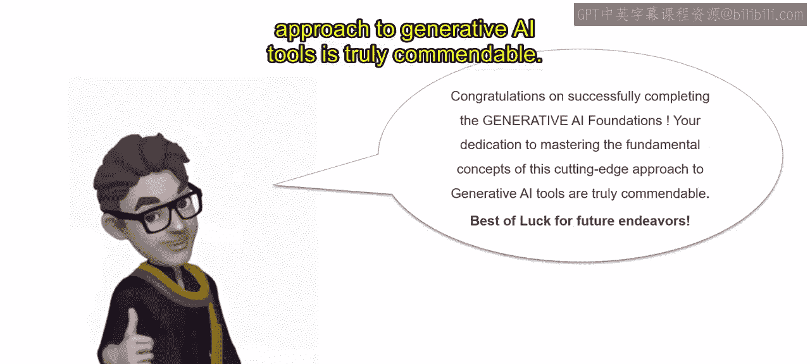

# Edureka《通过LLMs学习生成式AI（基础、应用开发、流行工具，第2、3、4课／共4课）｜Learn Generative AI with LLMs》中英 - P36：35_课程总结.zh_en - GPT中英字幕课程资源 - BV1ym421V7gx

Hello everyone welcome back to Generative AI foundations the Co summary so in our previous modules we explored the essential concepts of generative AI including generative AI fundamentals which provide a foundation for understanding how AI creates new data we also dived into the autoenrs and Gs which are techniques used to generate and manipulate the data as well as language models and transformer based models which are pivot for natural language processing and textgen tasks so coming to the future path by completing this course it will unlock a wealth of possibilities for AI MLl engineers data scientists fresher and many more this diverse opportunities ahead are incredibly promising offering a wealth of paths to explore and grow within the field of generative AI。

😊。

It's truly wonderful to have such a range of options at my disposal so finally congratulations on reaching the completion of Generative AI Foundations course your commitment to mastering the fundamental concept of this cutting edge approach to geneative AI tools is truly commendable so best of luck for your future ends Thank you。

😊。

