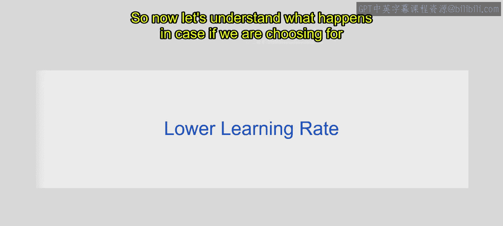
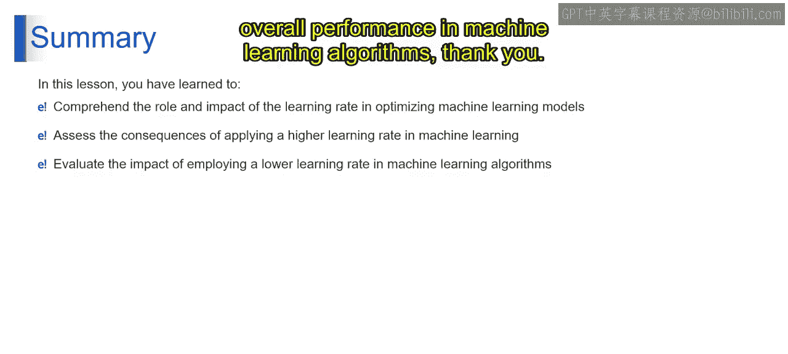

# Edureka《通过LLMs学习生成式人工智能（机器学习和NLP基础，第1课／共4课）｜Learn Generative AI with LLMs》中英字幕 - P36：35_较低的学习率.zh_en - GPT中英字幕课程资源 - BV1q4421Q7qh

So let's now explore the progression from our previous discussion。

 A lower learning rate means the model are just its parameters like weights more gradually during the training this can result in slower convergence but reduces the risk of overshooting and leading to more stable training dynamics thus selecting the right learning rate is important to balance the convergence speed and stability in the machine learning model training so now let's understand what happens in case if they are choosing lower learning rate so the first one is of tailored for specific tasks or function so AI systems are designed for particular tasks like medical diagnosis financial forecasting or NLP then specialized algorithms and techniques these AI systems are optimized algorithms such as CNs for image recognition and。

😊。

Ainance with attention mechanisms for language translation。

 then focusing on specific challenges or requirement means AI systems address particular challenges like optimizing user engagement in recommendation systems or minimizing false positive in fraud detection。

 then deliver targeted results by focusing on the specific tasks AI systems can provide accurate results tailored to user needs like high accuracy in speech recognition or natural conversations in the chat board。

 So now let's understand what happens in case of lower learning rate。

 the first one is of gradual parameter updates So lawyer learning rates result in small and gradual adjustments to model parameters during the training then hyperparameter tuning So choosing the right and appropriate lawyer learning。

😊，requiresquires careful hyperparameter tuning to balance training dynamics in performance then the next one is of smooth loss function behavior with lower learning rates。

 the loss function exhibits， smoother behavior leading to a more stable training process then reduced risk of overshooting so lower learning rates decrease the risk of overshooting the optimal solution promoting stability during the training then lower conversions while lower learning rates lead to more stable training they also result in slower convergs requiring more iterations to reach an optimal solution means in simple terms。

 lower learning rates entail slower but more stable training with gradual parameter updates。

 smoother loss function behavior reduced risk of overshooting and required。

Careful hyperparameter tuning to balance performance and training dynamics。

 So that's about the lower learning rate Now the summary in this lesson you have gained an understanding of the significance of the learning rate in optimizing machine learning models you have explored the consequenceti of both higher and lower learning rates recognizing their impacts on convergence speed stability and overall performance in machine learning algorithms Thank you。

😊。

