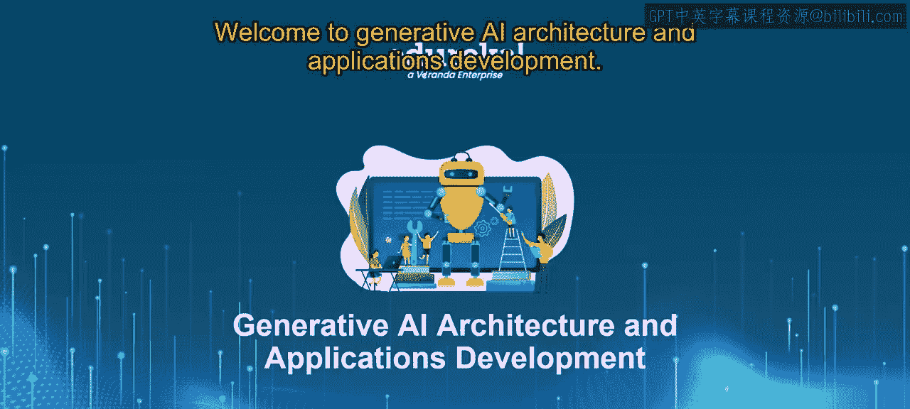
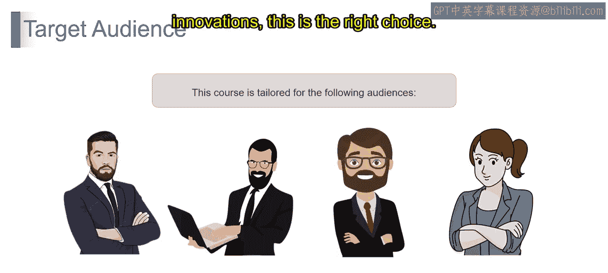
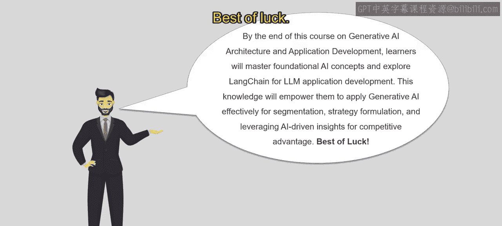

# Edureka《通过LLMs学习生成式AI（基础、应用开发、流行工具，第2、3、4课／共4课）｜Learn Generative AI with LLMs》中英 - P37：0_课程介绍.zh_en - GPT中英字幕课程资源 - BV1ym421V7gx

Hello everyone， welcome to Generative AI Architectural and App development。😊。

So the course interaction as part of our course interaction。

 we embark on a journey through the realLm of generative AI with the LLMs。

 so here is an overview of what we are going to cover here The first one is generative AI with LLMs we will dive into the fundamentals of generative AI focusing on pivotbo role played by generative AI large language models in generating the text then LLms for search prediction and generation Here we will explore how language models are utilized for variety of tasks including search prediction and text generation showcasing the versatility in natural language processing then we are going to understand language for LLM application development In this we are going to discover the language what exactly it is like。

😊，A robust platform for developing applications powered by the language models here we will learn how to leverage its features for seamless application development as well as deployment Then the next topic is integrating with data using the language and drag here we are going to investigate advanced techniques for integrating with data using the language and retrieve and generate that is drag models here we will understand the data processing and utilization strategies Then evaluating LM performance here we are going to learn about the various methodologies for evaluating the performance of the language models here we will explore different metrics for example。

 the complexityity blue score and human evaluation to ensure robust assessment practices then。😊。

generative AI for data privacy and protection here we will address the critical aspect of the data privacy and the protection in generative AI applications here we will discuss strategies and techniques for safeguarding sensitive data in the context of language model usage then finally the course wrap up and assessment we will summarize the key learnings from each module and engage in assessments to gauge your comprehensive and proficiency in applying generative AI concepts with the language models。

 so throughout this course you will gain a comprehensive understanding of generative AI foundations and develop practical skills to understand the language model efficiency in the various real scenarios。

😊，Coming to the target audience， the target audience for this course include machine learning engineers。

 individuals seeking to deepen their understanding of generative AI foundations and expand their expertise in utilizing the language models of various applications coming to the freshers。

 if you are entrylevel professionals or a student or even you are getting transition into the data science or the generative AI and if you are eager to explore the exciting field of generative AI and gain foundational knowledge in the language models to start their career。

 you can choose that and the data scientists， the professionals who are already familiar with the machine learning concepts and looking to specialize in generative AI particularly in leveraging language models for the data analysis prediction and gene tasks you can take this and。

😊，Coming to the researchers， so academics and researchers。

 if you are interested in delving into the advanced topics of generative AI。

 such as large language models and conducting research to contribute to the field of advancements and innovations this is a right choice go ahead and take the course So by the end of this course。

 you will become a master of foundational AI concepts and dive deep into the language for developing amazing applications with large language models imagine unlocking the power to create AI driven strategies and lies data for segmentation and gain competitive edge with insightful AI predictions so get ready to embark on incredible journey into the future of AI best of luck。

😊。

Thank you。