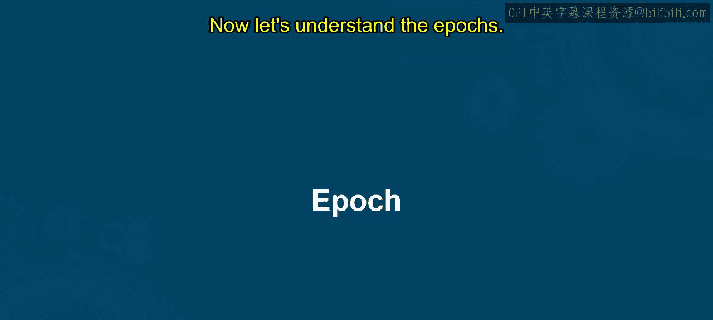
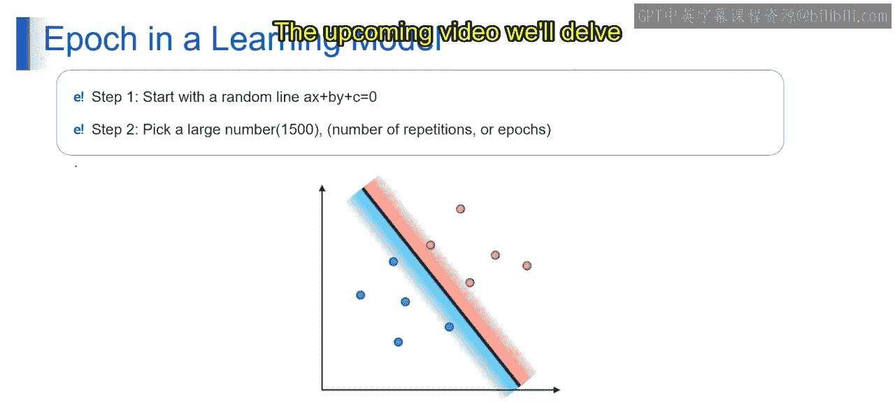

# Edureka《通过LLMs学习生成式人工智能（机器学习和NLP基础，第1课／共4课）｜Learn Generative AI with LLMs》中英字幕 - P37：36_轮数.zh_en - GPT中英字幕课程资源 - BV1q4421Q7qh

Hello everyone， welcomee back to machine learning and NLP basics。

 So now let's understand the epochs in this we are going to understand what exactly an epoch is an epoch in learning model and importance of an epoch by the end of the session you are able to comprehend the significance of epoch in training machine learning models so let's understand understanding an epoch such what exactly an epoch is all about so let's start understanding with an easy example Okay。

 so imagine you are trying to teach a computer to recognize different types of fruits。

 let's say apple， oranges and bananas to do this you show the computer lots of pictures of fruits and tell it what each fruit is Now you want the computer to get better at recognizing these fruit over the time this is。

😊。

Where epoch comes in means an epoch in deep learning is like a ground an epoch in deep learning is like a round of practice during each epoch the computer looks at all pictures of fluids you are given it tries to recognize them and learns from its mistakes So one epoch would be like going through all your fluid pictures once Now let's dive it a bit deeper So in deep learning data is usually divided into smaller batches for the training。

 let's say for example， we are having around thousand data points and we are segregating them into 50 and5 let's say for example the data is usually divided into smaller batches for training because processing all the data at once might be too much for the computer to handle So let's say in deep learning data is。

Usually divided into smaller batches for training， because processing all data at once might be too much for the computer to handle。

 So instead of looking at all the pictures of fruits in one go， the computer looks set。

 say 200 pictures at a time。 this number can vary depending on your set up， it's called batch size。

 this dividing the data into smaller trends is nothing but the batch size。

 So now let's put it all together。 Now you have a bunch of pictures of fruits。

 you divided these pictures into batches like 200 each So you show each batch to the computer。

 and it tries to recognize the fruits in those pictures after it's seen all the batches that is one it。

 So to improve the computer's ability to recognize the fruit。

You might repeat this process multiple times going through several epochs。 Now。

 this complete batch size is going to be the one epoch。 So like this。

 it will go through several epochs with each epoch。

 the computer gets better at recognizing the fruits because it's learning from its mistakes and refining its understanding of what makes an apple and an orange and so on means an epoch in deep learning is like a round of practice where the computer learns from a set of data that is nothing but a batch to improve its understanding of the task at hand whether it's recognizing the fruits or something else and by repeating this process through the multiple epochs this is altogether one epoch。

 So if we are repeating this process through multiple epochs the computer gets better。

And better at the task。 So that's about an understanding of what exactly an apoch is。😊。

So now let's understand the technical definition So in machine learning an Epoch refers to one complete pass through the entire training dataset during the training phase of a model during an epoch the model its its over all the samples in the dataset performs forward and backward passes to compute the laws and gradients and updates the model parameters using an optimization algorithm such as gradient descent means an epoch signifies the number of times the entire dataset is represented or presented to the model for training。

 it allows the model to learn from the entire dataset multiple times providing improving its ability to generalize and make accurate predictions so how exactly it is going to work as I mentioned so now let's understand epoch in learning a。

😊，So here we are providing epoch in learning model。 So the provided step is like an outline。

 So here they provided start with random line a plus d plus C is equal to0 so this step involves initializing a line represented by an equation x plus d plus C is equal to0 where a comm B and C are randomly chosen coefficients So this line could represent an initial guess or starting point for a process that aims to optimize or learn parameters then next one is of pick a large number that is 1500 number of reps or the epochs means this step involves determining the number of reps or epoch for an iterative process in this case the process will be repeated 1500 times this。

😊，er is often chosen based on the factors such as convergence behavior。

 computational resources and the complexity of the task means these steps suggest an iterative process that starts with an initial line representation and then repeats a certain number of times likely involving adjustments or optimizations to the lines parameters in each iteration So this specific details of the process and its purpose would depend on the context in each in which these steps are used So the upcoming video will delve further into the ongoing discussion。

😊。

