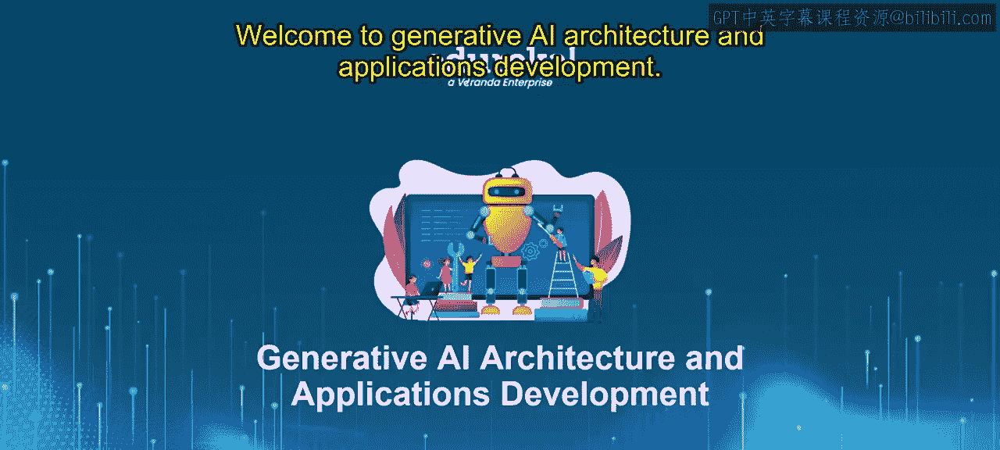
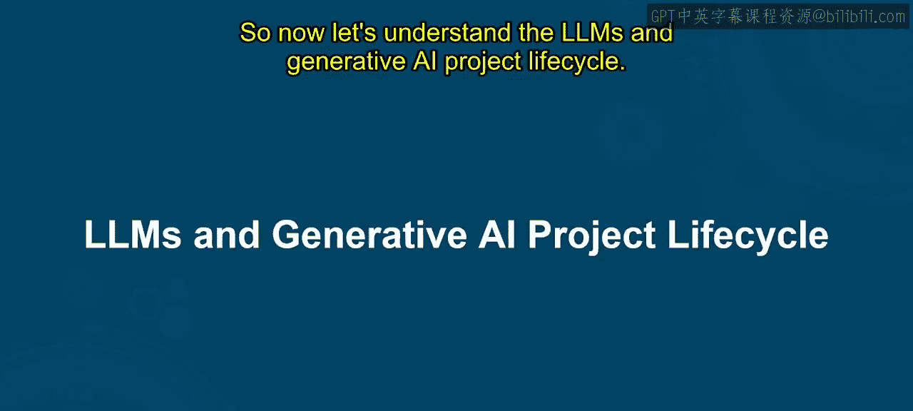
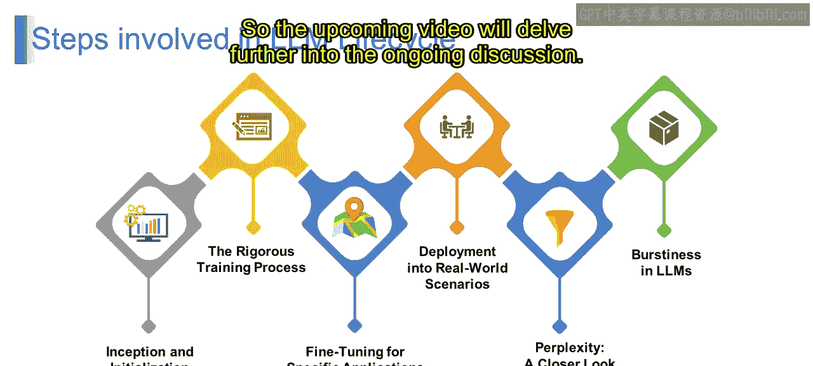

# Edureka《通过LLMs学习生成式AI（基础、应用开发、流行工具，第2、3、4课／共4课）｜Learn Generative AI with LLMs》中英 - P38：1_LLM和生成式AI项目生命周期.zh_en - GPT中英字幕课程资源 - BV1ym421V7gx

Hello everyone， welcome to Generative AI Architecture and App development so now let's understand the LLMs and Generative AI project lifecycle。

😊。

In this we are going to cover what are LLMs and generative AI project life cycle By the end of this session。

 you are able to understand the stages and key components of the generative AI project life cycle So let's get started first of all what exactly an LLM is all about Imagine you have a supermar robotbo buddy name it as a robotbobudy Now the Robbobudy is not your average metal sidekick It's equipped with an incredible ability to read understand an even created text just like your favorite storyteller So whether it's reading a bedtime story or drafting a catchy email Robbobudies got it covered but here is a geky part in the tech world we have engineer something similar called large language models or LLMs these digital marvels are like robotbobudy but superchar。

😊，On steroids the LLms are finely tuned AI systems designed to unase conds。

 create and even predict what comes next in any given piece of text。

 They are the superheroes of their digital language realm。

 So now let's break it down La language models are like the brainy wizards of artificial intelligence。

 they are experts taking in to of written information， making sense of it。

 and then using that understanding to do all sorts of the cool things。

 Just think of them as grammar nerds of the digital world。

 making sure everything written online makes perfect sense。

 One of the coolest thing about the LLms is their exceptional proficiency in processing and interpreting human language。

 It's like they have mastered the art of decoding our linguistic mysteries。

 This means they can effortlessly。St the context， sentiment and even the subtle shades in the way we talk all right。

 Now here is where it gets excited。 Lms are not just here to impress us with their linguistic expertise。

 They play a very important role in countless digital applications from the chat boats that can chat like humans to content creation tools that can write even the articles。

 So now let's understand the steps involved in the Lm life cycle。

 The first one is of inception and initialization。 So think of the first step like a new burn baby。

 It all starts with inception and the initialization with create a virtual brain sort of like a baby's brain ready to learn and grow。

 It's like bringing a new digital genuine to the world Now in the technical terms。

 this phase involves setting up the initial structure and parameters of the L。

It's like creating the foundation for our AI to understand the language a bit like teaching a new born the basicx Now the next one is of the rigorous training process so imagine your AI is hitting the gym lifting linguistic weights to get stronger during this phase R LLM exposed to a massive amount of text learning the patterns grammar and shades of the language in the technical terminology this is where the heavy lifting happens the model is strain on vast data sets becoming a language expert through countless iterations it's like turning our linguistic roy into a seasoned pro then the next one is of fine unique for specific application so imagine our LLM is putting on different hats of various tasks like becoming a chef in kitchen or detective solving mysteries in this。

😊，We tailor our AI for specific purpose， technically。

 we tweak the model to excel in certain particular areas if we want it to write a poetry or answer a specific question or get the summarization this fine tuning is like giving it specialized skills turning our language expert into versatile performer So then the next one is of deployment into real world scenarios。

 So our fully trained and fine tuned LLm is now ready for the deployment into the real world scenarios picture it like releasing your superhero into the digital where it can assist create and engage with the users means this is when we integrate the LLm into the applications making it a part of our everyday digital experiment。

 It's like setting our linguistic superhero loose to work its magic across the internet that's。😊。

The deploying into real world， then the next one is of perplexity， a closer look。 So。

 but what exactly the perplexity， Imagine our LLm encountering a confusing sentence。

 Its scratching its digital head， trying to make sense of it Perplexity is like a level of confusion are model experience while predicting the next word in a provided sentence technically perplexity is a measure of how well our LLm understands and predicts the language the lower the perplexity。

 the more confident and less perplexed R AI is making it a true language moisturetro Then the next one is of burstiness in LLm。

 So imagine R LLm as a balloon randomly inflating and deflating with words burstiness refers to the unpredictable occurrences of words in a sequence sometimes popping up frequently other times。

😊，Takking a break means the burstiness highlights the irregular distribution of the words in the language。

 It's like acknowledging that language has its quirky moments and our LLM embraces the unpredictable nature of words in its digital playground。

 That's about burstiness in LLms。 So the upcoming video will delve further into the ongoing discussion。

😊。

