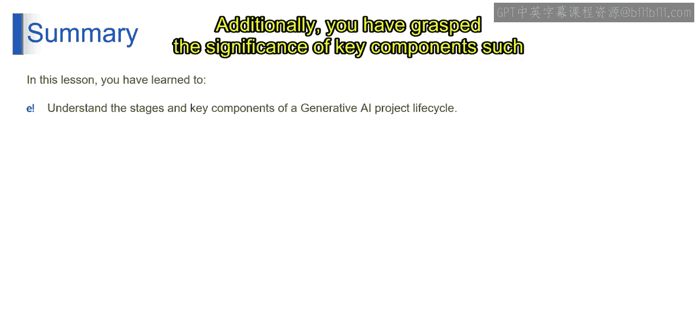
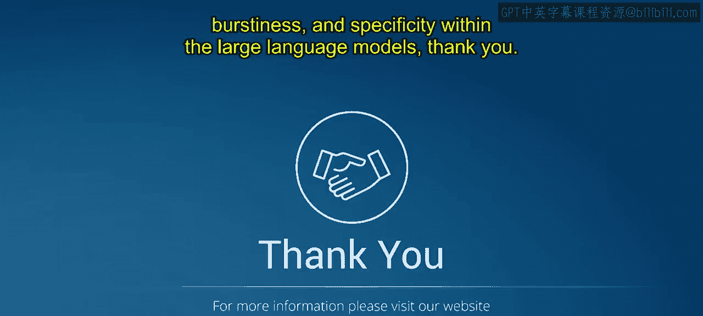

# Edureka《通过LLMs学习生成式AI（基础、应用开发、流行工具，第2、3、4课／共4课）｜Learn Generative AI with LLMs》中英 - P39：2_LLM生命周期续.zh_en - GPT中英字幕课程资源 - BV1ym421V7gx

So let's now explore the progression from our previous discussion then the next to continuation is specificity and context in LLMs。

 so imagine our LLM becoming a detective zooming in with a magnifying glass to understand the specific details and context of a provided sentence it's all about the precision means technically specificity and context refers to how well our LLM can grasp the details and the shades in the language It's like training our AI to be a sharelock homes of sentence always on the lookout first subtle clues then the next to one ease of engaging the reader with detailed paragraphs means picture our LLM as a skilled storyteller weaving narratives that captivate the readers this step is all about creating content that。

😊，Not just informative， but also a joy to read means this involves optimizing the LLM to generate detailed and engaging paragraphs。

 It's like teaching our digital wordsmith to craft content that keeps readers hooked sentence after the sentence。

 So that's about engaging the readers with the digital paragraphs。

 Then now understand conversational style in LLM content。

 Imagine our LLm sitting down for a friendly chat not just spewing information but engaging in a conversation。

 This step adds a human touch to our digital interaction。

 So technically we find tune in the LLM to generate the text that feels like a natural conversation。

 It's like making our AI， not just knowledge powerhouse。

 but also a pleasant companion in the digital realm。 So that's about conversational style in L。😊。

So now let's understand the theoretical questions。 So here picture。

 we are not here to throw information at you。 We are here to have a conversation。

 It's like sitting down with a cup of coffee and having a friendly chat about the ideas。

 this adds a human touch to our digital interactions。 Now from the technical standpoint。

 we have fine tune our Lm to perform more than just a repository of the knowledge。

 We have given it the ability to generate the text that feels like a natural conversation。

 It's like teaching our AI to be more than a brainy encyclopedia。

 It becomes a digital companion making the exploration of theoretical questions。

 not just informative but also enjoyable。 It's about creating a conversational experience that feels like you are talking with a knowledgeable friend in the digital realm。

 Then the next one is of analogs and metaphors， making a content accessible。😊。

So picture our LLM as a beacon of understanding illuminating the complex concepts with a relatable comparison this step is all about making content accessible and relatable so technically analogies and metaphors involve training the LLM to draw parallels between different ideas it's like giving our AI the ability to simplify intricate concepts making them more understandable and relatable for users so thats about analogies and metaphors means that was a quiet journey about the life cycle of the large language models from you know the basics of becoming linguistic superheroes in the digital realM these steps showcase the incredible capabilities of our AI companions so now the summary。

😊，In this lesson you have acquired a deep understanding of the stages involved in the Geneative AI project lifecycle from inception to real world deployment additionally you have grasped the significance of key components such as training process fine tuning and shades aspect like perplexity burstiness and specificity within the large language models Thank you。

