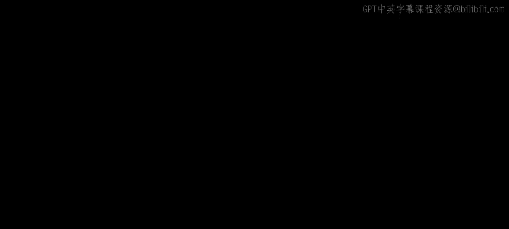
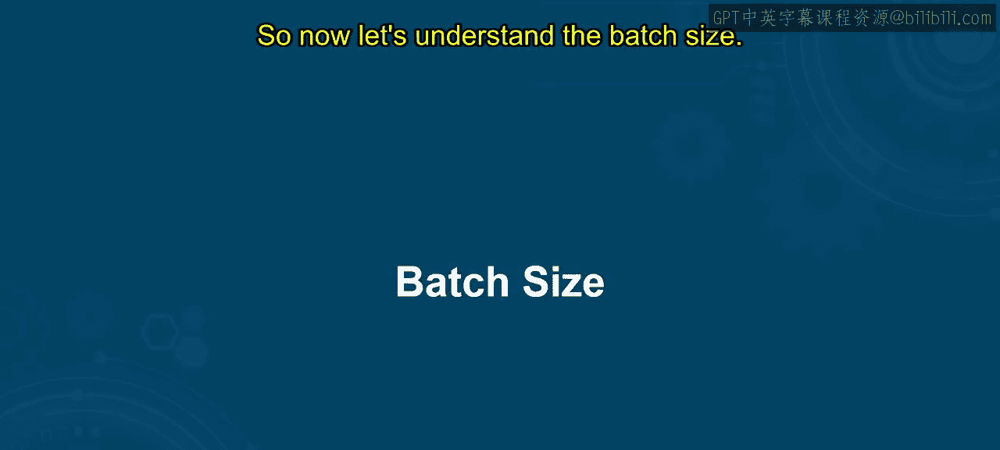
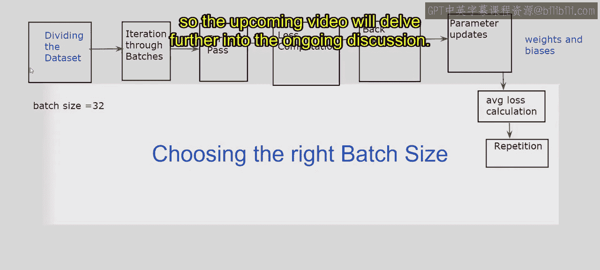

# Edureka《通过LLMs学习生成式人工智能（机器学习和NLP基础，第1课／共4课）｜Learn Generative AI with LLMs》中英字幕 - P39：38_批量大小.zh_en - GPT中英字幕课程资源 - BV1q4421Q7qh

Hello everyone welcome back to machine learning and NLP basics So now let's understand the bad size in this we are going to understand what exactly a bad size is and choosing the right batch size and impact of bad size on deep learning by the end of the session you are able to define the batch size as the number of samples processed per training iteration and also able to recognize how batch size interacts with learning rate and other hyperpara so let's get started understanding the bad size so first let's understand it with easy the example so imagine you are baking cookies okay and you have a recipe that makes hundred cookies instead of baking all hundred cookies at once you decided to bake them a smaller batches for instance you could。

😊。

Choose to bake only 10 cookies at this time。So in this。

 let's say you have a recipe that makes hundred cookies instead of baking all hundred cookies at once。

 you decided to bake them into a smaller batches。 For instance。

 you could choose to bake 10 cookies at a time。 This allows you to manage the baking process more efficiently and ensure consistent resultss in the similar way。

 in machine learning， batch size refers to the number of samples processed per training iteration。

 instead of updating the models parameter after processing every single training example。

 which is computationally expensive， the training data is divided into smaller batches like hundred to 10 these batches are then fed into the model and the models parameters are updated based on the average loss。

😊，pututed over each batch means each batch of cookies corresponds to the batch of training data。

 baking 10 cookies at a time is similar to processing a batch size of 10 samples per training iteration by dividing the task into smaller batches。

 the training process becomes more manageable and efficient。

 similar to how dividing the cookie recipe into batches makes the baking process more manageable。

 So that is what exactly a batch size is all about。

 So now let's understand the technical definition here。 batch size is the count of samples。

 trained per iteration whether if it is of the 10 samples。

20 samples or 30 samples or even one It will guiding the weight adjustments based on the error from。

These data subsets。 So that is what exactly the bad size will do。

 So now let's understand choosing the right bad size。

 So before we understand choosing the right bad size。

 let's dive into the technical steps involved in understanding the bad size。

So before understanding the choosing the right batch size。

 let's understand how exactly it will work first of all。

 So the very first step is dividing the data set。 So the data is divided into smaller subsets called batches。

 each containing a fixed number of samples determining by the batch size。

 Then the next step is iteration through the batches during each training iteration the model processes one batch of the data at a time。

 for example， if the batch size is set to 32， let's say。😊。

Means the model processes 32 samples in each iteration。 That is what iteration。

 Then the next step is forward pass。 What exactly happens here in each iteration。

 the input data from the current batch is fed to the forward through the model the model computes predictions for the input samples based on its current samples then it will be fed to the loss computation after forward pass。

 the model calculates the loss or the error between the predicted outputs and the actual labels for the samples in the batch and common loss function includes categorical cross entropy for classification task and mean squared error for the regression task and then the back propagation。

 the back propagation involves computing gradients of the loss function with respect to the model parameter。

😊，So these gradients represent the direction and magnitude of adjustments needed to minimize the loss。

 then parameter updates， the model parameters， nothing but the weights and biases always remember。😊。

The models parameters， weights and biases are updated using an optimization algorithm such as stochastic gradient descent or its variances like atom or RMS Pro the update rule are just each parameter based on the gradients computed during the back propagation scaled by the learning rate then the average loss calculation since the model parameters are updated based on the loss computed for each batch the average loss across all the samples in the batch is often Cal this average loss serves as a measure of how well the model is performing on the current batch of data then the next one is of repetition then steps2 to7 are represented for each batch in the data until all batches have been processed。

😊，The number of iterations required to complete one pass through the entire dataset is determined by the batch size means by following these steps bad size influences the granularity of training updates。

 balancing computational efficiency with learning dynamics in training machine learning models adjusting bad size impacts the trade of peten computational resources and convergence speed and generalization performance of the model so based on the understanding of the workflow so the upcoming video will delve further into the ongoing discussion。

