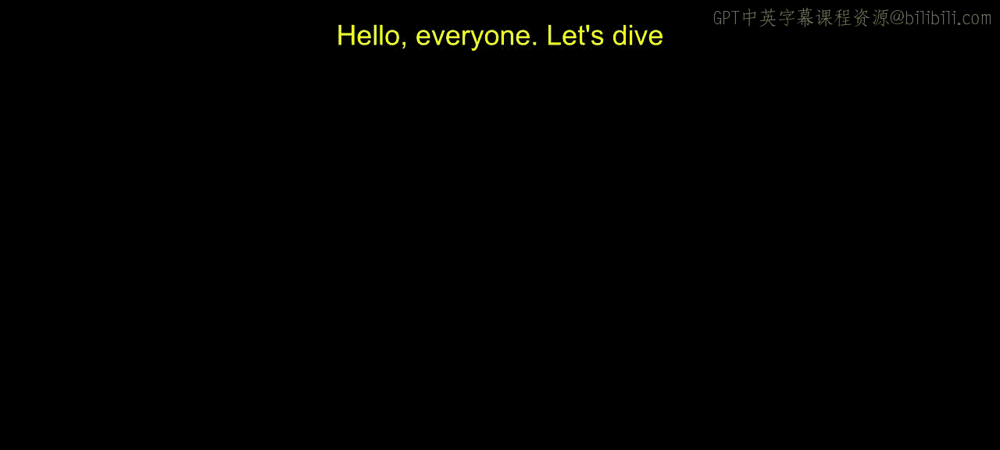
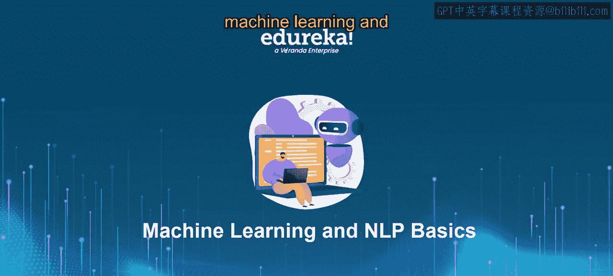
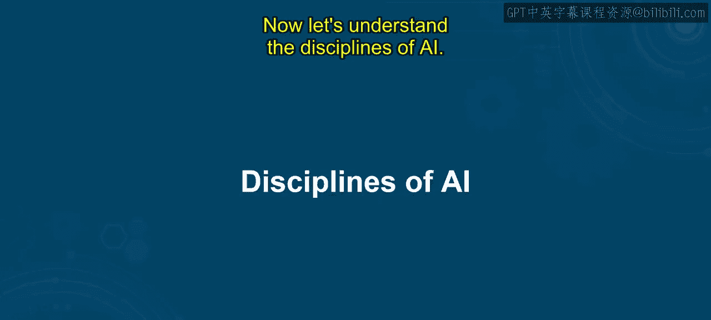
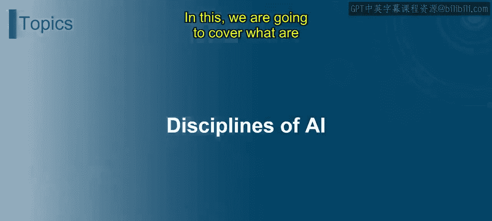
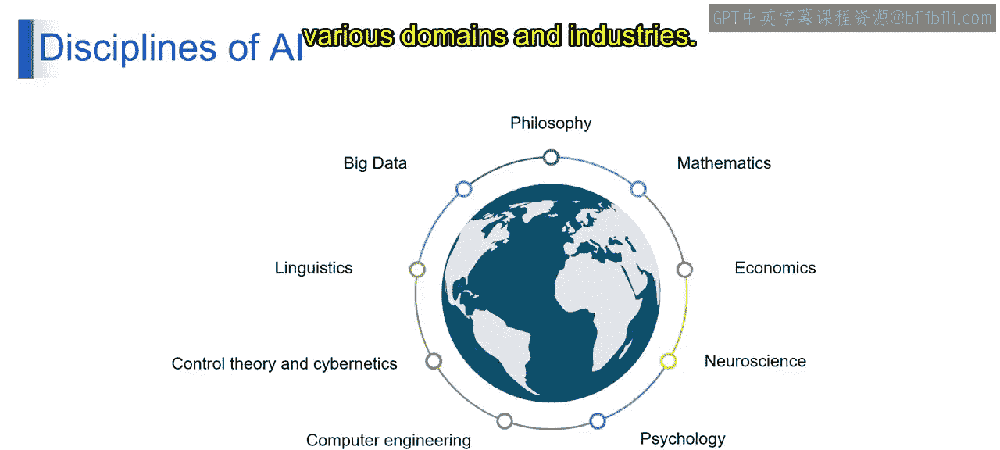

# Edureka《通过LLMs学习生成式人工智能（机器学习和NLP基础，第1课／共4课）｜Learn Generative AI with LLMs》中英字幕 - P3：2_AI的学科.zh_en - GPT中英字幕课程资源 - BV1q4421Q7qh

Hello， everyone， let's dive into the captivating world of machine learning and the foundational concepts of NLP together。

😊。

So now let's understand the disciplines of AI in this。

 we are going to cover what are the disciplines of AI。

And trends in the disciplines of AI by the end of the session you are able to understand and identify the and explain the core ideas of AI and you are able to grasp the core concepts and applications across the various AI disciplines so let's get started What is disciplines of AI。

Disciplines of AI is like different subjects or the areas of study within the field of artificial intelligence Each discipline focuses on specific things like teaching the computers to learn from the data understand human language recognize objects in the images or even act like humans in robot so these different areas help researchers and developersers explore different aspects of the AI and use them in different ways。

 like in healthcare finance or entertainment， understanding these disciplines。

 help us see the wide range of possibilities with artificial intelligence so now let's understand what does disciplines of AI include as mentioned the machine learning means teaching the computers to learn from the data and improve their performance over the time without being explicitly programmed coming to the natural language processing it will。

😊，Enable the computer to understand， interpret and generate human language in a way that is meaningful and contextually relevant。

 then coming to the computer vision， empowering the computers to interpret and analyze visual information from the images or the videos。

 enabling tasks like object detection， image classification and facial recognition。

 coming to the robotics， designing and developing robots that can perceive their environment。

 make decisions and perform tasks autonomously or semiaunomously， then coming to the planning。

 So creating algorithms and methods for generating the sequence of actions to achieve specific goals in various domains such as logistics。

 scheduling or autonomous navigations then knowledge representation for intelligent systems means。😊。

ing the techniques for representing and organizing knowledge in a way that computers can understand and reason with facilitating intelligent decision making and problem solving so these disciplines collectively contribute to the advancement of artificial intelligence by addressing the different aspects of intelligence and enabling a wide range of applications in the various domains and industries so let's break down each of the disciplines of AI The first one is going to be the philosophy so philosophy explores the fundamental questions about the nature of intelligence consciousness and ethics which inform the theoretical underpinning and ethical considerations of the AI development then coming to the mathematics it provides the fundamental framework for AI。

😊，goths and techniques including cliclus， linear algebra。

 probability theory and optimization which are essential for modeling and solving problems in the AI then coming to the economics economic studies the allocation of resources and decision making processes which are relevant to the AI in areas such as game theory optimization and market design as well as understanding the economic impact of AI technologies then the next one is of neuroscience so neuroscience investigates the structure and functions of the brain providing insights into biological intelligence and inspiring neural network models in the AI such as artificial neural networks and deep learning architecture then the next one is of psychology psychology explores。

😊，Han cognition， perception and behavior， which informs the design of AI systems that interact with the humans such as virtual assistants。

 chatbos and effective computing applications so that's about psychology then the next one is of computer engineering so computer engineering focuses on designing and building hardware and software systems including processes memory operating systems and programming language which are essential for implementing AI algorithms and applications then next one is of control theory and cybernetics so control theory and cybernetic study the principles of feedback and control in dynamic systems which are relevant to AI in areas such as robotic autonomous vehicles and adaptive systems then linguistic。

😊，It examines the structure and rules of the language which are essential for NLP in AI including tasks such as speech recognition。

 machine translation and sentiment analysis then the next one is of big data so big data focuses on the collection storage and analysis of large and complex data sets which are central to many AI applications including machine learning data mining and predictive analysis so these disciplines provide diverse perspectives and methodologies that contribute to the development understanding and applications of artificial intelligence in various domains and industries so the upcoming video will delve further into the ongoing discussion。

😊。

