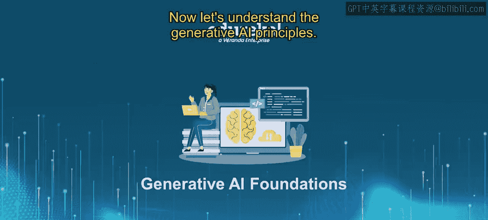
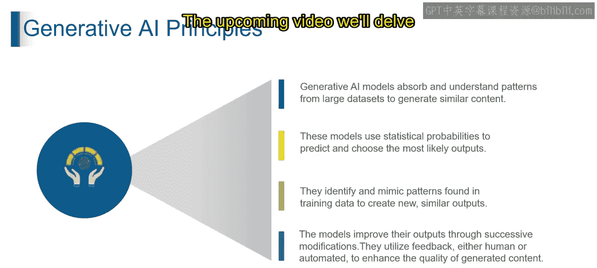

# Edureka《通过LLMs学习生成式AI（基础、应用开发、流行工具，第2、3、4课／共4课）｜Learn Generative AI with LLMs》中英 - P3：2_生成式AI原理.zh_en - GPT中英字幕课程资源 - BV1ym421V7gx

Hello everyone， welcome to Generative AI Foundations。

So now let's understand the generative AI principles in this we are going to cover the core principles of generative AI By the end of the session you are able to understand what are the core principles that govern the generative AI and its functioning so let's get started generative AI principles so here we presented total4 the first one is of absorbing patterns from the large data sets so generative AI starts by absorbing patterns from massive data sets much like learning from a huge library of examples think of it as a smart student studying from a vast collection of books means technically this principle involves training the AI model on the diverse data sets the AI learns every pattern in details understanding how different elements relate to each other then the next one ease of using statistical probabilities means。

😊。

It uses a statistical magic to predict and choose the most likely output。

 It's like predicting the next word in a sequence of a sentence based on the words that came before it means this principle involves the use of probability distributions。

 the AI calculates the likelihood of various outcomes and predicts the one that aligns with these statistical predictions。

 Then the next one is of identifying and mimicking the patterns means it identifies and mimics patterns found in its training data to create something new and similar。

 It's like an artist learning different styles to create their masterpiece means this involves the AI recognizing the patterns and structures in the data it has seen during the training time by mimicking these patterns。

 it generates content that mirrors the characteristics of the training data then the。😊。

Last one ease of improving through successive modifications means the AI refines its models based on feedback。

 whether from the humans or the automated systems。 this continuous improvement enhances the quality of the generated content over the time。

 So the upcoming video will delve further into the ongoing discussion。😊。

