# Edureka《通过LLMs学习生成式人工智能（机器学习和NLP基础，第1课／共4课）｜Learn Generative AI with LLMs》中英字幕 - P40：39_选择合适的批量大小.zh_en - GPT中英字幕课程资源 - BV1q4421Q7qh

So lets now explore the progression from our previous discussion。

 so now let's understand how to choose the right bad size。😊。

So choosing the right bath size is essential for effectively training deep learning models。

 so let's understand how to do that Me constraints choose a bath size that fits within the memory constraints of your hardware for example let's say GPU memory so larger the batch size require more memory for storing intermediate activations and gradients during the batch propagation then the next one is of training speed larger batch sizes typically result in faster training speed due to parallel processing and efficient memory utilization however。

 excessively large bath size may lead to slower convergence or poorer generalization then the next one is of convergence and performance Exp with different batch sizes to find one that es。

😊。

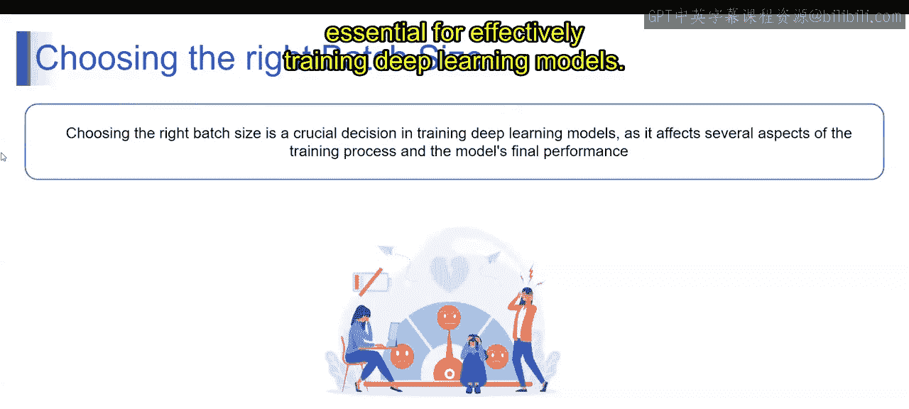

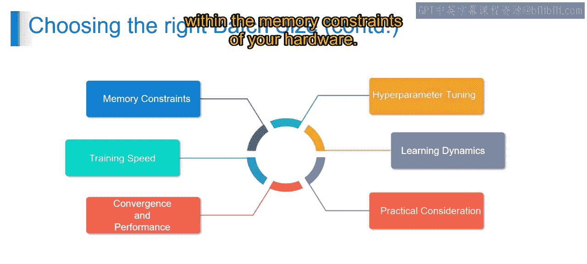

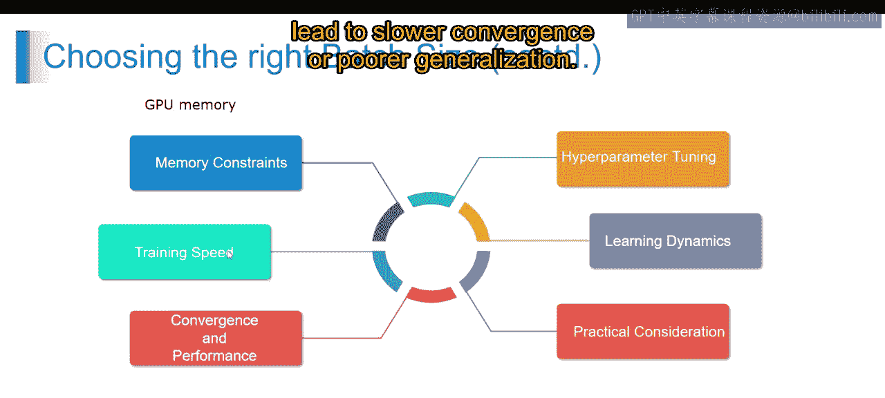

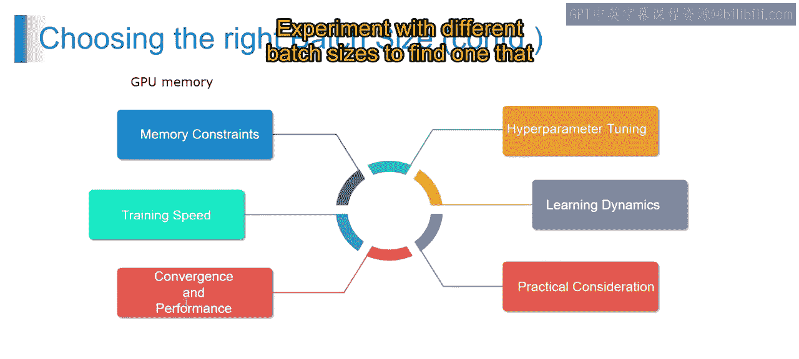

The fastest convergence and best performance on your dataset。

 smaller batch size may lead to more noisy updates。

 but can sometimes result in better generalization and performance。

 Then the next one is of practical consideration Consider practical constraints such as computational resources and time constraints when choosing the batch size for large data sets。

 smaller the batch size may be preferred to ensure faster iterations and quicker model evaluation。

 then learning dynamics the batch size influences the learning dynamics of the model affecting how quickly the model learns and adapts to the data。

 smaller batch sizes provide more frequent updates to the model parameters leading to faster learning dynamics。

 but potentially。😊，Higher variance and parametermeter updates。 Then finally， hyperparmeter tuning。

 So batch size is an important hyperparmeter that should be tuned along with other hyperparameter。

 for example， let's say。😊，Learning rate and network architecture to optimize the model performance and then conduct systematic experiments by training the model with different batch sizes and evaluating the performance metrics on a validation set means choosing the right batch size involves balancing memory constraints。

 training speed， convergence。😊。

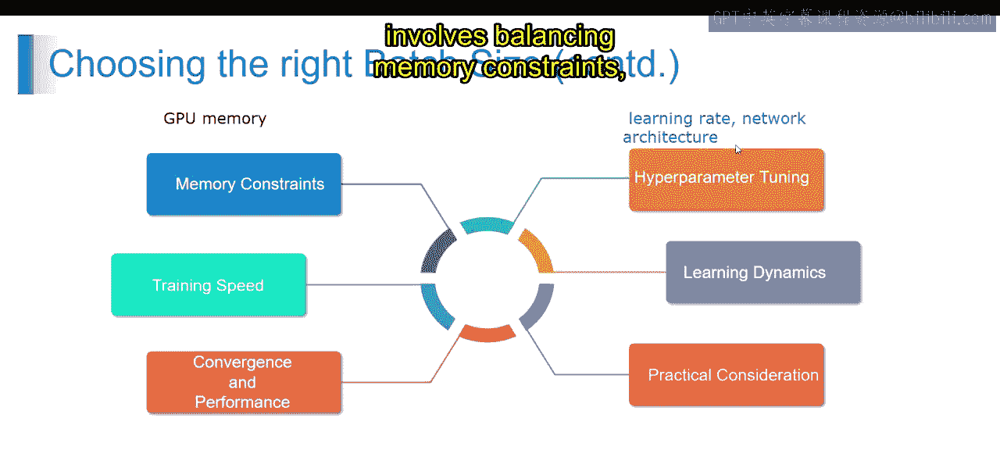

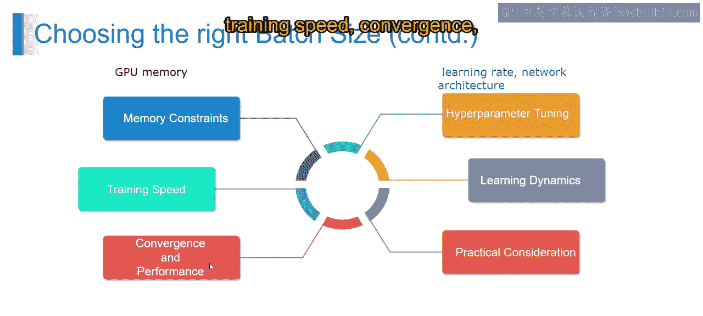

And practical considerations while considering the learning dynamics of the model。

 it is essential to experiment with different batch sizes and carefully evaluate their impact on model performance to find the optimal bath size for your specific task and data set。

 So now let's understand the impact of bath size on deep learning。😊。

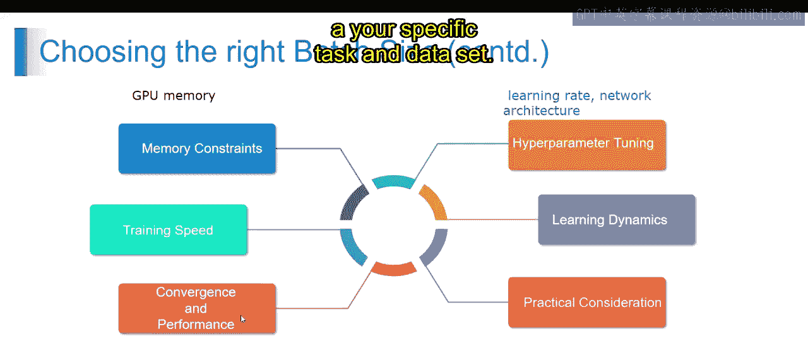

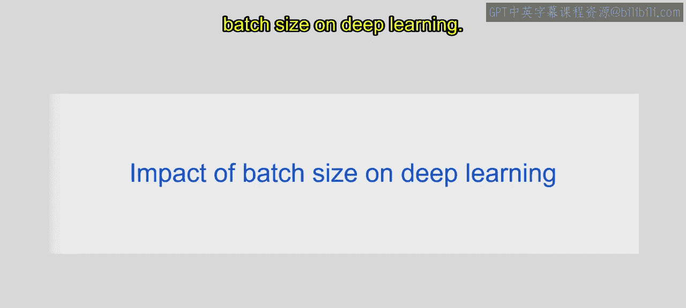

The first one is of gradient estimation batch size affect the quality of gradient estimation during the training。

 so larger batch sizes provide more accurate estimates of the true gradient resulting in smoother optimization trajectories however。

 smaller bath sizes introduce more noise into gradient estimates but may lead to better generalization and then the next one is of computational efficiency so larger batch size often lead to better computational efficiency by leveraging parallel processing and optimizing memory usage training with larger batches reduces the overhead associated with data loading and processing resulting in faster training times per epoch then computational efficiency it is nothing but the。

😊。

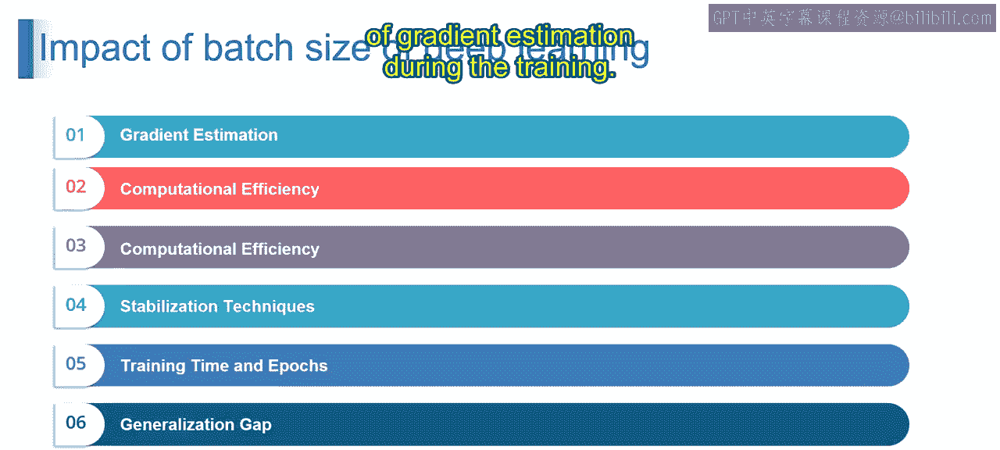

Repeated process training with larger batches often leads to better computational efficiency as it allows for more efficient use of hardware resources such as GPs。

 however， excessively large batch sizes may result in inefficient memory usage and slower convergence due to reduced stochastic city in gradient updates than the next even is of stabilization techniques。

😊，Bch normalization and other stabilization techniques can mitigate the effects of batch size on training dynamics。

 batch normalization normalizes activations within each mini batch reducing the dependence of the model on the batch size and improving training stability then the next one is of training time and epochs batch size influences the training time per epoch with large batch sizes typically resulting in faster training times。

 however， the number of epochs required for convergence may vary with batch size as smaller batches may require more iterations to reach the convergence then generalization gap so the choice of batch size can impact the generalization performance of the model smaller batch sizes may。

😊。

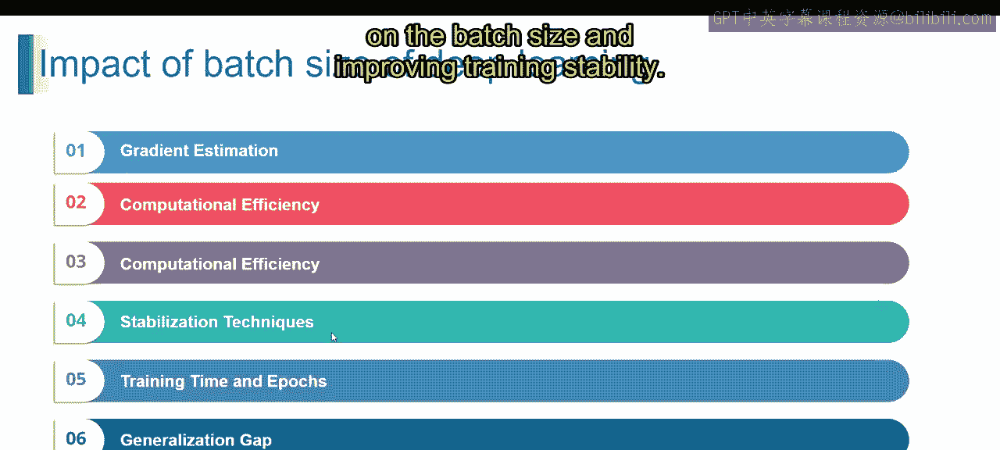

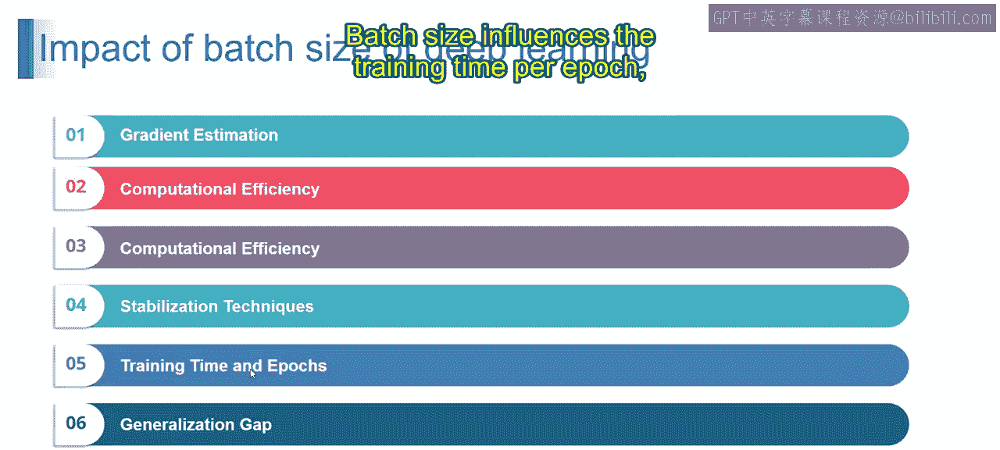

Introduce more noise into the optimization process leading to a larger generalization gap between training and validation or test performance。

 then finally， adaptive approaches， adaptive batch size strategies such as learning rate。

 scheduling and batch size unneing can dynamically adjust the bad size during the training process。

 These adaptive approaches can help balance the trade of between computational efficiency and optimizationization stability leading to improved model performance means the choice of the batch size in deep learning impacts。

 gradient estimation， computational efficiency and stabilization techniques， training time。

 generalization performance and adaptive approaches。

 Care consideration of these factors is essential for optimize。😊。

izing model training and achieving high performance on target tasks Now the summary in this lesson。

 you have grasped the essence of batch size， understanding it as the quantity of data samples processed in a single training step and identifying pivotboal factors。

 influencing its selection in deep learning by recognizing the impact of batch size choices on model training and outcomes。

 you are equipped to optimize training efficiency and model performance in deep learning tasks。😊。

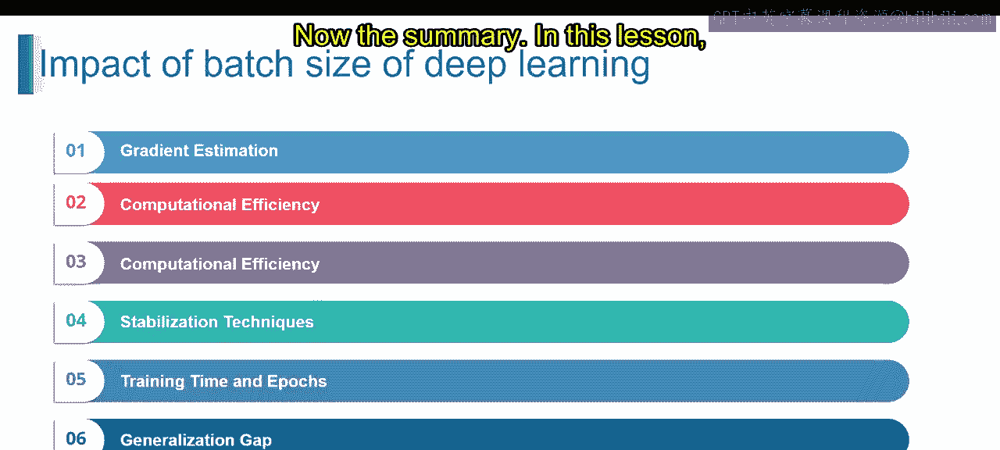

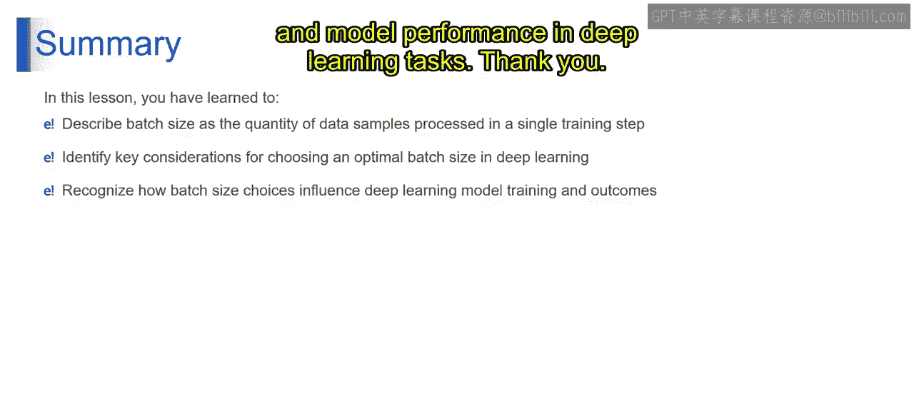

than you。