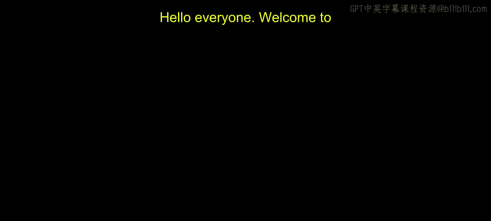
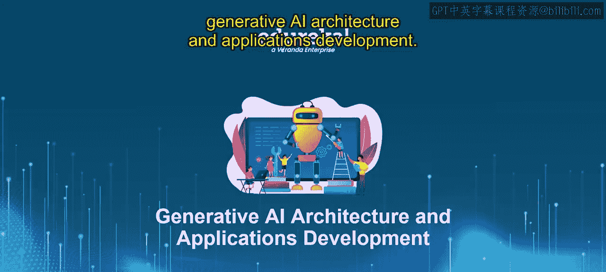
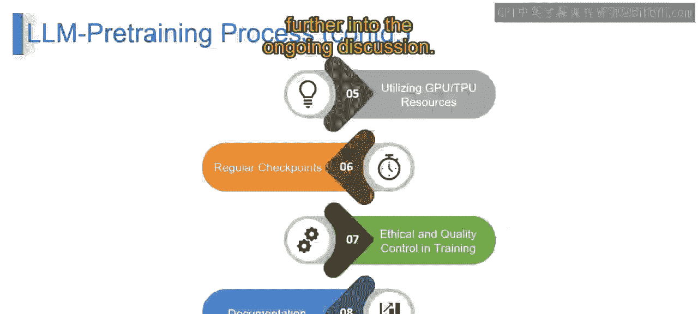

# Edureka《通过LLMs学习生成式AI（基础、应用开发、流行工具，第2、3、4课／共4课）｜Learn Generative AI with LLMs》中英 - P40：3_LLM预训练和扩展.zh_en - GPT中英字幕课程资源 - BV1ym421V7gx

Hello everyone welcomele to generative AI architectureect and applications development So now let's understand the topic the LLM's pretraining and its scaling by the end of the session you are able to learn the concept of the pre-training in LLM and you are able to explore the training techniques used to enhance the LLM performance so let's get started the LLM pretraining and its scaling the very first step for this is data collection and preprocessing imagine begging the perfect cake so before you start mixing ingredients you gather the best stuff life flow eggs and sugar so in LLM pretrain we do the same so but here we are collecting the tons of the text data the raw ingredients for our digital masterpiece then just like sifting floor to remove the lumps we clean and organize the data to make sure our。

😊。

I learns from the best out of it。 So technically the data collection and preproing involves gathering large amount of text data and preparing it for our AI learning。

 It's like selecting the finest ingredients and ensuring they are in the best possible form for our digital creation to learn efficiently。

 So that's about data collection and preproing。 then the next step is that model architecture and setup。

 Now think of building a spaceship。 you need a solid design right。 So Ls are similar。

 they need a well thought of architecture like crafting the perfect spaceship for our AI journey we set up the structure。

 deciding how our model will understand and generate the language the very essence of our digital space Odyssey technically the model architecture setup is about designing the blueprint of our。

AIIt involves creating the structure that defines how the model will process and generate the language。

 ensuring it's well equipped for its linguistic adventures。

 That's about model architecture and setup。 Then the next step is training script development So imagine teaching a robot its acs we develop a training script It's like a lesson plan for our digital student。

 This script guides the AI through the learning process。

 teaching it everything from the basic grammar rules to crafting compelling sentence means technically training script development is a to creating a curriculum for our AI。

 It's a detailed plan that guides the model through the learning process So teaching its shades and intricacies of the language。

 So that's about the training script development。 Then the next one is of monitoring and logging just like a cap。

😊，checks a ship's instruments。 We keep a close eye on our AIs progress。

 So we monitor its learning journey， logging every step。

 It's like fixing a small leak before it turns into a flood。

 ensuring the training process go smoothly means monitoring and logging involves keeping a track of the AIs progress during the training process。

 This ensures early detection of any issues。 making the training process more efficient and also more effective。

 So that's about monitoring and logging。 Then the next step is utilizing GPU or TU resources。

 So think of our AI as a superhero in training to speed up its learning。

 We give it a powerful sidekick， a GPU or the Tu。 It is nothing but graphics or tensor processinging units。

 It's like updating our heroes K to conquer the challenges faster and emerge as a language superhero。

Technically， utilizing GPU or TU resources involves providing additional computing power to our AI during the training process。

 it's akin to giving our digital superhero advanced equipment to enhance its learning。😊。

It's learning speed and efficiency so that's about utilizing GPU or TU resources then the next one is regular checkpoints so what exactly we are doing here in our AI adventure with checkpoints like saving game process these checkpoints safeguard the AIs learning allowing us to pick up from where we left off。

😊，If something unexpected happens， it's like having a magical bookmark in our AI storybook means technically regular checkpoints involves saving the AI's progress at intervals during the training process this ensures that if there is any interruption we can resume training from a specific point。

 much like picking up a story from very last leftoff。 So that's about regular checkpoints。

 then the next one is of ethical and quality control in training。

 So just like superheroes have a moral code。 our AI follows ethical guidelines。

 So we implement quality control measures to ensure our digital creation behaves responsibly creating a positive impact on the world。

 So ethical and quality control in training involves setting guidelines and measures to ensure the AI's behavior aligns with the ethical standards。

 it's about creating a。😊，ponsible and positive digital entity Then the next one is of documentation Last but not the least we document our AIs journey。

 its origin story， its powers and the lessons it learned this is like creating a superhero manual ensuring others can understand and built upon the incredible work we have done So documentation involves recording and detailing every aspect of the AI training process。

 It's like creating a comprehensive manual that provides insights into the AI's development capabilities and ethical considerations for future references so to sum it up the large language models pretraining and scaling we understood the journey of collecting organizing and teaching our digital companion of the language with robust architecture monitoring and ethical guidelines。

😊，We empower our AI to become the superhero of the linguistic realLM。

 So now let's understand the LLM scaling。 So the upcoming video will delve further into the ongoing discussion。

😊。

