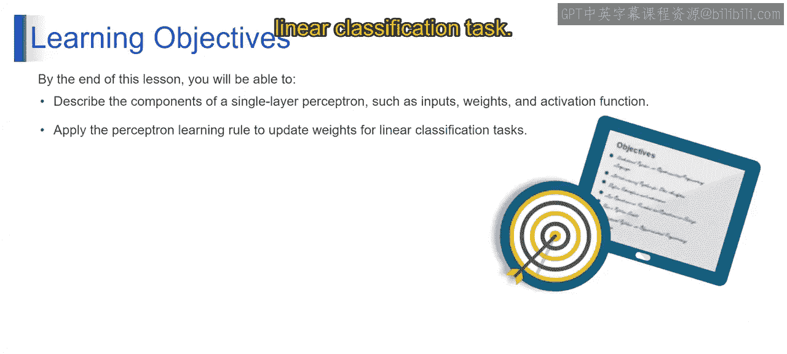
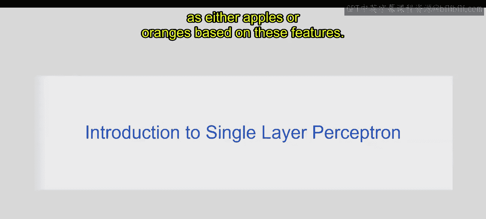
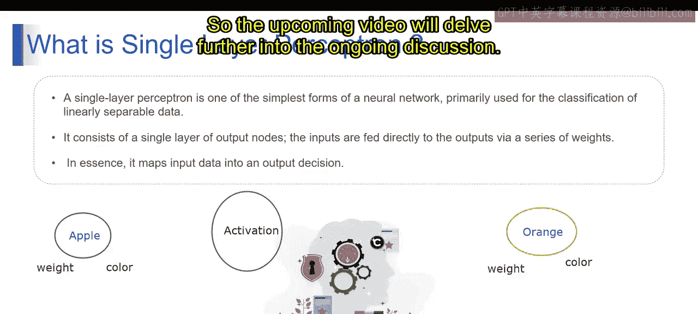

# Edureka《通过LLMs学习生成式人工智能（机器学习和NLP基础，第1课／共4课）｜Learn Generative AI with LLMs》中英字幕 - P41：40_单层感知器.zh_en - GPT中英字幕课程资源 - BV1q4421Q7qh

Hello everyone welcome back to machine learning and NLP basics so now let's understand single layer perceptron in this we are going to cover introduction to single layer perceptron and working of single layer perceptron by the end of the session you will be able to describe the components of single layer perceptron such as inputs。

 weights and activation function and you are able to apply the perceptron learning rule to update weights for a linear classification task so let's get started introduction to single layer perceptron first let's understand what exactly a single layer perceptron is all about let me explain about an example imagine you are trying to predict whether a fruit is an apple or an orange based on its weights and color。

😊。

SoYou have a dataset set of fruits with their corresponding weights and colors along with the labels indicating whether they are apples or oranges。

 so now you want to build a simple model that can learn to classify new fruits as either apples or oranges based on these features means technically a single layer perceptron is the simplest form of feed for neural network consisting of only one layer of neurons each neuron in single layer perceptron receive inputs which are multiplied by corresponding weights and summed together this weighted sum is then passed through an activation function and the output of the activation function determines the final classification of prediction。

😊。

So in our example， in the fruit classification， the single layer perceptron would have two input neurons representing weight and color of the fruit。

 Each input would be multiplied by corresponding weight representing the importance of the feature for classification the weighted sum of inputs is then passed through the activation function which could be a step function for binary classification。

 or sigmoid function for probabilistic classification So based on the output of the activation function。

 the single layer perceptron predicts whether the fruit is an apple or an orange means the single layer perceptron serves as a basic model for binary classification tasks where inputs are weighted and passed through an activation to make the predictions it simply。

😊，City makes it easy to understand and implement making it a foundational concept in neural network architecture。

So now let's understand the technical thing a single layer perceptron is a simplest form of neural network primarily used for classification of linear separable data and it consists of single layer as it is single layer perceptron of output notes the inputs are fit directly to the outputs via series of weight in the essence if maps input data to the output decision means single layer perceptron is fundamental type of neural architecture characterized by its simplicity and linear structure it comprises only one layer of neuron which directly maps input data to the output decisions so what are the key characteristics as we have seen simplicity linearly separable direct mapping weighted sum and activation function so the upcoming video will delve further into the ongoing discussion。

😊。

