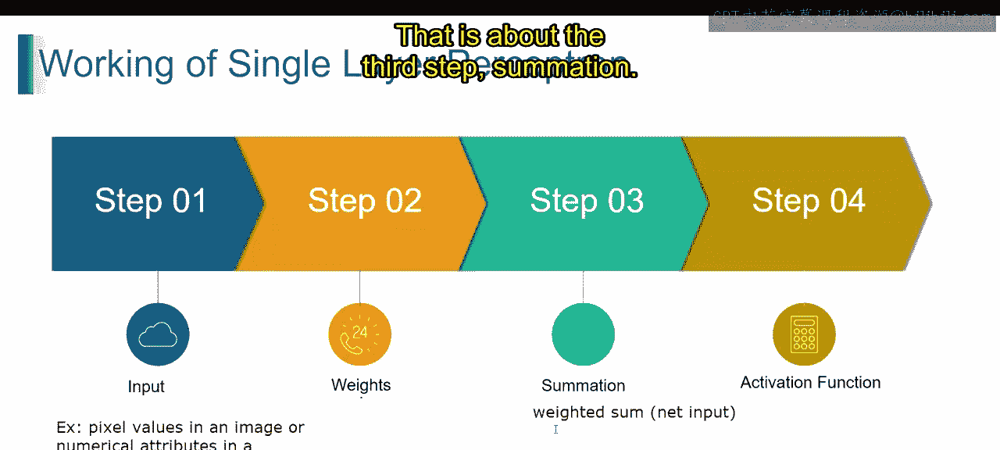
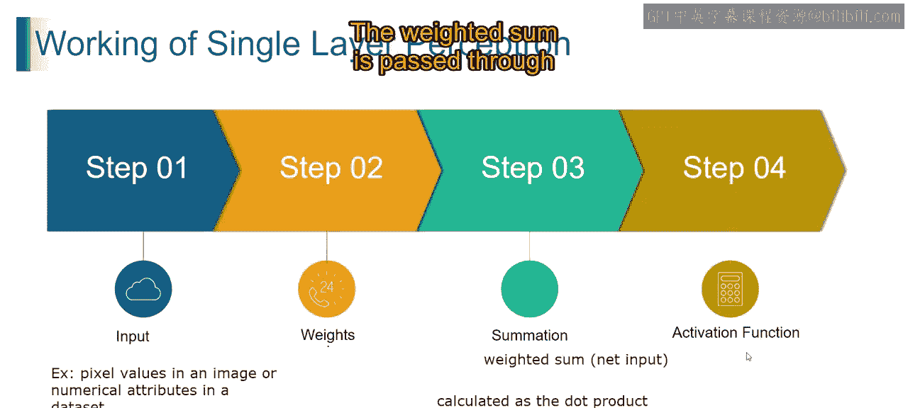
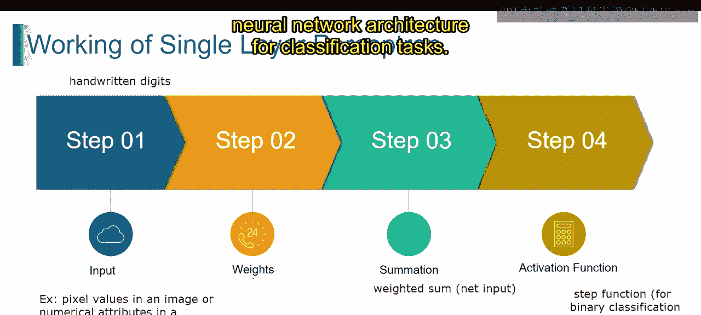
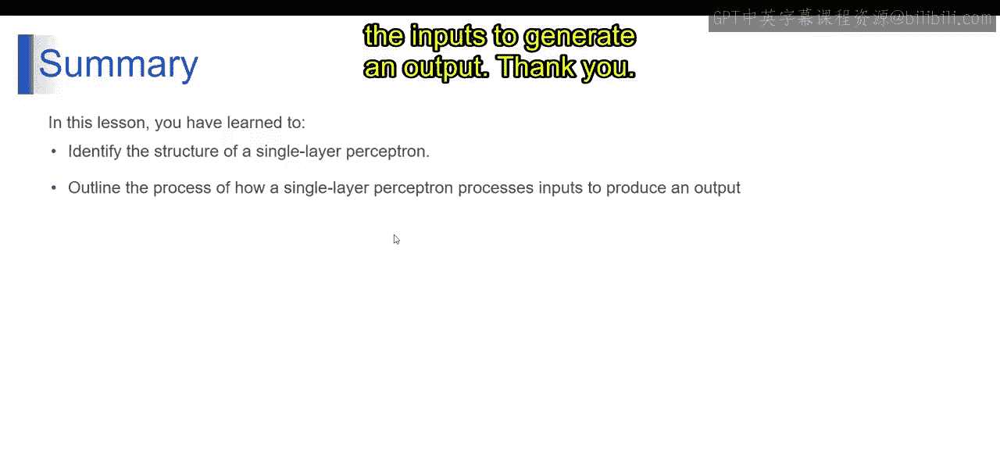

# Edureka《通过LLMs学习生成式人工智能（机器学习和NLP基础，第1课／共4课）｜Learn Generative AI with LLMs》中英字幕 - P42：41_单层感知器的工作原理.zh_en - GPT中英字幕课程资源 - BV1q4421Q7qh

So let's now explore the progression from our previous discussion。😊。

So now let's understand working of single layer perception So the first step is of input The process begins with the input layer where the data is fed into the perceptron each input neuron represents a feature of the input data such as pixel value in an image or numerical attributes in the data Each input neuron represents a feature of input data such as pixel values in an image or numerical attributes in a data then the second step is weights so each input neuron is associated with the weight which represents the importance of that particular feature in the decision making process these weights are adjusted during the training phase to optimize the model's performance then the next one is of sumization the weighted inputs are somewhat together。

😊，To produce a weighted sum also known as the net input mathematically the weighted sum or the net input is calculated as the dot product of the input vector and the weighted vector plus biostr so that is about the third step summation then the footstep activation function。

 so the weighted sum is passed through an activation function which determines the output of the perceptron the activation function introduces nonlineity into the model allowing it to learn complex patterns and relationships in the data common activation function include step function for binary classification task and the sigmoid function for probabilistic output。

😊。

The common activation functions include step function for binary classification tasks and the sigmoid function for probabilistic output then finally the interpretation the single layer perceptron makes decisions by arranging weighted inputs and applying an activation function to produce an output by adjusting the weights during the training the perceptron learns to classify input data currently based on the learned patterns in the training data。

 the activation function introduces non nonlinearity allowing the perceptron to learn a model complex relationship in the data。

😊，For example， let's consider a single layer perceptron trained to classify hand written disease。

 Let's say， for example。😊，A single layer perceptron trained to classify handwritten digits。

 Each input neuron represents a pixel value or in a digit image。

 Each weight represents the importance of that pixel in determining the digits identity。

 the perceptron sums。😊，The weighted pixel values and applies an activation function to predict the digit representation by the image means the working of single perceptron layer the single layer perceptron involves processing the input data aggregating the weighted inputs outputting or computing the weighted sum and applying an activation function to produce an output decisions it serves as a basic building block in neural network architecture for classification tasks now the summary in this lesson you have grasped the structure of single layer perceptron and understood how it processes the inputs to generate an output Thank you。

😊。

