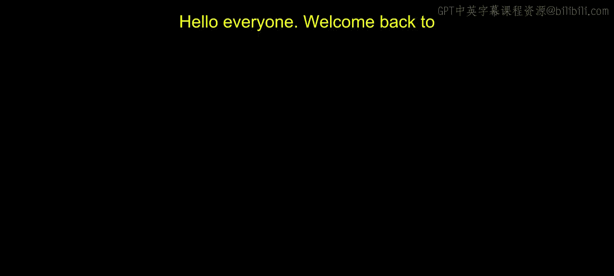
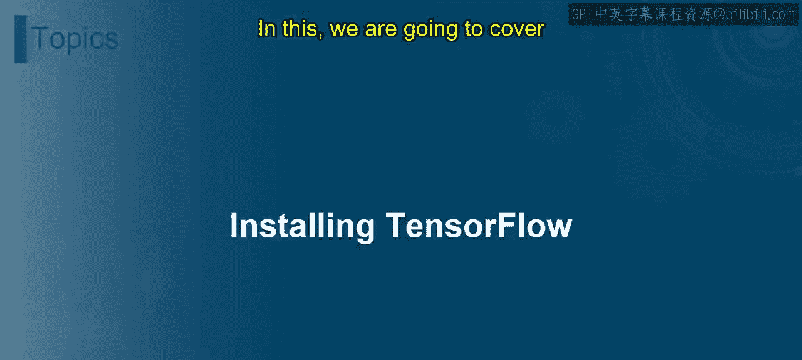
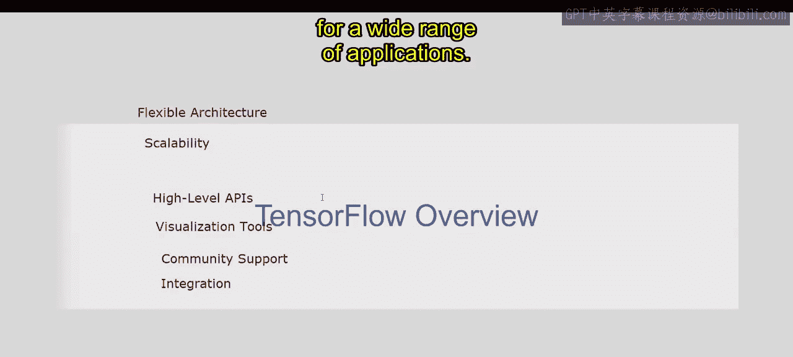
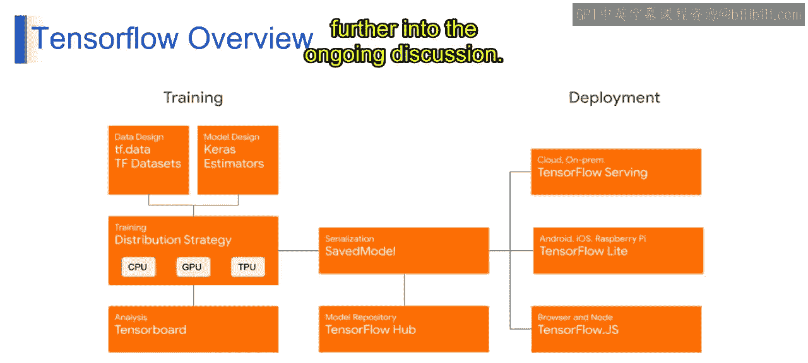

# Edureka《通过LLMs学习生成式人工智能（机器学习和NLP基础，第1课／共4课）｜Learn Generative AI with LLMs》中英字幕 - P43：42_安装TensorFlow.zh_en - GPT中英字幕课程资源 - BV1q4421Q7qh

Hello everyone welcome back to machine learning and NLP basics so now let's understand the installation of Tensorflow and how it is going to happen in this we are going to cover the Tensorflowlow overview and functions not sessions so let's understand all this by the end of the session you will be able to familiarize the system requirements for Tensorflowlow and you are able to learn the functions of Tensorflowlow 1。

 x and Tensorflow 2。0 so let's get started Tensorflow overview。😊。

So Tensorflow is an open source machine learning framework developed by Google for building and training machine learning models it provides a comprehensive ecosystem of tools libraries and resources to support various machine learning tasks including deep learning reinforcement learning and many more so what are the key features of it then generally so the key features of the Tensorflow includes so now let's understand the key features of Tensorflow that includes flexible architecture Tensorflow offers a flexible architecture that allows users to define and customize machine learning models at various level of abstraction from lowle maintenance from lowle mathematical operations to highle abstractions like Ks and then the next one is of scalability Tensorflow is。

😊，Tined to scale efficiently across multiple CPUs and GPs。

 enabling users to train and deploy models on wide range of hardware platforms from personal computers to distributed computing clusters。

 Then the next one is of highleve APIs。 Tensorflow provides highle APIs like ks。

 Tf dot ks and estimators with simplify the process of building and training machine learning models making it accessible to users with varying levels of expertise。

 Then the next one is of visualization tools。 Senorflow includes powerful visualization tools like Tensorboard which enables users to visualize and monitor the training process unless model performance and debu machine learning models effectively。

 Then the next one is of community。😊，Support TensorFlow has a vibrant and active community of developers。

 researchers and practitioners who contribute to its development。

 share resources and provide support through forums。

 tutorials and documentations then finally the integration TensorFlow seamlessly integrates with other popular machine learning libraries and frameworks such as psyic learn nu and pyt。

 allowing users to leverage their existing knowledge and resources means TensorFlow is a versatile and powerful framework that empowers developers and researchers to build and deploy state of the art machine learning models for a wide range of applications。

😊。

So here we provided the Tensorflow overview so the very first step isO data design Tensorflowlow provides tools like Tf dot data where we are having TfDt data and Tensorflow data sets for efficiently managing and preprocessing the data this Tf dot data allows for creating input pipelines to stream data efficiently from disk and perform transformation such as batching and shuffling that is about the data design then coming to model design for building neural network models CAas provides a user friendly interface for defining and training deep learning models while estimators provide a more structured approach suitable for distributed training and production deployment then the next one is of the training with distribution。

😊，Strategy so the Tensor flow supports various distribution strategies for training the models across multiple processing units。

 including CPUs， GPUs and Ts， which are nothing but tensor processinging units。

 this allows for parallelizing computations and speeding of the training process。

 especially for large scale data sets and complex models。

 Then the next step is serialization saved model。 So after training models are serialized and saved using the saved model format providing a standardized way to save and share trained models。

 Tensor flow hub。😊，Serves as a model repository where pretrained models can be shared。

 discovered and reused by the machine learning community。

 Then analysis Tensor board Tensor board is a visualizing toolkit provided by Tensorflow for understanding debugging and optimizing machine learning models。

 it allows for visualizing various aspects of the model training and evaluation including loss curves。

 model architecture and embeddings。 Finally， the deployment Tensorflow supports deployment across various platforms。

 including cloud on premises， mobile devices and web browsers for cloud deployment Tensorflow serving。

 enables serving trained models as scalable production ready APIs for interface in cloud environments for edge devices。

😊，Such as mobile phones and ID devices and embedded systems like Raspberry Pi Tensorflow light provides a lightweight runtime for running machine learning models with low latency and resource constraints。

 Tensorflow dot Js allows deploying models in both browsers and node node dot Js environment enabling machine learning applications to run directly in the browser without serverside processing so this recorded overview provides structured progression from data preprocessing to model training analysis and deployment reflecting the typical workflow when working with the TensorF so the upcoming video will delve further into the ongoing discussion。

😊。

