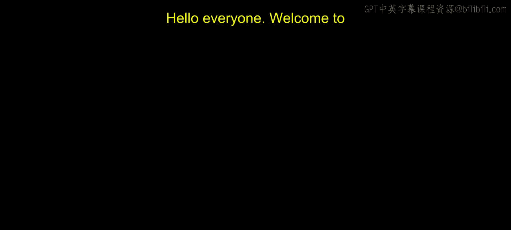
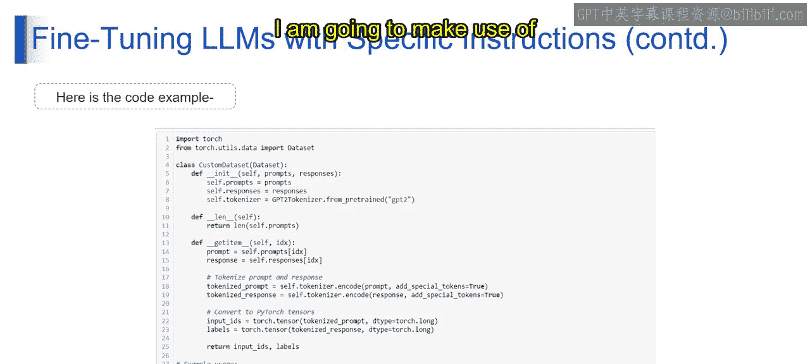

# Edureka《通过LLMs学习生成式AI（基础、应用开发、流行工具，第2、3、4课／共4课）｜Learn Generative AI with LLMs》中英 - P43：6_使用特定指令微调LLM.zh_en - GPT中英字幕课程资源 - BV1ym421V7gx

Hello everyone， welcome to Generative AI Architectural and applications development。😊。

The fine tuning LLMs were the specific instructions。

So in this we are going to understand the fine tuning elementsLlums with the specific instructions by the end of the session you are able to grasp the importance of the fine tuning in tailoring elementsLlums for a specific task。

 so let's get started。😊，So in previous module on parameter fine tuning。

 we primarily focused on optimizing the parameters of pretrained model to ensure its overall performance。

 so without specifying any taskspec instruction， however。

 in fine tuning LLMs word specific instruction we tailor the fine tuning process to imbue the model with the particular capabilities or behaviors based on the explicit instructions or the guidelines。

 for example in parameter fine tuning， we might adjust the learning read or regularization technique to improve the model's general performance in contract fine tuning LLMs word specific instruction involves walls providing the model with the targeted guidance or the additional training data aimed at achieving the particular language generation task such as generating a text。

😊，With specific themes， sentiments or even styles， so in the essence file parameter tuning aim to enhance the overall model performance。

 fine tuning elementsLMS with the specific instructions redirect the fine tuning process towards achieving a task specific objectives by providing the model with explicit instructions or the guidelines。

😊，Let's dive into each of these common parameters using the fine tuning language models。

 so the very first thing is of learning rate， so this determines the step size at which the model parameters are updated during the training it influences the speed and stability of the training process with a higher learning rate leading to faster convergence but potentially causing instability while a lower learning rate may result in slower convergence but more stable training then coming to the next one is of the batch size so batch size refers to the number of training examples。

😊，Processed together in each iteration during the training process。

 it affects the speed and memory requirements of the training with larger batch sizes often result in faster training but requiring more memory and smaller batch sizes offering more stability and potentially better generalization then the next one is of number of training steps or epochs so the number of training steps or epochs specifies how many times the entire training data is passed through the model during the training process it influences the model convergence and generalization with more training steps potentially leading to better performance but also increasing the risk of overfitting if not properly controlled then the next one is of the dropout rate so dropout rate ease。

😊，A regularization technique certainly drops a proportion of neurons or the connections during the training to prevent the overfitting。

 so dropout rate determines the proportion of neurons or connections to be dropped with higher dropout rates offering more regularization but potentially slowing down the training and requiring longer training times。

😮，That is about dropout rate then coming to the next one weight decay。

 so it also known as L2 regularization， it penalizes large weights in the model to prevent the overfitting it adds regularization term to loss function that penalizes large weight values。

 encouraging the model to learn simpler and more generalized patterns。😊。

Then the next one is warm up steps so initial training step with a low learning rate to stabilize the training process and prevent diverggens so in gradient accumulation steps so it accumulates gradients over the multiple patches before updating the model parameters useful for training with large patch sizes then the next one is of atom optimizer parameter so what exactly it will do so parameter specific to the atom optimizer such as beta coefficients or even epsilon which controls the momentum and scale of parameter updates then the next one is learning rate schedulers it will adjust learning rates during the training based on the predefined schedules such as exponential decay or the linear warmup then the last one is of the ta specific parameters。

😊，Additional parameters specific to fine tuning tasks such as text generation pros or classification labels tailored to the specific objective of the fine tuning process。

😊，Then fine tuning LLMs worth specific instruction the very first one is importance of specific instruction in fine tuning so specific instructions guide the fine tuning process ensuring that the LLM is tailored to perform taskspec objectives such as generating text to with particular themes or the styles these instructions Pro clarity and direction enhancing the effectiveness of the fine tuning process then the next one is of the process of fine tuning with the specific instruction means the process involves providing the LLM with taskspec instructions or the guidelines which could include additional training data prompts or the constraints the model is then fine tuned using these instructions to adapt its language generation capabilities accordingly then the next one is of。

😊，menting specific instruction in fine tuning so specific instructions can be implemented by incorporating task specific prompts or constraints during the fine tuning process。

 for example， for sentiment analysis， the LLM may be fine tuned with the labeled sentiment data instructing it to generate with the desired sentimented tones。

That's about specific instruction then the next one is fine tuning objective with specific instructions So what exactly happens here is that the objective of the fine tuning with the specific instruction is to adapt the model to perform task specific language generation tasks such as text summarization translation or the sentiment analysis by providing explicit instructions the model can learn to generate text that align with the desired criteria then the next one is of applications and challenges of fine tuned LLMs so fine tune elementss have applications across the various domains including content generation conversational agents and text classification however challenges may arise in effectively defining and completing the specific instructions as well as ensuring the model performance。

😊，Alliance with the desired objectives。 then the last one is of advanced steps in fine tuning elementss。

 so advanced steps may include experimenting with different fine tuning strategies such as multitaask learning。

 transfer learning or architectural modifications。 Additionally。

 techniques like hyperparameter tuning and regularization methods can further optimize the fine tuning process for improved performance。

😊，Here we have provided with some code。😊，So in the next video。

 I will be explaining about the coding part of fine tuning the LM with the specific instructions I am going to make use of the open AI API for this particular task。

😊。

Thank you。