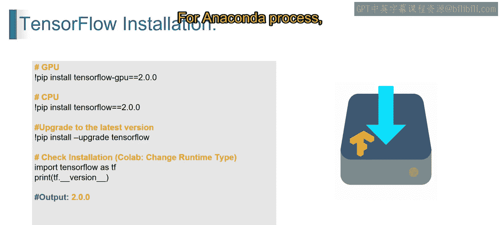
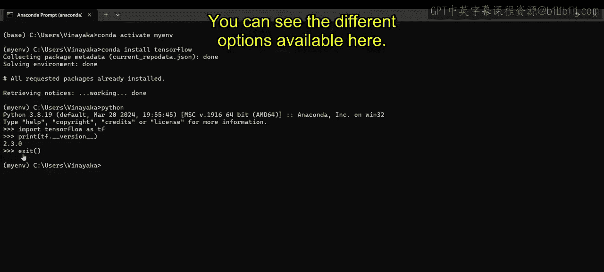
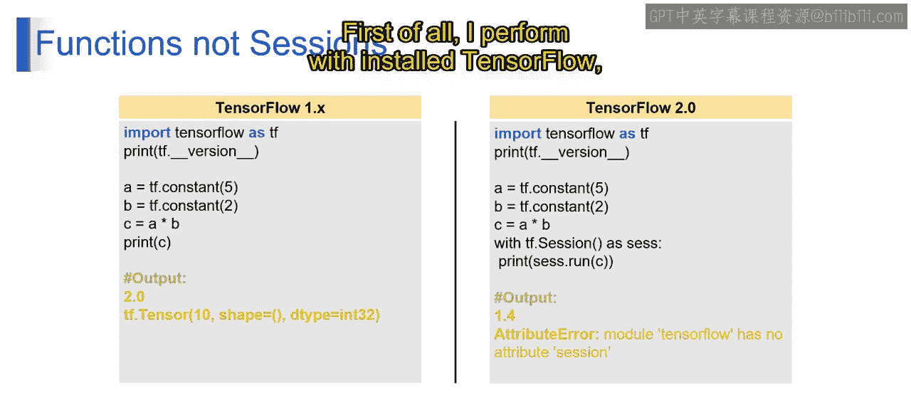
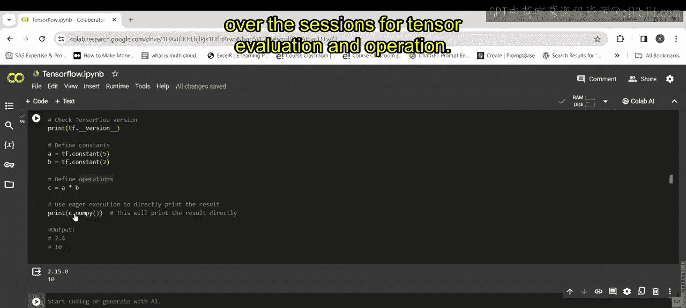
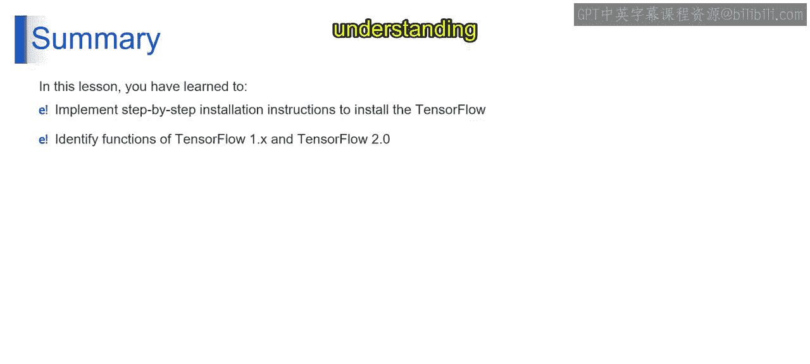

# Edureka《通过LLMs学习生成式人工智能（机器学习和NLP基础，第1课／共4课）｜Learn Generative AI with LLMs》中英字幕 - P44：43_TensorFlow安装.zh_en - GPT中英字幕课程资源 - BV1q4421Q7qh

So lets now explore the progression from our previous discussion so based on this understanding lets move into the installation guide so you can install either on GPU CPU and you can even upgrade to the latest versions also if you are already have it in your local okay so now let's perform it I am using the Anaconda prompt for this。

😊，So for under the process。

First of all， I am activating the new environment。 So for that I am telling Koda activate my environment and it will activate my environment。

 Once if it is done， you can start install tensorflow with Koda instead of using pe。

 you can try installing tensorflow using the Koda which might resolve compatibility issues more refracively。

 so you can simply provide Koda install tensorflow So as it is already installed on my mission。

 it may give me like you know it is already present。 but if you are doing it for the first time。

 it can process it and can provide it to you it is loading。

 So now you guys can see all requested packages are already installed。

 So if you are doing it for the first time， it may take around two or three minutes。 Okay。

 so once if it is done。 how can I check whether the tensorflow is installed on my machine or not。

 So simply type Python here。😊，And click on enter it will provide the Python interpreter。

 So once the Python interpreter is ready， you can execute import。

 you can simply type import Tensorflow Sf。 It will take some time and can give you the output。😊。

So now it is done。 Now you can simply print Tf dot underscore underscore version underscore underscore。

 So this should correctly print the tensorflow version installed in your environment。

 you can see it is giving me 2。3。0。 After checking the version。

 you can simply type exit If you want to exit from the interpreter。

 That's it Now you are ready with your tensor flow in your local。😊。

So you can see the different options available here。 you can try and check it from your local。

 So now the functions not sessions。 what exactly it is。 So let's understand it now。

 So in this you guys can see in tensorflow 1。 X the traditional approach involved using the sessions of Tf dot session to execute computational graphs and evaluate the tensors So here is the code they have provided and coming to the tensorflow 2。

0 in tensorflow 2。0 the paradigm has shifted towards eager execution by default eliminating the need first sessions。

 So let's execute them on the collab notebook I am using the Google collab to showcase the example。😊。

Here is a code for your reference。 so first of all。

 I perform install tensorflow I am using my Google coab。 so once if it is done。

 you can simply copy the code whatever they provided and here we imported tensorflow as Tf and here we are checking the version and then a is equal to Tf dot constant of 5 and 2 means we are defining the constant and then we are providing the operation of multiplication and then we are printing the results so let's execute it can you all see this we are getting the output as 2。

15。 or this is a version and now here the tensorflow 1。

 x requires the explicit creation of a session to run the computational graph and evaluation the tensors although the operation were defined eagerly the execution of the graph and evaluation of tensors。

😊。

Requires the explicit use of the sessions here we are getting the output as Tf dot tensor of 10 means5 into 2 and it is providing the shape comma D type as in now lets execute it with the other way around。

😊，Now， can you all see it is now printing the output directly without all this information So what is the difference here In tensorflow。

 it enables eager execution by default， allowing immediate execution of tensors without the need for explicit sessions。

 you can directly access the Ny array representation of the tensor using dot Ny method to get the value in tensorflow 2。

 x， it promotes a more intuitive and pythonic way of working with tensors。

 eliminating the need for managing sessions explicitly functions such as C dot Ny are predefined over the sessions for tensor evaluation and operation。

😊。

Here， if we can see the coding example， the Tensorflow 1。 x， this code is written using Tensorflow 1。

 x syntax in Tensorflow 1。 x， the session is explicitly created using the Tf dot session and operations are executed within the session using the session dot run you can see this however when you execute this code with Tensorflow 2。

 x you encounter the attribute error because the Tensorflow 2。

 x no longer uses Tf dot sessions where in tensorflow 2。

x example the code that whatever we have seen in the syntax it performs eager execution is enabled by default meaning operations are evaluated immediately instead of building a computational graph to be executed later hence you don't need to create a session explicitly。

😊，When you execute this code with Tensorflow 2。 x， it directly prints the result of the tensor C。

 So now the summary in this lesson， you have understood the step by step installation process for tensorflow on Windows in tensorflow on annaconda ensuring seamless setup Additionally。

 you have identified the difference between the tensorflow 1。 x and 2。 x operational differences。😊。

And understanding the respective function paradigm， Thank you。😊。

