# Edureka《通过LLMs学习生成式AI（基础、应用开发、流行工具，第2、3、4课／共4课）｜Learn Generative AI with LLMs》中英 - P44：7_微调演示.zh_en - GPT中英字幕课程资源 - BV1ym421V7gx

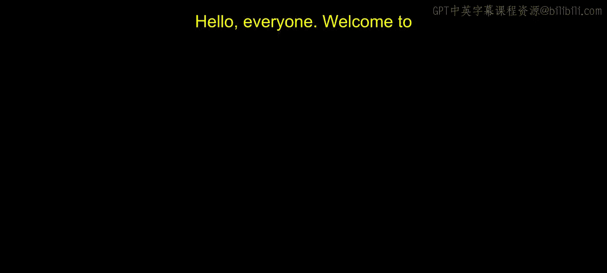

Hello everyone， welcome to Generative AI Architectural and applications development Hello everyone welcome back。

😊。

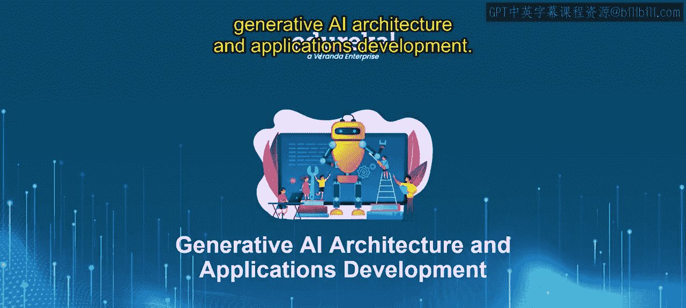

So in the previous demonstration of fine tuning the elementss。

 we showcased the usage of the normal fine tuning techniques like parameter fine tuning as well as instruction fine tuning。

So in the previous video we understood the theoretical part now let's do it practically here I am going to make use of the open AI API key for accessing the language models so in this demo I am going to explain the fine joining process exploring the three distinct methods the normal code generation or text generation and parameter based fine joining and instructionbased fine joining so let's get started so for this I am going to make use of open AI API I am making use of the version0。

 to8 so let's execute it and this is the code from the open AI for the text generation so if you want to understand where I'm getting all these core and do you can go here and search with text generation。

😊。

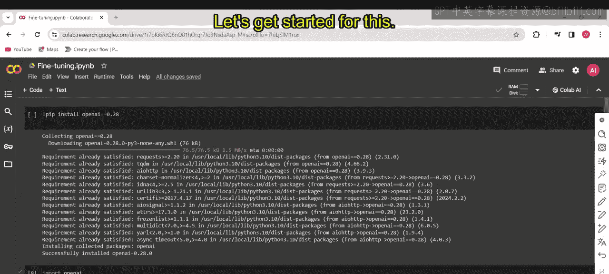

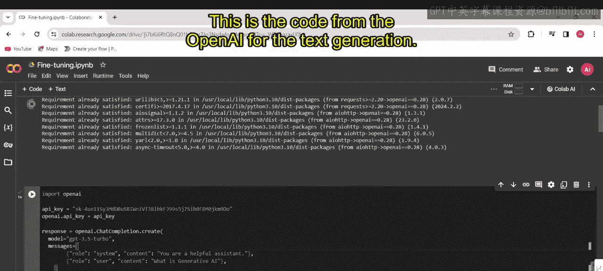

Can you see here we are having the text generation click on this and scroll it down。

 You will be able to say this。 I'm exactly making use of the same code。

 And here if you can see I am providing my API key a very little bit modification to get the functional code that additionally I am adding the API key so you all know how to get the API key from the open AI API right So I am just utilizing it and click on enter and here I have a question what is generatedative AI So for that it is generating generatedative AI refers to the type of artificial intelligence technology and etc。

 So means what exactly I was doing here I just provided the API key and then I am making use of the model G3。

5 here I have assigned a role as a system then provided the content as you are in helpful assistant and here I am passing the direct straightforward question so now if I want to make it as a functional code。

😊。

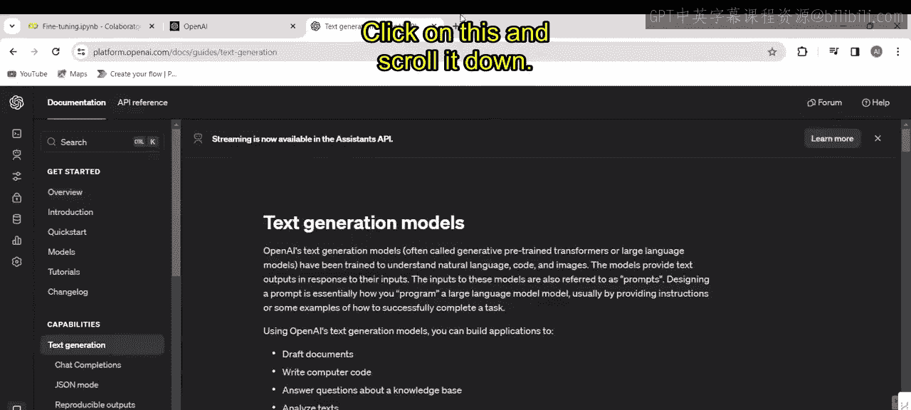

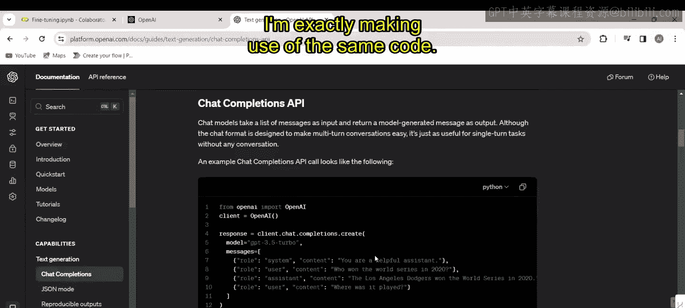

Now you can see I am making it as a functional code for the time being I'm stopping the okay so now Im going to execute this code here I am just doing role is equal to system content is equal to you are a helpful assistant now I am expecting the end user to provide the query here if you can see user message is equal to input means it is expecting you to provide the query Now you can see it here Now if I'm going and asking what is Python and click on enter it will make use of GPPT3。

5 Dvo and will provide you the output。😊，Oh， it seems like you are referring to the python that is a spelling mistake。

 Now you can see the beauty it is understanding directly and providing me the answer。

 Let me ask one more question。😊，What is generated AI。

Can you all say this that of beauty right now I am going to ask a quo related question。😊。

Please provide code to add。Two numbers in Python let me click on enter Oh again a spelling mistake。

 but yes， this time it is providing a right answer。 So that is where the difference comes in。

 So what exactly the difference we are having here So previously we are directly making use of this code but here I just made it as the end user interactive code That's it now I want to get the outputs in a different format let's see how can we do that for the time being I' am stopping this execution And now you can see I am just providing the additional parameter telling that maximum number of tokens I wanted to utilize is 150 means。

😊。

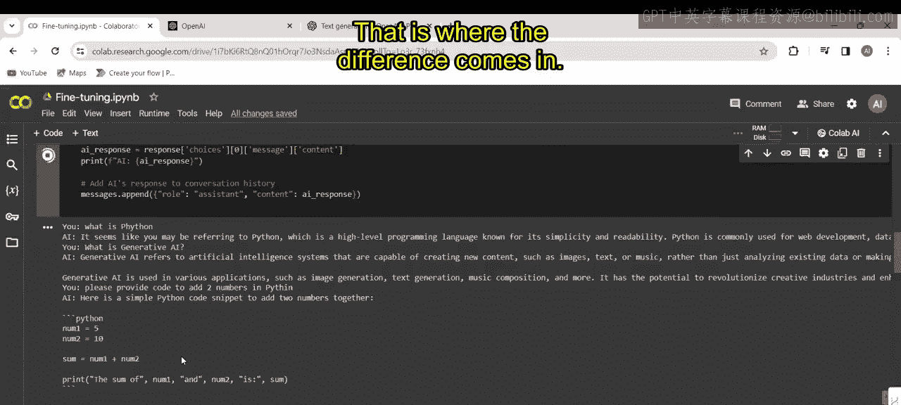

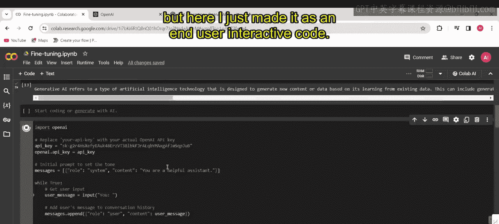

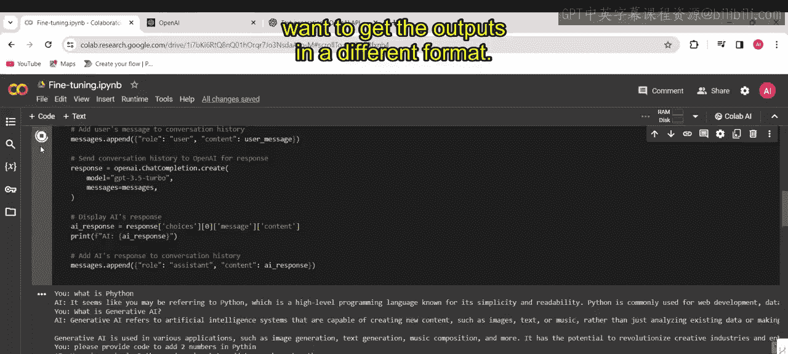

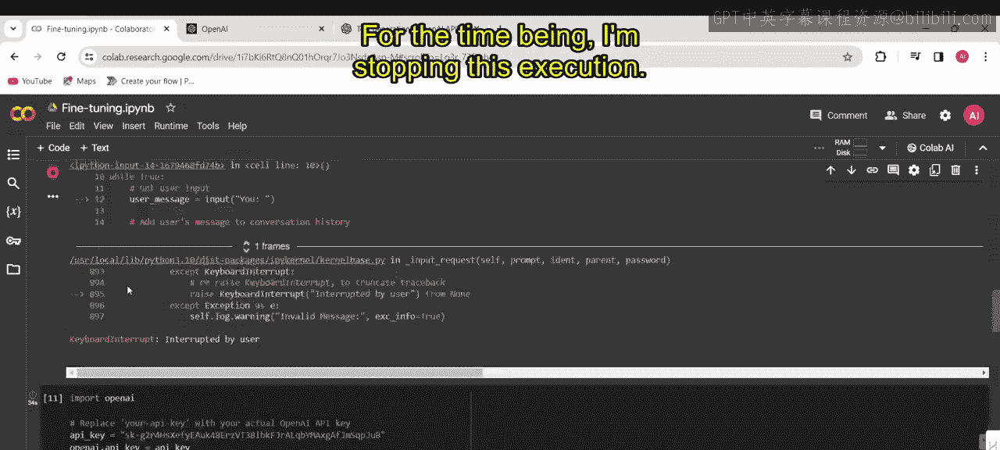

It should adjust this based on the response length means if you want your model to provide the more descriptive answer。

 you can increase the token limit， or if you are expecting that my model should provide me the short answer you can reduce number limit here also and now in case if your model is expected to generate multiple number of queries。

 you can change it and the temperature stop is equal to none。

 it defines a stop sequence if needed So temperature value， it adjust the temperature is equal to 0。

7 here the temperature values ranges between the 0。

2 higher is the creativity answer and the layer is the safety answer So now let's see how it is going to work。

 This is nothing but the parameter based hyperparmeter toning means we are adjusting the parameters here。

 So let's check how it is going to work Im going to ask what is python Now you can see it is。😊。

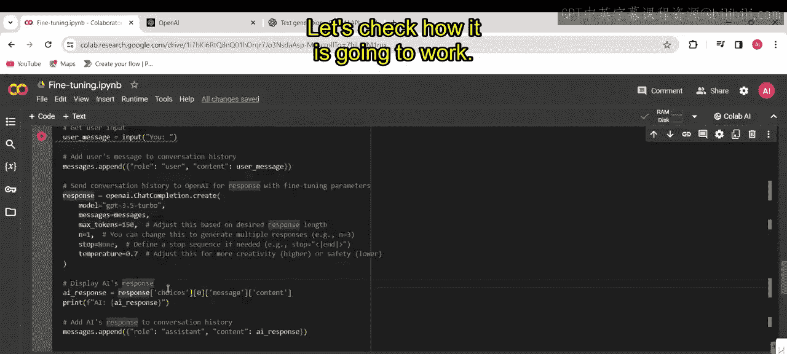

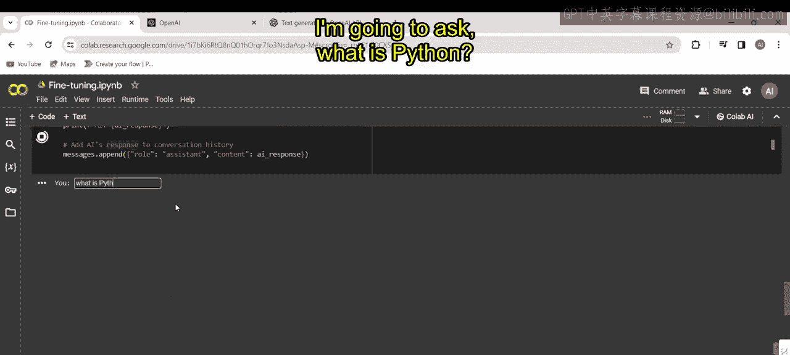

Python is a high level interpreted programming language previously it was telling Python is a highle programming language known for its simplicity and readability。

 Now you can the difference in the answer means that is because the temperature value and again different parameters that be provided here So now what if I am going to change the temperature value to the one So let's execute it as you mentioned lower the temperature value you will get the safety answers and higher the temperature value you will get more creative answers。

😊。

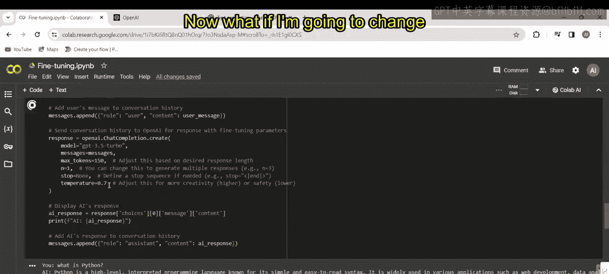

So let me stop it and execute it again。😡，Now， I am going to ask。What is Python。

 Can you all see the difference between the previous answer and the current answer。

 And now it is telling Python is a versatile and popular programming language。

 Now I am going to take the temperature value as to。 Let's see what it is going to generate。😊，Again。

 I'm asking the same query， what is Python？😊，Can you all see the difference in answers so that's where these parameters will help you to get the desired outcomes based on the requirement means you can adjust these parameters I can suggest you guys to give it try by changing the parameters based on your requirement so but this is all about the parameter based fine tuning so now the next one is about instruction based parameter so what exactly the instructionbased fine tuning here I am telling the model I am a legal information assistant I cannot provide legal advice but I can help you find relevant information and responses on legal matters and it should be restricted in case it is encountering these words if not it is going to provide the error message I can only assist you on the legal cases please rephrase your question in a legal context so。

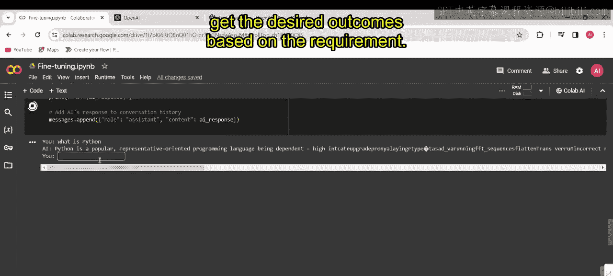

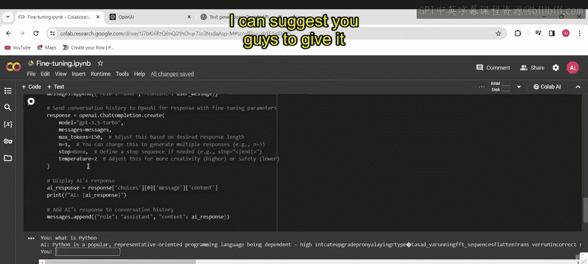

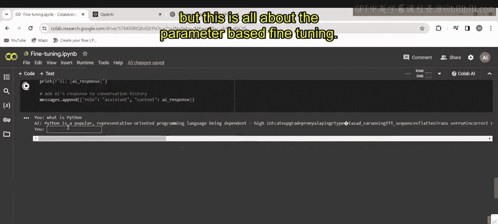

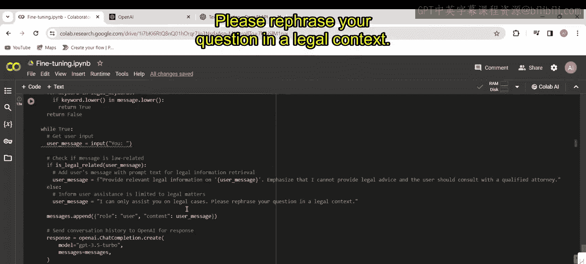

See how it is going to work。 I'm just executing it。 I'm just asking。

What is Python here can you all see it is telling how can I assist you with the legal information or resources today is asking。

😮。

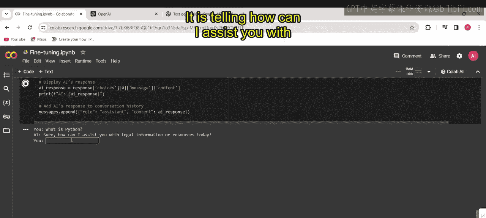

I want you to provide me the technical definition of Python。😔。

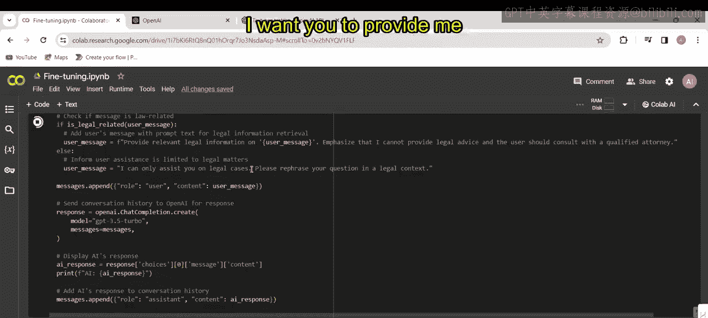

It keeps on asking， how can I help you legal research or information？😮。

Regarding a specific legal issue or case means if it is not relevant to the legal information。

 obviously it will not take the content， so let's drive with the another case where we are having a question related to the legal I'm going to ask what is the legal process for filing a small claim lawsuit Let's click on enter。

😊。

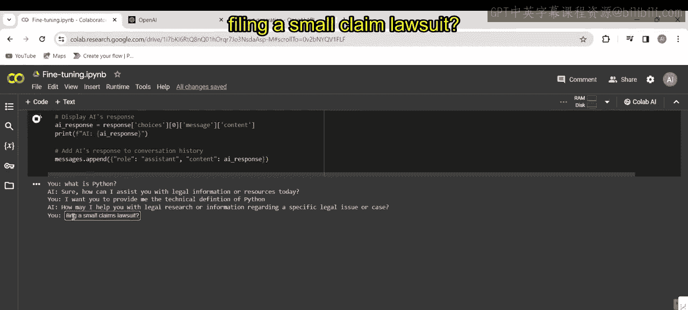

Can you all see it is providing me the output？😮，Now Im going to ask one more question。

 so now I'm going to ask what are the some common contract classes I should be aware of so let's click on enter。

It is loading now you can see it is providing the answer means this is about instruction based hyp parameter instruction based fine tuning technique so in this example I am utilizing the open AI API you can utilize on your own so that's about the demonstration of how the fine tuning technique evolve。

 whether if it is of the parameter based or the instruction based。So in this lesson。

 we delved into the significance of fine tuning in customizing the LLMs for a precise task。

 recognizing how specific instructions guide the adoption process through this understanding we equip ourselves to optimize the LLMs。

 the diverse' language generation objectives， ensuring their efficiency in the real world obligation。

😊，That's the summary。 We identified different fine tuning techniques like using parameters as well as instructions specific fine tuning process。

 Thank you。😊。

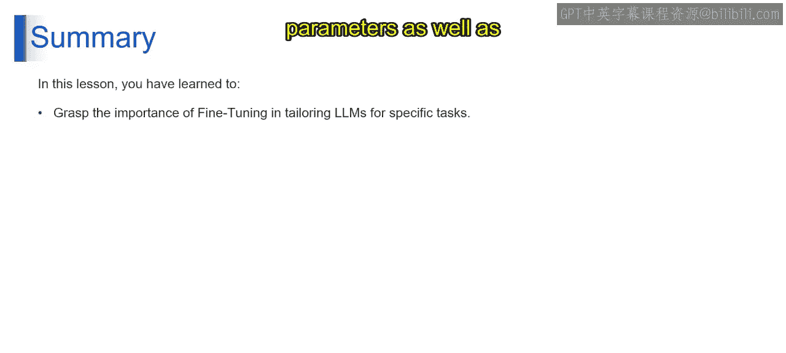

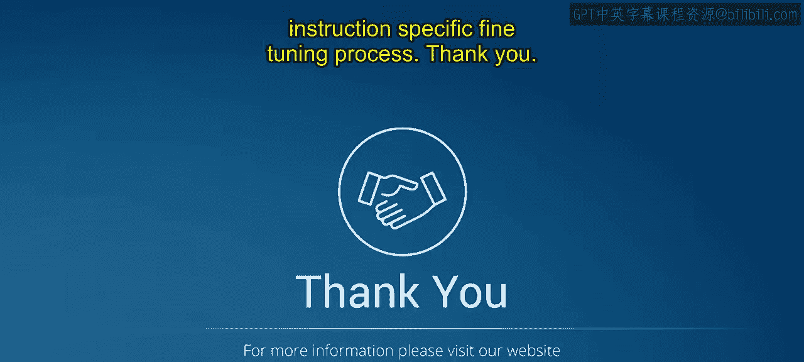