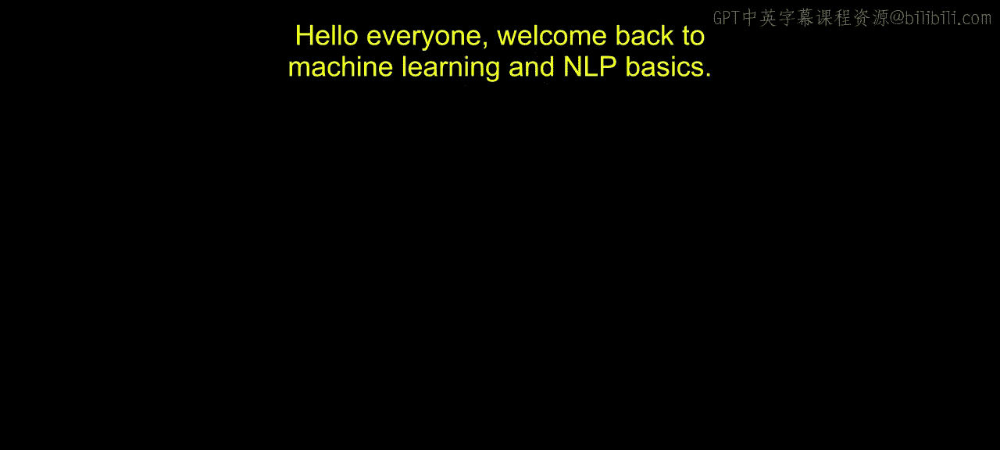
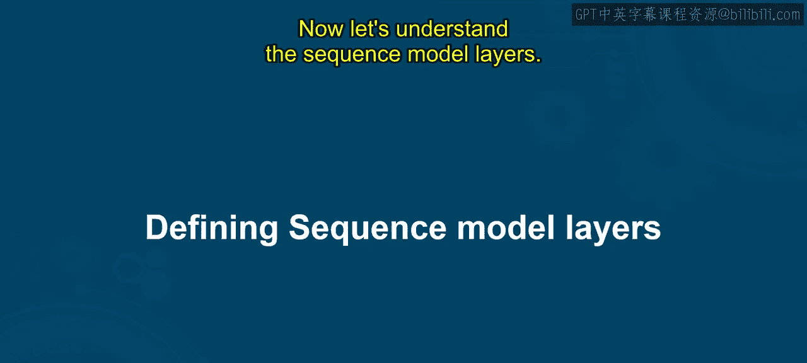
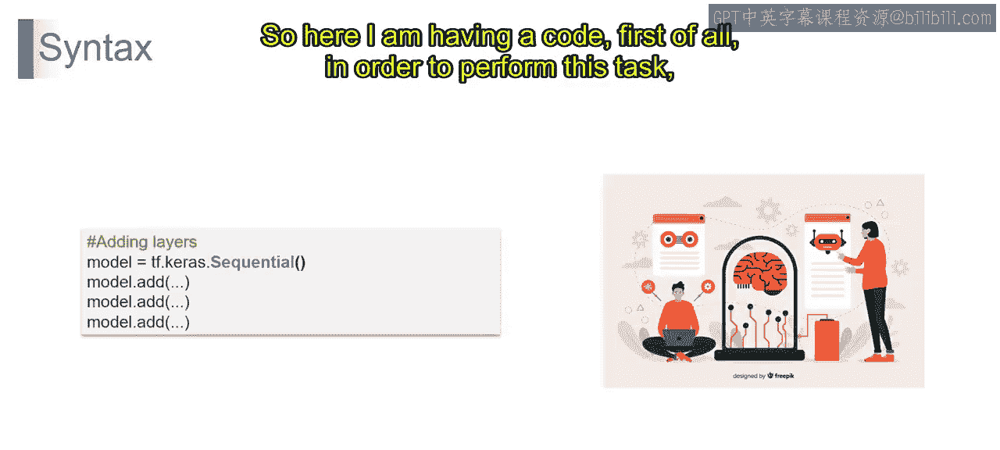
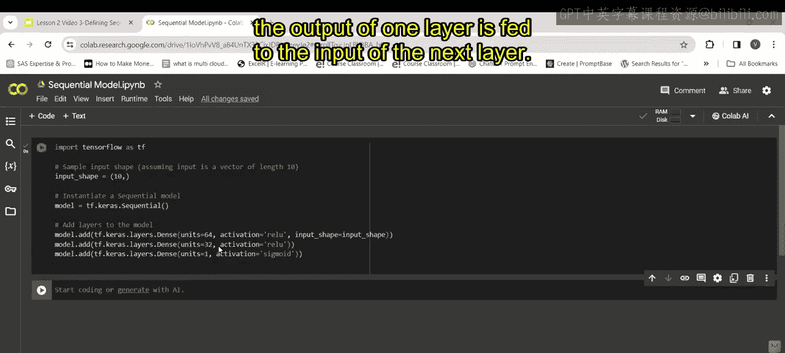
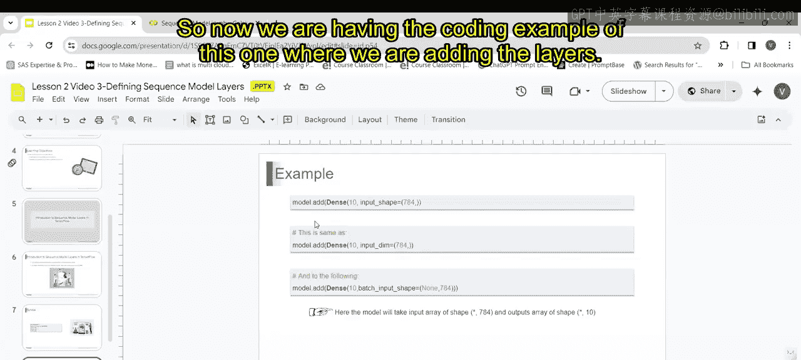
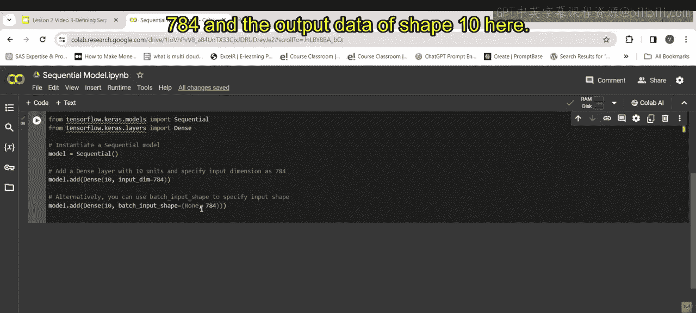
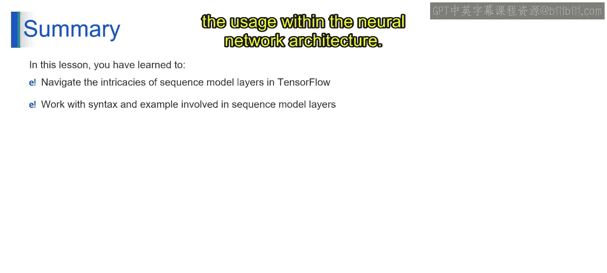

# Edureka《通过LLMs学习生成式人工智能（机器学习和NLP基础，第1课／共4课）｜Learn Generative AI with LLMs》中英字幕 - P45：44_定义序列模型层.zh_en - GPT中英字幕课程资源 - BV1q4421Q7qh

Hello everyone， welcome back to machine learninging and NL basicsics。😊。

Now let's understand the sequence model layers in this。

 we are going to cover the introduction to sequence model layers in Tensorflow and syntax and example of model layers by the end of the session。

 you will be able to implement the sequence models in Tensorflow and able to identify the syntax involved with the sequence model layers。

 so let's get started introduction to sequence model layers in Tensorflow。

 So before understanding all this。

So what exactly is sequence model layer， So it refers to the layer specifically designed for modeling the sequential data。

specpeciialally designed a model in the sequential data in the context of neural network sequence data typically includes sequence of time time series audio signals or any other data where the order of elements matters。

 for example， let's consider a text to classification where you want to classify movie reviews as positive or negative each movie review is sequence of words and the order of these words is crucial in determining sentiment of the review in this case you would use sequence model layer to process the input sequences effectively means technically sequence model layers in tensorflow specialized are specialized layers that operate on sequence data they can handle variable length input sequences and are capable of capturing temporal dependenceencies within the data。

Tamples of sequence model layers include recurural neural networks like LSTM GRU。

 as well as CNN convolutional layers， adapters the sequence data。

 such as one day convolutional layers So now the simple understanding the sequential class in tensorflow represents the simplest form of the neural network model layers are stacked linearly on top of each other。

 This sequential stacking allows for the creation of a straightforward feet forward architecture where data flows from one layer to the next layer in sequential manner to build a sequential model and define its layers we have to start by importing the required libraries including tensorflow here we have an example so this is the basic syntax for adding the layer。

So now let's understand with the practical implementation。😊，So here I am having a quote first of all。

 in order to perform the stars we need to perform input library of Tensorflow so we import Tensorflow library with the layers of Tf and then we define the input shape which represents the shape of the input data in this example it vector length of 10 I consider so we create a sequential model which is linear stack of layers I said this means the output of one layer is fed as input to the next layer so that's the reason we are providing Tf dot k of sequential so we add the layers to the model the first layer is a dense layer with 64 units as nothing but neurons using the relu activation function it also specifies the input shape then the second layer is another dense layer with 32 units now that is nothing but 32 neurons units and relu activation function。

Similarly， the third layer is a dense layer with one unit and sigmoid activation function。

 which is often used for binary classification task。

 This code sets up a simple fit for a neural network for binary classification generally。

 So this is how we will provide a linear stack layer means the output of one layer is fed to the input of the next layer。

 Now you can see here。😊。

Means what exactly it is doing we are instantiating the sequential model object using Tf dot k dot sequential and then we are adding the layers to the model using the ad method so that's it means the sequential class in Tensorflow simplifies the process of welding neural network models by allowing layers to be stacked sequentially by importing the tensorflow and installing sequential model you can easily define the architecture of your neural network and add layers to it to create a functional model for various machine learning tasks so now let's understand the other example。

😊，So now we are having the coding example of this one where we are adding the layers， first of all。

 we considered from Tensorflow dot k dot models。😊。

Iput sequential and dense。 So this indicates input necessary libraries from the densesorflow dot k。

 one is sequential， which is used to create a linear stack of layers and the dense represents a fully connected layer then we are performing model is equal to sequential So this line creates a sequential model。

 which is a linear stack of the layers， and then model dot add dot dense of 10 comma input underscore demo equal to 784 so this line adds a dense layer to the model it has 10 units。

 meaning it will have 10 neurons the input underscore dim parameter is set to 784 indicating that the input data should have a shape of 784 where tar represents the bad size this layer will process input data of shape comma 74。

😊，And the output of the shape，10。So this line adds another dense layer to the model similar to the previous layer It has 10 units。

 The batchge input shape parameter is set to none comma 784 where none signifies that the model can accept any batch size this layer also expects input data of shape comma 784 and the output data of shape 10 in simple this code sets up the sequential model with two dense layer each having 10 units and specifies the input shape in two different ways using input dim in the first layer and the batchge input shape in the second layer both layers are designed to handle input data of shape 784 and the output data of shape 10 here in this case the star represents the batch size where this layer will process the input data of shape comma 7。

😊。

84 and the output data of shape commma star comma 10 Now the summary in this lesson you have gained proficiency in handling sequence model layers within the Tensorflow understanding their syntax and practical implementation through examples through exploring different ways to define and manipulate these layers you have developed a solid understanding of the role and the usage within the neural network architecture Thank you。

